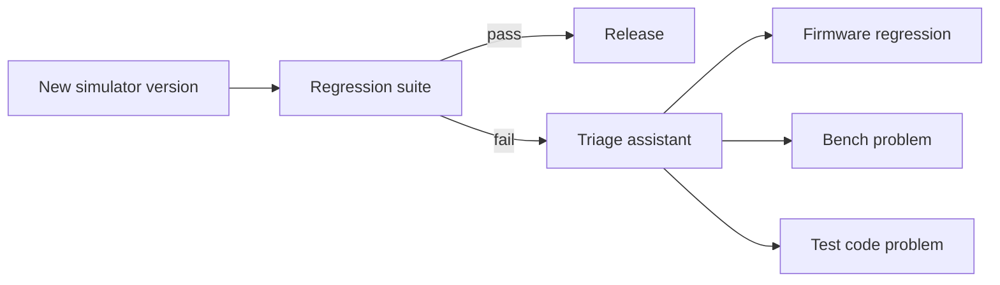

# virtual-rf-testbench

An automated RF test bench that runs regression tests against simulated instruments, plus an
assistant that says whether a failure came from the firmware, the bench or the test.

[](https://github.com/kaustubhagarwal18/virtual-rf-testbench/actions/workflows/ci.yml)


## The problem

Instrument software teams release new firmware regularly, and every release must pass a
regression suite on test benches before it ships. When a test fails, someone has to work out
which of three things went wrong:

| Source | What it looks like | What it means |
|---|---|---|
| **Firmware** | A real regression | Blocks the release |
| **Bench** | A degraded cable, a stale calibration, a misbehaving instrument | Fix the bench, rerun |
| **Test code** | A timeout that's too tight, a flaky test | Fix the test, rerun |

That triage is slow and manual. The knowledge of what fixed a similar failure last time lives
in people's heads or in old tickets.

## What this project does about it

- **A virtual bench.** Simulated instruments (a signal generator and a spectrum analyzer that
  speak SCPI over TCP) play the firmware under test. Each new simulator version is a
  "release".
- **A regression suite with real measurement discipline.** Every measurement has a limit and
  a margin, the bench is calibrated before measuring, and the instrument error queue is
  checked after every command group.
- **A triage assistant.** It answers "Is this the firmware, the bench or the test, and what
  fixed it last time?", citing the past runs and notes it drew on.



Faults are injected on purpose (extra cable loss, a level offset, slow responses, a
behaviour change in a new version), so every failure has a known cause. That lets the
assistant's accuracy be measured rather than guessed.

## Status

The virtual bench works: the simulated instruments, their drivers, measurement records, and
a bench suite that runs against the instruments in Docker, locally and in CI. Fault injection
and calibration come next, then the triage assistant. The [roadmap](docs/ROADMAP.md) has the
plan, and [ARCHITECTURE.md](docs/ARCHITECTURE.md) explains how the pieces fit
together.

## Quick start

You need git, `make`, [uv](https://docs.astral.sh/uv/) and Docker. On macOS, install uv with
Homebrew and start Docker Desktop:

```
brew install uv
```

On Linux, follow uv's [installation guide](https://docs.astral.sh/uv/getting-started/installation/)
and make sure the Docker daemon is running. uv installs Python 3.13 for the project, so the
system Python doesn't matter.

Clone the repository and install the dependencies:

```
git clone https://github.com/kaustubhagarwal18/virtual-rf-testbench.git
cd virtual-rf-testbench
make setup
```

Run the tests, which need no Docker:

```
make test
```

Start the bench in Docker, run the bench suite against it, and print its results:

```
make bench-up
make bench-test
make bench-summary
```

The summary shows 7 tests passed. Each reading, with its limit and margin, is in
`reports/bench-junit.xml`. Stop the bench when you're done:

```
make bench-down
```

The sections below go further: talking to the instruments by hand, driving them from
Python, and the development commands.

## Run the simulators

Each simulated instrument speaks SCPI over TCP, as networked instruments do. The signal
generator also reports its state as JSON on an admin port (5125), which the spectrum analyzer
reads to know what it is measuring. Start each in its own terminal; on one machine the
analyzer needs a different SCPI port:

```
uv run python -m simulators.signal_generator
```

```
uv run python -m simulators.spectrum_analyzer --scpi-port 5026
```

From a third terminal, switch the generator on and measure it with the analyzer:

```
printf 'FREQ 1 GHz\nPOW -10\nOUTP ON\n' | nc -w 1 127.0.0.1 5025
printf 'CALC:MARK:MAX\nCALC:MARK:X?;CALC:MARK:Y?\n' | nc -w 1 127.0.0.1 5026
printf 'CALC:MARK:FUNC:POW:RES? CPOW\n' | nc -w 1 127.0.0.1 5026
```

The analyzer reads about -11.5 dBm at 1 GHz: the generator's -10 dBm, minus 1.5 dB of cable
loss, plus a small flatness error and reading noise.

| Instrument | Commands |
|---|---|
| Both | `*IDN?`, `*RST`, `*CLS`, `*OPC?`, `*ESE`, `*SRE`, `*ESR?`, `*STB?`, `SYST:ERR?` |
| Signal generator (SG-1) | `[SOURce]:FREQuency` (9 kHz to 6 GHz), `[SOURce]:POWer` (-120 to +20 dBm), `OUTPut` (ON or OFF) |
| Spectrum analyzer (SA-1) | `[SENSe]:FREQuency:CENTer` and `:SPAN`, `[SENSe]:BANDwidth` (RBW), `INITiate` and `INITiate:CONTinuous`, `CALCulate:MARKer:MAXimum`, `:X?` and `:Y?`, channel power with `[SENSe]:POWer:ACHannel:BANDwidth` and `CALCulate:MARKer:FUNCtion:POWer:RESult? CPOWer` |

Several queries on one line get one reply line, joined by `;`, as IEEE 488.2 requires. Each
command after a `;` is read from the root, so it needs its full path:
`CALC:MARK:X?;CALC:MARK:Y?` works, but the short form `CALC:MARK:X?;Y?`, which real
instruments accept, gives -113 for `Y?`. Bad commands queue standard SCPI errors instead of failing silently. If the analyzer can't reach
the generator, it measures no signal, as with an unplugged cable, and logs a warning. Logs go
to stderr as one JSON object per line. `--help` lists each simulator's options, and
`SIMULATOR_FIRMWARE_VERSION` sets the version `*IDN?` reports.

## Run the bench in Docker

The same two instruments run as containers from one image, which is how CI and the cluster
run them. With Docker Desktop running:

```
make bench-up
```

It builds the image, starts both instruments, and returns once each answers `*IDN?`. They
listen on localhost only: the generator on 5025 (admin port 5125) and the analyzer on 5026.
The `nc` and Python examples on this page work against them unchanged.

```
make bench-logs
make bench-down
```

Each container runs as an unprivileged user on a read-only filesystem, and reports the
image's version in `*IDN?`. ADR 0004 explains the choices.

### The bench suite

With the bench up, run the suite in `tests/bench/` against the containers:

```
make bench-test
make bench-summary
```

The suite treats the instruments as black boxes, reaching them only over SCPI through the
drivers. It checks identity and release, reset defaults, level and frequency at 1 GHz,
channel power, the noise floor with RF off, and that bad commands are rejected. Every
reading is recorded with its limit and margin in `reports/bench-junit.xml`. Tests are
marked `smoke`, `regression` or `negative`, so `uv run pytest tests/bench -m smoke --no-cov`
runs just the quick checks. If the bench isn't running, the suite stops at once and says to
run `make bench-up`. Set `BENCH_HOST`, `BENCH_GENERATOR_PORT` and `BENCH_ANALYZER_PORT` to
point it at another bench.

## Drive the instruments from Python

The drivers in `drivers/` control the instruments the way bench tests will: over SCPI
through R&S's RsInstrument library, with every command group synchronised on `*OPC?` and
every instrument error raised as `InstrumentError`. With both simulators running as above,
save this as `measure.py`:

```python
from drivers.session import RsInstrumentSession, socket_resource
from drivers.signal_generator import SignalGenerator
from drivers.spectrum_analyzer import SpectrumAnalyzer

with (
    RsInstrumentSession(socket_resource("127.0.0.1", 5025)) as generator_session,
    RsInstrumentSession(socket_resource("127.0.0.1", 5026)) as analyzer_session,
):
    generator = SignalGenerator(generator_session)
    analyzer = SpectrumAnalyzer(analyzer_session)
    generator.configure(frequency_hz=1e9, level_dbm=-10.0)
    generator.set_output(on=True)
    analyzer.configure(centre_hz=1e9, span_hz=1e6, rbw_hz=1e3)
    print(analyzer.measure_peak())
```

Then run it:

```
uv run python measure.py
```

Bench tests turn each reading into a `Measurement` from `measurements/record.py`: the value,
its limit, the margin, pass or fail, and both instruments' firmware versions. Each one is
written into the JUnit XML, so a failure always says by how much it missed.

## Development

You need [uv](https://docs.astral.sh/uv/) and `make`. uv installs Python 3.13 for the project,
so it doesn't matter which Python your system has.

```
make setup
make lint
make test
```

| Command | What it does |
|---|---|
| `make setup` | Installs Python 3.13 and the dependencies, and installs the pre-commit hooks |
| `make lint` | Runs ruff, mypy (strict), pylint, pydoclint (docstring Args, Returns and Raises), bandit and codespell, checks the Makefile with mbake and the Dockerfile with hadolint |
| `make fmt` | Formats the code and the Makefile, and applies safe lint fixes |
| `make test` | Runs the tests and fails if coverage is below 80%; writes `reports/junit.xml` and `reports/coverage.xml` |
| `make summary` | Prints a results summary from those files: tests run, passed, failed and skipped per suite, coverage, failures and the slowest tests |
| `make bench-up` / `bench-down` / `bench-logs` | Starts, stops or follows the containerised bench |
| `make bench-test` / `bench-summary` | Runs the bench suite against the containers, writing `reports/bench-junit.xml`, and prints its summary |
| `make clean` | Removes the virtual environment, the tool caches and the pre-commit hook; `make setup` restores them |

The pre-commit hooks run `make lint` before every commit, so the same checks run locally and
in CI.

### Continuous integration

GitHub Actions runs on every pull request and on every push to `main`:

| Job | What it checks |
|---|---|
| Lint | Every pre-commit hook on all files: trailing whitespace, final newlines, YAML and TOML syntax, large files, merge conflict markers, then `make lint` |
| Test (Python 3.13) | `make test`, including the 80% coverage floor, then `make summary`, whose table appears on the run's summary page |
| Bench (containers) | Builds the simulator image, `make bench-up`, `make bench-test`, then `make bench-summary` on the run's summary page; shows the simulator logs if anything failed |
| Secret scan | gitleaks 8.30.1 over the full git history, including merge commits; the download is checksum-verified |
| Results comment | On pull requests, once the other jobs finish: posts one comment with the test and bench results, coverage, any failures and each job's result, and updates that same comment on every push |

Actions are pinned to commit SHAs, and dependencies install from `uv.lock` exactly
(`uv sync --locked`).

## Known issues

- The simulators read every command in a compound line from the root, so the SCPI short
  form that keeps the previous command's path (`CALC:MARK:X?;Y?`) gives -113. Write each
  command in full, or start it with `:`. The drivers always send full paths.
- RsInstrument leaves a socket open when a connection is refused, so a test that connects to
  a closed port shows a `ResourceWarning`. It comes from the library and is harmless in test
  runs; [ADR 0003](docs/adr/0003-rsinstrument-rather-than-plain-pyvisa.md) has the details.

## Further reading

- [Architecture](docs/ARCHITECTURE.md): how the simulators, drivers, measurement records and
  test suites fit together, and where to look in the code
- [Roadmap](docs/ROADMAP.md): what's done and what comes next
- [Decision records](docs/adr/): why the main choices were made

## License

[MIT](LICENSE)
