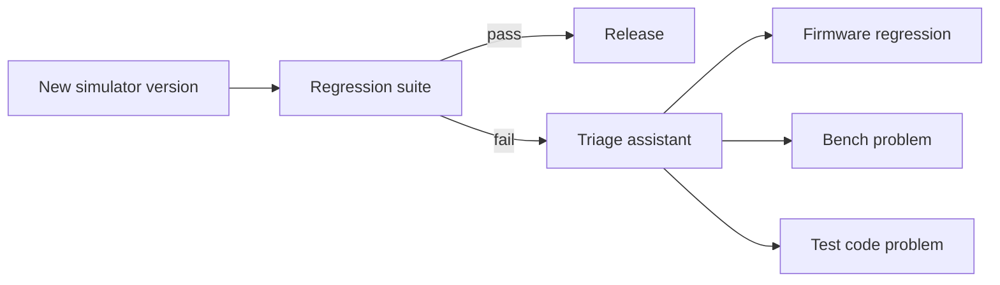

# virtual-rf-testbench

An automated RF test bench that runs regression tests against simulated instruments, plus an
assistant that says whether a failure came from the firmware, the bench or the test.

[](https://github.com/kaustubhagarwal18/virtual-rf-testbench/actions/workflows/ci.yml)


## The problem

Instrument software teams release new firmware regularly, and every release must pass a
regression suite on test benches before it ships. When a test fails, someone has to work out
which of three things went wrong:

| Source | What it looks like | What it means |
|---|---|---|
| **Firmware** | A real regression | Blocks the release |
| **Bench** | A degraded cable, a stale calibration, a misbehaving instrument | Fix the bench, rerun |
| **Test code** | A timeout that's too tight, a flaky test | Fix the test, rerun |

That triage is slow and manual. The knowledge of what fixed a similar failure last time lives
in people's heads or in old tickets.

## What this project does about it

- **A virtual bench.** Simulated instruments (a signal generator and a spectrum analyzer that
  speak SCPI over TCP) play the firmware under test. Each new simulator version is a
  "release".
- **A regression suite with real measurement discipline.** Every measurement has a limit and
  a margin, the bench is calibrated before measuring, and the instrument error queue is
  checked after every command group.
- **A triage assistant.** It answers "Is this the firmware, the bench or the test, and what
  fixed it last time?", citing the past runs and notes it drew on.



Faults are injected on purpose (extra cable loss, a level offset, slow responses, a
behaviour change in a new version), so every failure has a known cause. That lets the
assistant's accuracy be measured rather than guessed.

## Status

Early development. The first milestone is the simulated instruments, their Python drivers
and the first bench tests, running on Docker Compose. Setup instructions will be added here as
each part starts working.

## Development

You need [uv](https://docs.astral.sh/uv/) and `make`. uv installs Python 3.13 for the project,
so it doesn't matter which Python your system has.

```
make setup
make lint
make test
```

| Command | What it does |
|---|---|
| `make setup` | Installs Python 3.13 and the dependencies, and installs the pre-commit hooks |
| `make lint` | Runs ruff, mypy (strict), pylint, pydoclint (docstring Args, Returns and Raises), bandit and codespell, and checks the Makefile's syntax and formatting with mbake |
| `make fmt` | Formats the code and the Makefile, and applies safe lint fixes |
| `make test` | Runs the tests and fails if coverage is below 80% |
| `make clean` | Removes the virtual environment and tool caches |

The pre-commit hooks run `make lint` before every commit, so the same checks run locally and
in CI.

### Continuous integration

GitHub Actions runs on every pull request and on every push to `main`:

| Job | What it checks |
|---|---|
| Lint | Every pre-commit hook on all files: trailing whitespace, final newlines, YAML and TOML syntax, large files, merge conflict markers, then `make lint` |
| Test (Python 3.13) | `make test`, including the 80% coverage floor |
| Secret scan | gitleaks 8.30.1 over the full git history; the download is checksum-verified |

Actions are pinned to commit SHAs, and dependencies install from `uv.lock` exactly
(`uv sync --locked`).

## License

[MIT](LICENSE)
