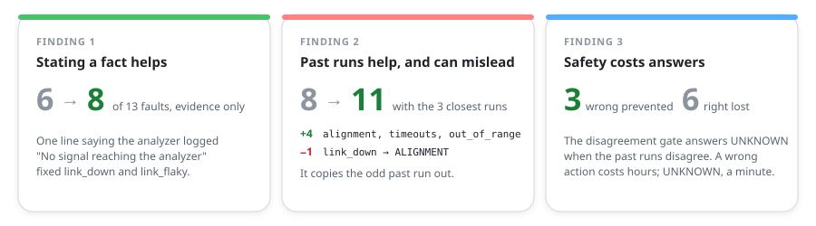
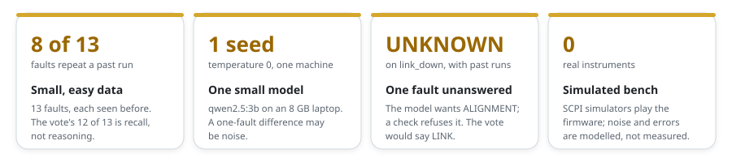

# virtual-rf-testbench

### A test failed. Was it the firmware, the bench or the test?

A simulated RF bench, and a local AI that names the likely culprit and quotes what fixed it
last time.

[](https://github.com/kaustubhagarwal18/virtual-rf-testbench/actions/workflows/ci.yml)


<br>


<br>


<p align="center">
  
</p>
<p align="center"><sub><b>Figure 1.</b> A release runs on the virtual bench; a failed run goes to the triage assistant.</sub></p>

## Abstract

Instrument firmware ships only after a regression suite passes on a test bench. When a test
fails, an engineer has to decide whether the firmware regressed, the bench is faulty or the
test is wrong, and what fixed a similar failure last time is often in someone's head. This
project builds a simulated RF bench, a 20-test regression suite with limits and margins,
and thirteen faults injected on purpose, so every failure has a known cause. A triage
assistant, running locally, names the cause and quotes what fixed the most similar past
failures. With no evidence at all, a rules-only baseline answers UNKNOWN on every fault:
the floor is 0 of 13. From a run's own evidence it names the right fix for **8 of 13 faults**;
applying checks alone to that evidence doesn't solve more faults but converts wrong answers
to UNKNOWN, so the floor is safer. With past runs and behind its safety gate it solves **9
with no wrong answers**. A majority vote over the retrieved past runs solves 12 but answers
the last one wrong: on this data set, retrieval does most of the work, and the gate is what
keeps it from being confidently wrong. `qwen2.5:7b` matches `qwen2.5:3b`'s ceiling at
12 of 13: a larger model does not help once retrieval is in place.

## 1 · Method

<p align="center">
  
</p>
<p align="center"><sub><b>Figure 2.</b> The triage pipeline. Every guardrail can only turn an answer into <code>UNKNOWN</code>, never pick another action.</sub></p>

- **One action from a fixed list**, so an answer is checked by exact match. The cause
  (firmware, bench or test) is looked up from the action.
- **Retrieval**: the three closest past runs, cited by neutral ids; their recorded fix is
  quoted, never generated.
- **Guardrails**: a gate answers `UNKNOWN` when the past runs disagree, and five rule checks
  refuse a verdict the evidence contradicts.
- **Local and private**: `qwen2.5:3b` and `nomic-embed-text` on Ollama; nothing leaves the
  machine.
- **In CI**: when the bench job fails, each distinct failure (up to five) is triaged on its
  own, and the answers, with what fixed the cited past runs, go into the pull request
  comment.

<p align="center">
  <picture>
    <source media="(prefers-color-scheme: dark)" srcset="docs/images/ci-triage-comment-dark.png">
    
  </picture>
</p>
<p align="center"><sub>The comment on a CI run with two unrelated faults at once: two failures solved, two left to a person, none wrong (ADR 0020).</sub></p>

## 2 · Data

<p align="center">
  
</p>
<p align="center"><sub><b>Figure 3.</b> Thirteen faults with known causes. The assistant may retrieve the history runs and is scored on the question runs.</sub></p>

## 3 · Results

<p align="center">
  
</p>
<p align="center"><sub><b>Table 1.</b> A fault is solved when all three of its questions are right; the small numbers are 95% intervals.</sub></p>

A real answer from the API, on a run whose path loss at 100 MHz is 1.89 dB against a limit of
0.97 dB:

```
fix:   CABLE
where: cable
why:   Extra loss in the cable between generator and analyzer, from a damaged cable
cause: bench
cited: past-72b3edd9, past-22406f9c, past-7858bf7e
last time: Replaced the cable and recalibrated the path loss (past-72b3edd9, past-22406f9c, past-7858bf7e)
```

<p align="center">
  
</p>
<p align="center"><sub><b>Figure 4.</b> Three findings from the experiments.</sub></p>

[docs/EVALUATION.md](docs/EVALUATION.md) has every scenario and what each experiment taught.

## 4 · Limitations

<p align="center">
  
</p>
<p align="center"><sub><b>Figure 5.</b> What these results do not show.</sub></p>

## 5 · Reproduce

You need git, `make`, [uv](https://docs.astral.sh/uv/) and Docker. On macOS:

```
brew install uv
git clone https://github.com/kaustubhagarwal18/virtual-rf-testbench.git
cd virtual-rf-testbench
make setup
make test
```

Run the 20-test suite against the bench in Docker:

```
make bench-up
make bench-test
make bench-down
```

Score the triage assistant and triage one run, with [Ollama](https://ollama.com) running:

```
ollama pull qwen2.5:3b
ollama pull nomic-embed-text
make eval
make triage-demo RUN=triage/data/runs/questions/cable_loss-1
```

On Linux, install uv from its [guide](https://docs.astral.sh/uv/getting-started/installation/)
and start the Docker daemon. [docs/USAGE.md](docs/USAGE.md) covers the instruments, faults,
Python drivers and the HTTP API.

## Development

```
make lint
make test
```

`make lint` runs ruff, mypy (strict), pylint, pydoclint, bandit, codespell, hadolint on the
Dockerfile and mbake on the Makefile; `make test` enforces 80% coverage.
[docs/DEVELOPMENT.md](docs/DEVELOPMENT.md) lists every command and CI job.

## Known issues

- Compound SCPI lines need full paths: `CALC:MARK:X?;Y?` gives -113 for `Y?`. The drivers
  always send full paths.
- RsInstrument leaves a socket open when a connection is refused, so Python shows a harmless
  `ResourceWarning` ([ADR 0003](docs/adr/0003-rsinstrument-rather-than-plain-pyvisa.md)).

## Documentation

<table>
<tr>
<td width="33%" valign="top">

<b>Use it</b><br><br>
<a href="docs/USAGE.md"><b>Usage</b></a><br>
<sub>Instruments, Docker bench, faults, Python drivers, HTTP API</sub><br><br>
<a href="docs/ADAPTING.md"><b>Adapting</b></a><br>
<sub>Triage your own failures, add a fault, drive real instruments</sub><br><br>

</td>
<td width="33%" valign="top">

<b>Understand it</b><br><br>
<a href="docs/EVALUATION.md"><b>Evaluation</b></a><br>
<sub>Every scenario, the guardrails, and what each experiment taught</sub><br><br>
<a href="docs/ARCHITECTURE.md"><b>Architecture</b></a><br>
<sub>How the pieces fit, and where to look in the code</sub><br><br>
<a href="docs/adr/"><b>Decision records</b></a><br>
<sub>Why the main choices were made</sub><br><br>

</td>
<td width="33%" valign="top">

<b>Build on it</b><br><br>
<a href="docs/ROADMAP.md"><b>Roadmap</b></a><br>
<sub>What's done and what comes next</sub><br><br>
<a href="CONTRIBUTING.md"><b>Contributing</b></a><br>
<sub>Setup, workflow, the checks and the project's rules</sub><br><br>

</td>
</tr>
</table>

## License

[MIT](LICENSE)
