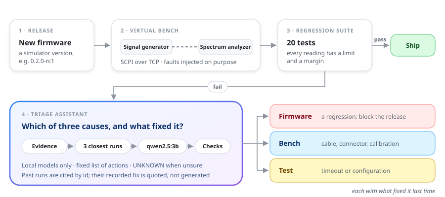
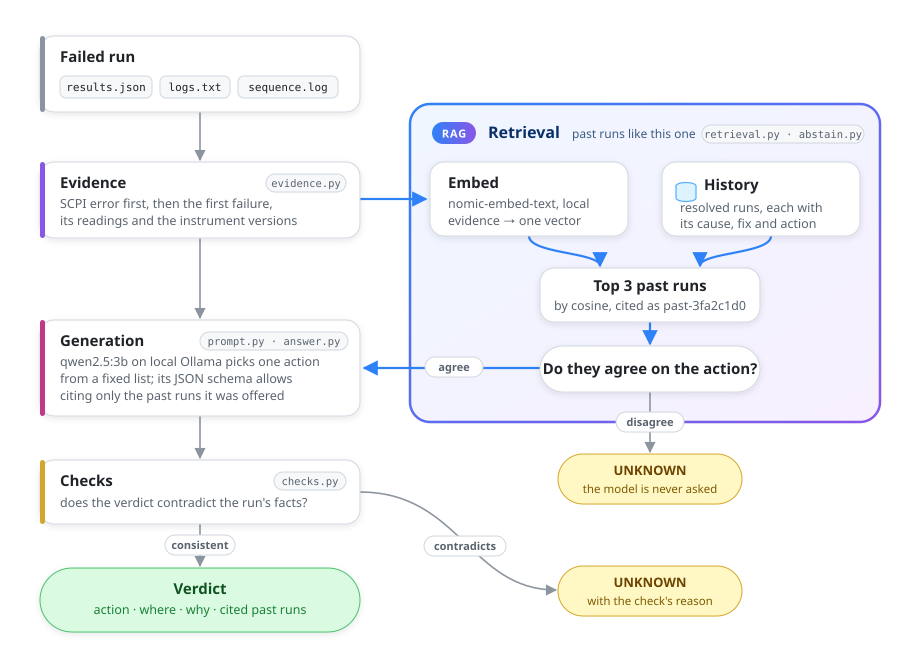
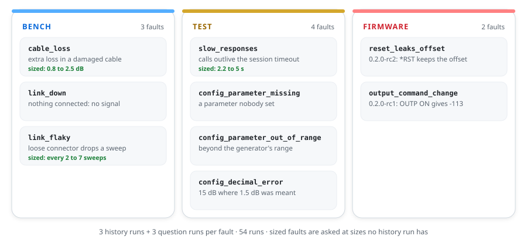

# virtual-rf-testbench

**What went wrong: the firmware, the bench or the test? A simulated RF test bench, and a
local assistant that triages its failures.**

[](https://github.com/kaustubhagarwal18/virtual-rf-testbench/actions/workflows/ci.yml)


<br>


<br>


<p align="center">
  
</p>
<p align="center"><sub><b>Figure 1.</b> A release runs on the virtual bench; a failed run goes to the triage assistant.</sub></p>

## Abstract

Instrument firmware ships only after a regression suite passes on a test bench. When a test
fails, an engineer has to decide whether the firmware regressed, the bench is faulty or the
test is wrong, and what fixed a similar failure last time is often in someone's head. This
project builds a simulated RF bench, a 20-test regression suite with limits and margins,
and nine faults injected on purpose, so every failure has a known cause. A triage assistant,
running locally, names the cause and quotes what fixed the most similar past failures. From
a run's own evidence it names the right fix for **7 of 9 faults**; behind its safety gate it
solves **5 with no wrong answers**. A majority vote over the retrieved past runs solves all
9: on this data set, retrieval does most of the work.

## 1 · Method

<p align="center">
  
</p>
<p align="center"><sub><b>Figure 2.</b> The triage pipeline. Every guardrail can only turn an answer into <code>UNKNOWN</code>, never pick another action.</sub></p>

- **One action from a fixed list**, so an answer is checked by exact match. The cause
  (firmware, bench or test) is looked up from the action.
- **Retrieval**: the three closest past runs, cited by neutral ids; their recorded fix is
  quoted, never generated.
- **Guardrails**: a gate answers `UNKNOWN` when the past runs disagree, and four rule checks
  refuse a verdict the evidence contradicts.
- **Local and private**: `qwen2.5:3b` and `nomic-embed-text` on Ollama; nothing leaves the
  machine.

## 2 · Data

<p align="center">
  
</p>
<p align="center"><sub><b>Figure 3.</b> Nine faults with known causes. The assistant may retrieve the history runs and is scored on the question runs.</sub></p>

## 3 · Results

<p align="center">
  
</p>
<p align="center"><sub><b>Figure 4.</b> Faults solved, with 95% intervals, and confident wrong answers, for each configuration.</sub></p>

<div align="center">

| Configuration | Faults solved (of 9) | Wrong answers (of 27) |
|:---|:---:|:---:|
| Error message only | 3 (1–6) | 18 |
| Full evidence | **7** (4–8) | 6 |
| + 3 closest past runs + checks | 6 (3–8) | 3 |
| + disagreement gate (the API) | 5 (2–7) | **0** |
| Majority vote of the 3 past runs, no model | 9 (6–9) | 0 |

<sub><b>Table 1.</b> A fault is solved when all three of its questions are right; 95% intervals in brackets.</sub>

</div>

A real answer, on a run whose configuration asked for a 15 dB level offset instead of 1.5 dB:

```
fix:   CONFIGURATION
where: bench configuration
why:   The bench configuration asks for a 15 dB level offset where 1.5 dB was meant:
       a misplaced decimal point, and far more than the cable's loss.
cause: test
cited: past-9e31db17, past-4b20146a
last time: Corrected level_offset_db to 1.5 (past-9e31db17, past-4b20146a)
```

**Findings.**
- **Stating a fact helps a small model.** A line saying the analyzer logged no signal took
  full evidence from 5 to 7 of 9.
- **Past runs can mislead it.** It copies the odd one out: "recalibrated" in `link_down`'s
  history becomes `ALIGNMENT`, so past runs fix one fault and break two.
- **Safety costs answers.** The gate prevents 3 wrong answers and gives up 3 right ones; a
  wrong action costs hours, an `UNKNOWN` a minute.

[docs/EVALUATION.md](docs/EVALUATION.md) has every scenario and what each experiment taught.

## 4 · Limitations

- **The data set is small and easy:** 9 faults, each seen before; six have nothing to vary,
  so their questions repeat a past run. The vote's 9 of 9 shows recall, not reasoning.
- **One model, one seed, one machine:** a 3B model at temperature 0 on an 8 GB laptop.
- **`link_down` gets no action** with past runs: the model answers `UNKNOWN`.
- **The instruments are simulated**, not real hardware.

## 5 · Reproduce

You need git, `make`, [uv](https://docs.astral.sh/uv/) and Docker. On macOS:

```
brew install uv
git clone https://github.com/kaustubhagarwal18/virtual-rf-testbench.git
cd virtual-rf-testbench
make setup
make test
```

Run the 20-test suite against the bench in Docker:

```
make bench-up
make bench-test
make bench-down
```

Score the triage assistant and triage one run, with [Ollama](https://ollama.com) running:

```
ollama pull qwen2.5:3b
ollama pull nomic-embed-text
make eval
make triage-demo RUN=triage/data/runs/questions/config_decimal_error-1
```

On Linux, install uv from its [guide](https://docs.astral.sh/uv/getting-started/installation/)
and start the Docker daemon. [docs/USAGE.md](docs/USAGE.md) covers the instruments, faults,
Python drivers and the HTTP API.

## Development

```
make lint
make test
```

`make lint` runs ruff, mypy (strict), pylint, pydoclint, bandit and codespell; `make test`
enforces 80% coverage. [docs/DEVELOPMENT.md](docs/DEVELOPMENT.md) lists every command and CI
job.

## Known issues

- Compound SCPI lines need full paths: `CALC:MARK:X?;Y?` gives -113 for `Y?`. The drivers
  always send full paths.
- RsInstrument leaves a socket open when a connection is refused, so Python shows a harmless
  `ResourceWarning` ([ADR 0003](docs/adr/0003-rsinstrument-rather-than-plain-pyvisa.md)).

## Documentation

| | |
|---|---|
| [Usage](docs/USAGE.md) | instruments, Docker bench, faults, Python drivers, HTTP API |
| [Evaluation](docs/EVALUATION.md) | every scenario, the guardrails, and what each experiment taught |
| [Architecture](docs/ARCHITECTURE.md) | how the pieces fit, and where to look in the code |
| [Roadmap](docs/ROADMAP.md) | what's done and what comes next |
| [Decision records](docs/adr/) | why the main choices were made |

## License

[MIT](LICENSE)
