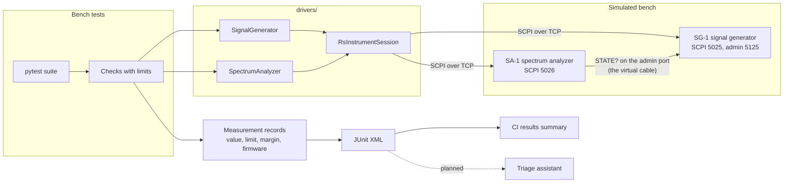
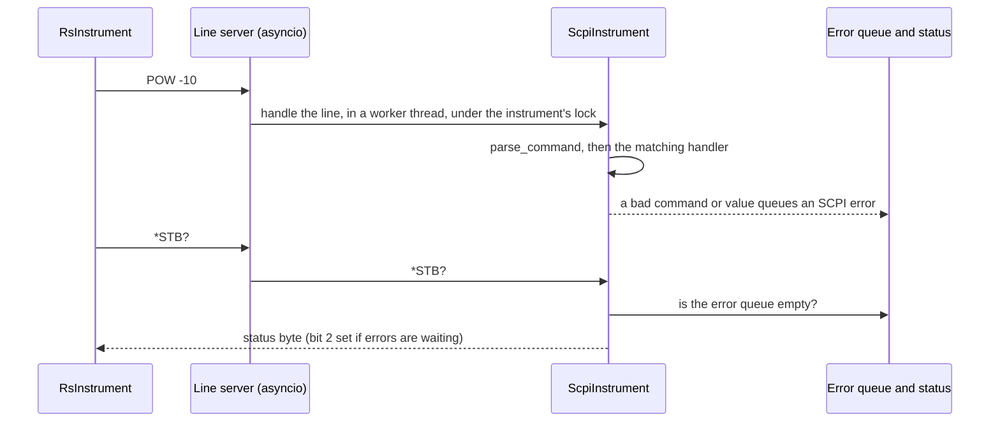
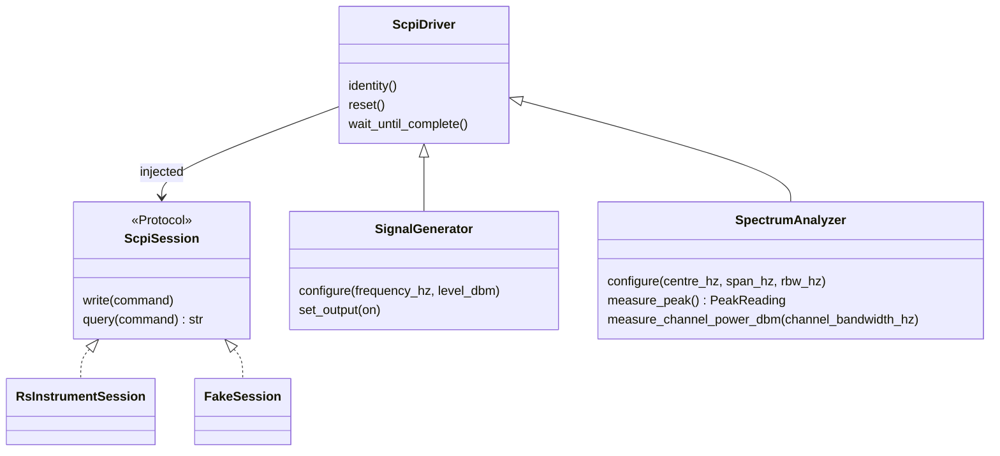

# Architecture

How the pieces of the bench fit together today: two simulated instruments, the drivers
that control them, the measurement records every test produces, and the three test suites.
Each design choice that needed weighing has an ADR in [docs/adr/](adr/).

## The big picture

A test asks the generator for a carrier and the analyzer for a reading, through the drivers.
The analyzer has no real cable, so it asks the generator what it is sending over the
generator's admin port, and turns that into a reading with the physics model. The test
compares the reading with its limit and records value, limit, margin and both firmware
versions in the JUnit XML. CI turns that XML into the summary on each run page. The planned
triage assistant will read the same records to explain failures.

## The simulated instruments

Both simulators are built from the same parts in `simulators/common/`, and differ only in
their SCPI commands.

- **The line server** (`server.py`) reads one line at a time and caps line length. Each line
  runs in a worker thread behind a per-instrument lock, so a slow command never blocks the
  event loop and two clients can't interleave on one instrument.
- **The instrument base** (`instrument.py`) handles the IEEE 488.2 common commands (`*IDN?`,
  `*RST`, `*CLS`, `*OPC?`, `*ESR?`, `*STB?` and the rest) and dispatches everything else to
  the subclass's command table. Several commands on one line are split on `;`, and their
  replies are joined with `;`. A command error discards the rest of the line, as the
  standard says.
- **Errors** (`errors.py`, `status.py`) go into a queue of 10, with -350 when it overflows,
  and set the status bits that RsInstrument checks after every command. Nothing fails
  silently: a bad command or an out-of-range value always leaves an error to read.
- **Numbers** (`numbers.py`, `parser.py`) accept SCPI's units (`1 GHz`, `-10 dBm`), and
  range checks reject out-of-range values with -222 without changing
  the setting.
- **The admin port** (`admin.py`) answers JSON, apart from the SCPI interface. The analyzer
  reads the generator's `STATE?` there (ADR 0002). The planned fault switches will be further
  admin commands, so test code can never reach them over SCPI.
- **Logs** (`logs.py`) are one JSON object per line on stderr, so they can be searched and,
  later, ingested by the triage service. Logging never blocks an instrument: each record
  goes on a bounded queue that a background thread writes to stderr. If nothing reads
  stderr and the queue fills, records are dropped and counted, and a warning says how many
  were lost once there is room again.
- **JSON** (`jsontext.py`): JSON has no NaN or infinity, so admin replies and log lines
  write them as the strings `"NaN"`, `"Infinity"` and `"-Infinity"`. Every line stays
  standard JSON.

### The physics model

`physics.py` turns what the generator sends into what the analyzer reads:

| Effect | Model | Default |
|---|---|---|
| Cable loss | grows with the square root of frequency (skin effect) | 1.5 dB at 1 GHz |
| Analyzer flatness | a smooth sine ripple across frequency | ±0.15 dB, repeating every 1.7 GHz |
| Noise floor | -174 dBm/Hz + noise figure + 10·log10(RBW) | noise figure 24 dB, so -120 dBm at 1 kHz RBW |
| Tone on the floor | the tone and the floor added as powers | |
| Channel power | the noise over the channel, or over the span if that is narrower, plus the tone when it lies in both | |
| Reading noise | seeded normal noise; `*RST` reseeds, so readings repeat | 0.02 dB on a tone, 0.5 dB on the bare floor |

So -10 dBm at 1 GHz reads about -11.5 dBm. If the analyzer can't reach the generator, it
measures no signal, as with an unplugged cable, and logs a warning.

## Drivers

- Drivers talk SCPI and nothing else. They take any `ScpiSession`, so unit tests pass a
  `FakeSession` (`tests/unit/drivers/fakes.py`) and the bench passes `RsInstrumentSession`. A real instrument would plug in the
  same way.
- `RsInstrumentSession` opens a plain socket (no VISA install), accepts only instruments that
  identify as VirtualRF, and keeps RsInstrument's `*STB?` check after every command on.
  Every instrument error is raised as `InstrumentError`, and a timeout as
  `InstrumentTimeoutError` (ADR 0001, ADR 0003).
- Long operations, such as a sweep, are synchronised with `*OPC?`, and every call has a
  timeout.
- `drivers/protocols.py` defines small interfaces, `LevelSource` and `PowerMeter`, for code
  that needs only one capability.

## Measurement records

Tests never assert on a bare reading. Each reading becomes a `Measurement`
(`measurements/record.py`): the value, its unit, a `Limit` (a window or an upper or lower
bound), the margin to that limit, pass or fail, and both instruments' firmware versions.
The `record_measurements` fixture writes each one into the JUnit XML as properties, then
fails the test listing every measurement that missed, with its margin. A failure therefore
always says what was measured, against which limit, by how much it missed, and on which
firmware. That is the evidence the triage assistant will cite. A NaN or infinite reading
always fails, and its value and margin are recorded as `"NaN"`, `"Infinity"` or
`"-Infinity"`, so the JUnit properties stay standard JSON.

`tools/results_summary.py` reads the JUnit XML, and the coverage XML when there is one, and
prints the Markdown table CI shows: tests per suite, failures with their messages, coverage
against the floor, and the slowest tests.

## Three test suites

| Suite | Runs against | Command | What it proves |
|---|---|---|---|
| `tests/unit/` | single functions and classes, with fake sessions and sockets | `make test` | each part does its job, including every error path |
| `tests/integration/` | the simulators started inside pytest, in background threads, plus real subprocesses | `make test` | the parts work together, and RsInstrument works against the simulators |
| `tests/bench/` | the containers from `make bench-up`, as black boxes | `make bench-test` | the released image measures correctly from the outside, as a real bench would |

The integration and bench suites take the same measurements through the same checks
(`tests/support/bench_checks.py`). Only the expected level differs: in-process, the tests know
the exact physics; against the containers, they use the cable's datasheet loss. `make test`
needs no Docker, and enforces the 80% coverage floor over the first two suites.

## Containers

One image runs both simulators (ADR 0004); Compose picks which one each container runs. The
image is built from `uv.lock` in two stages, contains no RsInstrument (only the drivers need
it), runs as an unprivileged user on a read-only filesystem with every capability dropped,
and reports its version in `*IDN?`. That version is the "firmware release" under test.
`make bench-up` waits until both healthchecks see an `*IDN?` reply. The analyzer reaches the
generator's admin port by its Compose service name, and every port is published on
localhost only.

## Where to look

| To change... | Look in |
|---|---|
| A generator or analyzer SCPI command | `simulators/signal_generator/instrument.py`, `simulators/spectrum_analyzer/instrument.py` |
| Common commands, the status byte, the error queue | `simulators/common/instrument.py`, `status.py`, `errors.py` |
| How commands and numbers are parsed | `simulators/common/parser.py`, `numbers.py` |
| What the analyzer reads | `simulators/common/physics.py` |
| How the analyzer finds the generator | `simulators/spectrum_analyzer/link.py`, `simulators/signal_generator/admin.py` |
| Simulator startup and command-line options | `simulators/common/app.py`, each simulator's `app.py` |
| A driver method | `drivers/signal_generator.py`, `drivers/spectrum_analyzer.py`, `drivers/base.py` |
| How sessions connect, and how errors are raised | `drivers/session.py` |
| Limits, margins and JUnit properties | `measurements/record.py`, `measurements/junit.py` |
| The CI results table | `tools/results_summary.py` |
| A bench check or its limit | `tests/support/bench_checks.py` |
| The bench suite and its addresses | `tests/bench/` |
| The image, Compose and healthcheck | `Dockerfile`, `compose.yaml`, `simulators/healthcheck.py` |
| CI jobs | `.github/workflows/ci.yml` |

## Decisions

| ADR | Decision |
|---|---|
| [0001](adr/0001-rsinstrument-session-and-test-backend.md) | RsInstrument's session settings, how the driver tests stand in for it, and why the project writes its own simulators |
| [0002](adr/0002-analyzer-reads-generator-state-from-admin-port.md) | The analyzer reads the generator's state from the generator's admin port |
| [0003](adr/0003-rsinstrument-rather-than-plain-pyvisa.md) | RsInstrument rather than plain PyVISA, behind a small session interface |
| [0004](adr/0004-one-simulator-image-on-compose.md) | One hardened simulator image, run with Docker Compose |

What comes next is in the [roadmap](ROADMAP.md).
