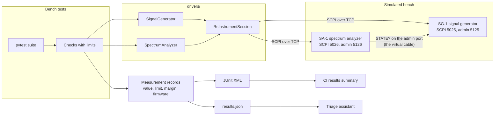
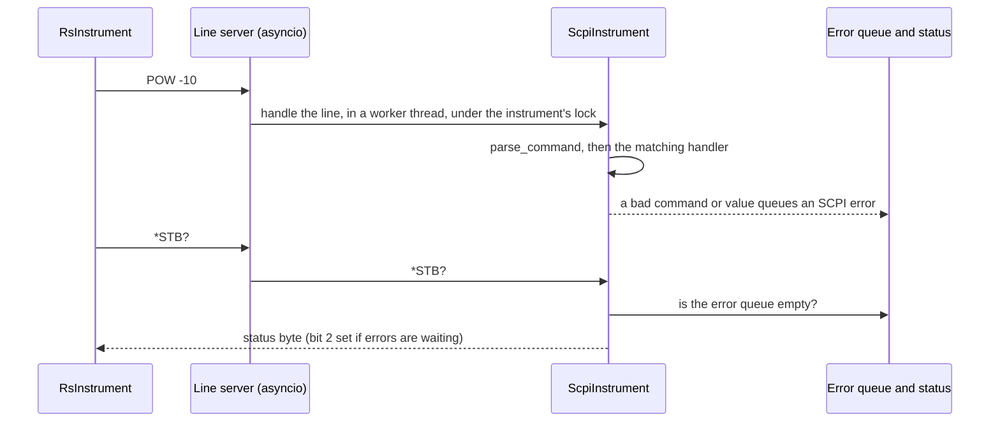
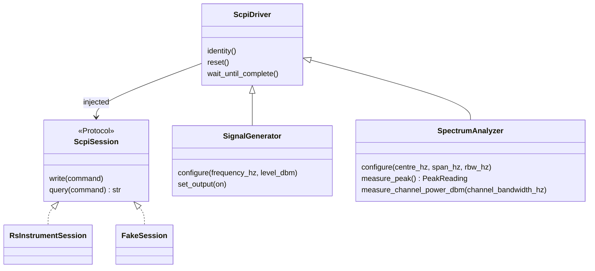
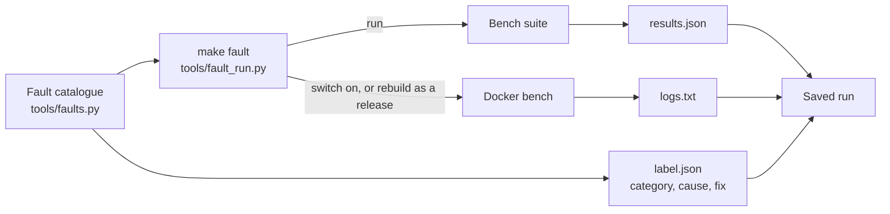
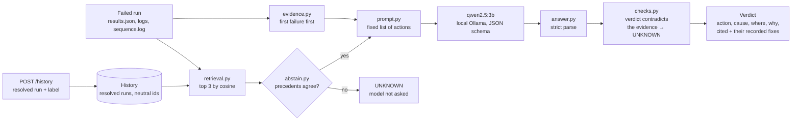
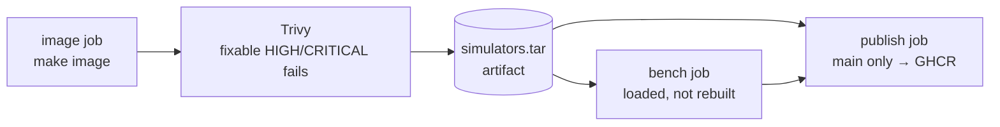

# Architecture

How the pieces of the bench fit together today: two simulated instruments, the drivers
that control them, the measurement records every test produces, and the three test suites.
Each design choice that needed weighing has an ADR in [docs/adr/](adr/).

## The big picture

A test asks the generator for a carrier and the analyzer for a reading, through the drivers.
The analyzer has no real cable, so it asks the generator what it is sending over the
generator's admin port, and turns that into a reading with the physics model. The test
compares the reading with its limit and records value, limit, margin and both firmware
versions in the JUnit XML. CI turns that XML into the summary on each run page. The triage
assistant reads the same records, from the run's results file, to explain a failure.

## The simulated instruments

Both simulators are built from the same parts in `simulators/common/`, and differ only in
their SCPI commands.

- **The line server** (`server.py`) reads one line at a time and caps line length. Each line
  runs in a worker thread behind a per-instrument lock, so a slow command never blocks the
  event loop and two clients can't interleave on one instrument.
- **The instrument base** (`instrument.py`) handles the IEEE 488.2 common commands (`*IDN?`,
  `*RST`, `*CLS`, `*OPC?`, `*ESR?`, `*STB?` and the rest) and dispatches everything else to
  the subclass's command table. Several commands on one line are split on `;`, and their
  replies are joined with `;`. Each command is matched from the root, so it needs its full
  path; SCPI's relative form, which reuses the previous command's path (`CALC:MARK:X?;Y?`),
  isn't supported. A command error discards the rest of the line, as the standard says.
- **Errors** (`errors.py`, `status.py`) go into a queue of 10, with -350 when it overflows,
  and set the status bits that RsInstrument checks after every command. Nothing fails
  silently: a bad command or an out-of-range value always leaves an error to read.
- **Numbers** (`numbers.py`, `parser.py`) accept SCPI's units (`1 GHz`, `-10 dBm`), and
  range checks reject out-of-range values with -222 without changing
  the setting.
- **The admin ports** (`admin.py`) answer JSON, apart from the SCPI interface: the generator
  on 5125, the analyzer on 5126. The analyzer reads the generator's `STATE?` there
  (ADR 0002), and the fault tooling switches faults there, so test code can never reach them
  over SCPI.
- **Faults** (`faults.py`, ADR 0005) are numbers where 0 means off: extra cable loss, a
  disconnected link, a link that drops one reading in N, and a delay before the generator
  handles each SCPI line. A firmware regression is a simulated release instead
  (`signal_generator/releases.py`): `0.2.0-rc1` drops the short `OUTP` form, and `0.2.0-rc2`
  stops clearing the level offset on `*RST`.
- **Logs** (`logs.py`) are one JSON object per line on stderr, so they can be searched and,
  posted to the triage service with a failed run. Logging never blocks an instrument: each record
  goes on a bounded queue that a background thread writes to stderr. If nothing reads
  stderr and the queue fills, records are dropped and counted, and a warning says how many
  were lost once there is room again.
- **JSON** (`jsontext.py`): JSON has no NaN or infinity, so admin replies and log lines
  write them as the strings `"NaN"`, `"Infinity"` and `"-Infinity"`. Every line stays
  standard JSON.

### The physics model

`physics.py` turns what the generator sends into what the analyzer reads:

| Effect | Model | Default |
|---|---|---|
| Cable loss | grows with the square root of frequency (skin effect) | 1.5 dB at 1 GHz |
| Analyzer flatness | a smooth sine ripple across frequency | ±0.15 dB, repeating every 1.7 GHz |
| Noise floor | -174 dBm/Hz + noise figure + 10·log10(RBW) | noise figure 24 dB, so -120 dBm at 1 kHz RBW |
| Second harmonic | a weaker tone at twice the frequency, which the cable then attenuates more | 45 dB below the carrier |
| Tone on the floor | the tone and the floor added as powers | |
| Channel power | the noise over the channel, or over the span if that is narrower, plus the tone when it lies in both | |
| Reading noise | seeded normal noise; `*RST` reseeds, so readings repeat | 0.02 dB on a tone, 0.5 dB on the bare floor |

So -10 dBm at 1 GHz reads about -11.5 dBm. If the analyzer can't reach the generator, it
measures no signal, as with an unplugged cable, and logs a warning.

## Drivers

- Drivers talk SCPI and nothing else. They take any `ScpiSession`, so unit tests pass a
  `FakeSession` (`tests/unit/drivers/fakes.py`) and the bench passes `RsInstrumentSession`. A real instrument would plug in the
  same way.
- `RsInstrumentSession` opens a plain socket (no VISA install), accepts only instruments that
  identify as VirtualRF, and keeps RsInstrument's `*STB?` check after every command on.
  Every instrument error is raised as `InstrumentError`, and a timeout as
  `InstrumentTimeoutError` (ADR 0001, ADR 0003).
- Long operations, such as a sweep, are synchronised with `*OPC?`, and every call has a
  timeout.
- `drivers/protocols.py` defines small interfaces, `LevelSource` and `PowerMeter`, for code
  that needs only one capability.

## Measurement records

Tests never assert on a bare reading. Each reading becomes a `Measurement`
(`measurements/record.py`): the value, its unit, a `Limit` (a window or an upper or lower
bound), the margin to that limit, pass or fail, and both instruments' firmware versions.
The `record_measurements` fixture writes each one into the JUnit XML as properties, then
fails the test listing every measurement that missed, with its margin. A failure therefore
always says what was measured, against which limit, by how much it missed, and on which
firmware. That is the evidence the triage assistant reads. A NaN or infinite reading
always fails, and its value and margin are recorded as `"NaN"`, `"Infinity"` or
`"-Infinity"`, so the JUnit properties stay standard JSON.

`tools/results_summary.py` reads one or more JUnit XML files, and the coverage XML when there
is one, and prints the Markdown table CI shows: tests per suite, failures with their messages,
coverage against the floor, and the slowest tests. A results file that should exist but
doesn't is named, so a job that died early can't pass for a short, clean run.

On pull requests, CI's last job turns the same results into a comment with
`tools/pr_comment.py`: the unit, integration and bench results together, plus each CI job's
result and a link to the run. The comment starts with a hidden marker, so each push updates
the same comment instead of adding another.

## Results files and saved runs

Every bench run writes `reports/bench-results.json` (`tests/utilities/results_file.py`): the
firmware versions, the selection (collected, selected and deselected tests, so a subset never
passes for a full run), and for each test its outcome, message, the SCPI errors in its
failure, and its measurements with limits and margins. It holds only what a real bench knows
after a run, never the cause.

`make fault` saves a run as `results.json`, the last lines of the instruments' logs,
`sequence.log` from the setup sequence, and a separate `label.json`, so triage reads the
evidence without ever seeing the answer. For the configuration faults and the leaked offset,
`sequence.log` is the only place the cause appears (ADR 0007). The data
set in `triage/data/runs/` holds three history runs per fault, which triage may retrieve, and
three question runs per fault, each at a size no history run has where the fault has a size,
which it is asked about.

## Triage

The triage assistant answers one question about a failed run: what should an engineer do
about it? It is one pipeline (`triage/service.py`), used three ways: `make triage` on a saved
run, the HTTP API (`triage/api.py`, `make triage-api`), and the evaluation
(`triage/evaluate.py`, `make eval`), which scores it against the labelled question runs.

- **Evidence** leads with the first failure, because a run with nineteen errors has one
  cause, and puts any SCPI error the instruments reported ahead of it, because a rejected
  command shows up as a timeout. It never reads `label.json`.
- **In CI**, a run's failed tests are first split into distinct failures (`failures.py`):
  the tests one setup step stopped, or the cases of one test failing the same way. Each of
  the first five is triaged as a run focused on it, and the same answers share a block
  (ADR 0020).
- **Retrieval** embeds each resolved run with `nomic-embed-text` and ranks by cosine
  similarity in memory. A source is cited by a hash of its text (`past-3fa2c1d0`), never by
  its folder, because folder names name the fault (ADR 0009).
- **The model** picks one action from a fixed list, or `UNKNOWN`. Its reply is constrained
  to the answer's JSON schema and still parsed strictly: an invented citation or an
  off-list action is refused, not interpreted.
- **Checks** compare the verdict with facts the evidence states outright, and turn a
  contradicted one into `UNKNOWN`: `FIRMWARE` naming a release the run didn't run,
  `FIRMWARE` when the firmware is the same release as the last passing run, and `TIMEOUT`
  when a failed test reports an SCPI error. A check never picks another action in the
  model's place.
- **Gates** (`abstain.py`) answer `UNKNOWN` before the model is asked. The API applies one:
  the retrieved precedents record different actions. The evaluation also scores a second,
  the closest precedent below a similarity threshold that `tools/calibrate_abstention.py`
  sets from the history alone, which cost more than it saved (ADR 0013).
- **The reply's schema** lists the ids of the sources offered with each question, so the
  model can cite only those; the parser still refuses anything else.
- **The evaluation** scores eight scenarios, each changing one thing in another: error text
  only, full evidence, full evidence without its firmware line, plus retrieval, plus the
  checks, the same with the question's own fault held out of the history, and both of those
  with the gates. The fault is the unit scored: one is solved when all three
  of its questions are right, with a 95% interval over the 13 faults (ADR 0012). It counts
  right, `UNKNOWN`, confidently wrong and malformed answers apart, scores against the action
  key each label records, and reports how often retrieval offered a past run of the
  question's own fault, and whether a right answer cites and quotes its own fault's past
  runs (ADR 0019). Model answers are cached under `.cache/triage-answers/`, so a rerun
  asks only the prompts that changed.

The API (ADR 0010) keeps the history in memory, loaded from `triage/data/runs/history/` at
start, and adds to it through `POST /history`. It listens on localhost and talks only to the
local Ollama.

## Three test suites

| Suite | Runs against | Command | What it proves |
|---|---|---|---|
| `tests/unit/` | single functions and classes, with fake sessions and sockets | `make test` | each part does its job, including every error path |
| `tests/integration/` | the simulators started inside pytest, in background threads, plus real subprocesses | `make test` | the parts work together, and RsInstrument works against the simulators |
| `tests/bench/` | the containers from `make bench-up`, as black boxes | `make bench-test` | the released image measures correctly from the outside, as a real bench would |

The integration and bench suites take the same measurements through the same checks
(`tests/utilities/bench_checks.py`). Only the expected level differs: in-process, the tests know
the exact physics; against the containers, they use the cable's datasheet loss. `make test`
needs no Docker, and enforces the 80% coverage floor over the first two suites.

## Containers

One image runs both simulators (ADR 0004); Compose picks which one each container runs. The
image is built from `uv.lock` in two stages, contains no RsInstrument (only the drivers need
it), applies Debian security updates and drops `pip`, runs as an unprivileged user on a
read-only filesystem with every capability dropped, and reports its version in `*IDN?`. That version is the "firmware release" under test.
`make bench-up` waits until both healthchecks see an `*IDN?` reply. The analyzer reaches the
generator's admin port by its Compose service name, and every port is published on
localhost only.

In CI the image is built once (ADR 0011). Trivy scans it and fails on any fixable high or
critical vulnerability. The bench suite then runs against that same image, loaded rather
than rebuilt, and only after a push to `main` is it pushed to GitHub Container Registry,
tagged `<version>-<commit>`.

## Where to look

| To change... | Look in |
|---|---|
| A generator or analyzer SCPI command | `simulators/signal_generator/instrument.py`, `simulators/spectrum_analyzer/instrument.py` |
| Common commands, the status byte, the error queue | `simulators/common/instrument.py`, `status.py`, `errors.py` |
| How commands and numbers are parsed | `simulators/common/parser.py`, `numbers.py` |
| What the analyzer reads | `simulators/common/physics.py` |
| How the analyzer finds the generator | `simulators/spectrum_analyzer/link.py`, `simulators/signal_generator/admin.py` |
| Faults and simulated releases | `simulators/common/faults.py`, `simulators/signal_generator/releases.py` |
| Simulator startup and command-line options | `simulators/common/app.py`, each simulator's `app.py` |
| A driver method | `drivers/signal_generator.py`, `drivers/spectrum_analyzer.py`, `drivers/base.py` |
| How sessions connect, and how errors are raised | `drivers/session.py` |
| Limits, margins and JUnit properties | `measurements/record.py`, `measurements/junit.py` |
| The CI results table and the pull request comment | `tools/results_summary.py`, `tools/pr_comment.py` |
| A bench check or its limit | `tests/utilities/bench_checks.py` |
| The bench suite and its addresses | `tests/bench/` |
| The image, Compose and healthcheck | `Dockerfile`, `compose.yaml`, `simulators/healthcheck.py` |
| The JSON results file | `tests/utilities/results_file.py`, `tests/bench/conftest.py` |
| Path-loss calibration and its limits | `tests/utilities/calibration.py` |
| The setup sequence and its log | `tests/bench/conftest.py`, `tests/utilities/sequencer.py`, `tests/utilities/bench_config.py` |
| The fault catalogue, `make fault` and the data set | `tools/faults.py`, `tools/fault_run.py`, `tools/bench_control.py` |
| The evidence a run gives the model | `triage/evidence.py` |
| The prompt and the list of actions | `triage/prompt.py` |
| How a reply is parsed, and its schema | `triage/answer.py` |
| Retrieval and source ids | `triage/retrieval.py`, `triage/embed.py` |
| Checks on a verdict | `triage/checks.py` |
| Abstaining from retrieval, and its threshold | `triage/abstain.py`, `tools/calibrate_abstention.py` |
| The HTTP API | `triage/api.py` |
| Triage of a failed bench run in CI, and its comment section | `tools/save_failed_run.py`, `triage/failures.py`, `tools/ci_triage.py`, the `triage` job in `.github/workflows/ci.yml` |
| Evaluation scenarios and running them | `triage/evaluate.py` |
| Outcomes, scores and the 95% interval | `triage/scores.py` |
| The report and its findings | `triage/report.py`, `triage/results/rag.md`, `docs/EVALUATION.md` |
| CI jobs, the image scan and publishing | `.github/workflows/ci.yml` |

## Decisions

| ADR | Decision |
|---|---|
| [0001](adr/0001-rsinstrument-session-and-test-backend.md) | RsInstrument's session settings, how the driver tests stand in for it, and why the project writes its own simulators |
| [0002](adr/0002-analyzer-reads-generator-state-from-admin-port.md) | The analyzer reads the generator's state from the generator's admin port |
| [0003](adr/0003-rsinstrument-rather-than-plain-pyvisa.md) | RsInstrument rather than plain PyVISA, behind a small session interface |
| [0004](adr/0004-one-simulator-image-on-compose.md) | One hardened simulator image, run with Docker Compose |
| [0005](adr/0005-fault-injection.md) | Fault injection on the admin ports and as simulated releases |
| [0006](adr/0006-calibrated-level-measurements.md) | Levels are judged against a measured path loss, not a nominal one |
| [0007](adr/0007-sequence-log.md) | A failed setup step names the step, and the sequence log holds the reason |
| [0008](adr/0008-triage-design.md) | How triage is built and measured: a fixed list of actions, injected interfaces, one prompt |
| [0009](adr/0009-honest-triage-evaluation.md) | Neutral source ids, a held-out-fault scenario, three questions per fault, and a firmware check |
| [0010](adr/0010-triage-http-api.md) | A FastAPI service with an in-memory history; pgvector deferred |
| [0011](adr/0011-ci-image-build-scan-publish.md) | Build the image once in CI, scan it with Trivy, bench it, and publish it from `main` |
| [0012](adr/0012-score-faults-key-labels-by-action.md) | Score faults, not questions; name each action by its symptom; record the action key in every label; three checks |
| [0013](adr/0013-abstain-from-retrieval.md) | Gates that abstain from retrieval alone, the instrument error first, and a firmware-line ablation |
| [0014](adr/0014-api-gate-cited-ids-version-wording.md) | The disagreement gate in the API, cited ids in the reply schema, and version wording without "firmware" when unchanged |
| [0015](adr/0015-majority-vote-baseline.md) | A majority vote over the same past runs, with no model, scored as a baseline |
| [0016](adr/0016-answer-states-cause-and-past-fix.md) | The answer states the cause and quotes what fixed each cited run last time |
| [0017](adr/0017-no-signal-line-and-alignment-check.md) | A "No signal" line in the evidence, and a check that refuses alignment without a signal |

What comes next is in the [roadmap](ROADMAP.md).
