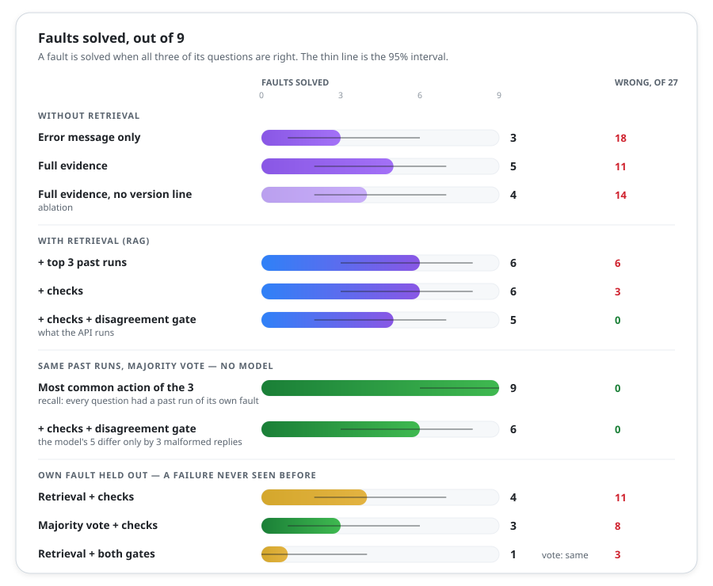

# How the triage assistant is measured

The README says what the assistant does. This page is for the numbers behind it: how each
answer is kept from being confidently wrong, how it scores on the labelled faults, and how
the evaluation was made harder to fool. `make eval` reproduces every number here; each
question's answer is in [`triage/results/rag.md`](../triage/results/rag.md).

The data set is 27 failed runs of 9 known faults, three per fault, scored per fault with a
95% interval ([`triage/data/README.md`](../triage/data/README.md) describes it). The answering
model is `qwen2.5:3b` on local Ollama, at temperature 0 with a fixed seed, on one machine.

## Guardrails against a confident wrong answer

A wrong action costs an engineer hours; `UNKNOWN` costs a minute. Every layer below can only
turn an answer into `UNKNOWN` or refuse it, never pick a different action.

| Layer | What it does | Measured effect |
|---|---|---|
| **Fixed action list** | the model picks a key, so scoring is an exact match | no judge model needed |
| **Reply schema** | one action from the enum; `cited` limited to the offered ids; 512-token cap | an invented citation can't be written |
| **Strict parser** | anything unusable is counted as malformed, never read generously | none in the current run; 3 `link_down` replies before ADR 0017 |
| **Disagreement gate** | top 3 past runs resolved different ways → `UNKNOWN`, model not asked | wrong answers 3 → 0, at a cost of 6 right ones |
| **Checks** | `FIRMWARE` on a release the run didn't run, or on unchanged firmware; `TIMEOUT` beside an SCPI error; `ALIGNMENT` when the analyzer logged no signal | turned 3 wrong answers into `UNKNOWN`, cost none |

## Results

  

Counts, not percentages: with 13 faults, "11 of 13, 8 to 12" is honest where "85%" is not.
Every question's answer is in [`triage/results/rag.md`](../triage/results/rag.md).

## What the numbers say

- **Counting the past runs' actions beats the model on this data set, until it doesn't.** A
  majority vote over the same top 3, with no model, solves 12 of 13 against the model's 11.
  Behind the gate the model differs from the vote only on `link_down`: it answers `UNKNOWN`
  where the vote says `LINK`. Held out, the vote also gets `link_flaky`: 5 of 13 to 4.
- **The vote is confidently wrong on a fault whose runs are identical.** The three
  `fixture_skips_reset` history runs are the same run, so they are indexed once (ADR 0012).
  A question about it is offered that one run and two `config_decimal_error` runs, which fail
  at the same setup step, and both the vote and the model answer `CONFIGURATION`. Only the
  gate notices the disagreement and answers `UNKNOWN`: 3 wrong answers for the vote, none
  behind the gate.
- **Past runs help the model on four faults and mislead it on one.** The run's own evidence
  solves 8 of 13; with the past runs, 11. They fix `analyzer_needs_alignment`,
  `slow_responses`, `sweep_timeout` and `config_parameter_out_of_range`, but the model
  copies "recalibrated" from `link_down`'s past fixes into `ALIGNMENT`. With the fault held
  out, 4 of 13.
- **More history can unblock the gate, and block it.** `slow_responses` used to be refused:
  its closest past runs were resolved by `TIMEOUT` and `FIRMWARE`; the `sweep_timeout` runs
  made them agree, so the model is asked and is right. The `fixture_skips_reset` run did the
  opposite for `reset_leaks_offset` and `config_decimal_error`: their closest three now
  disagree, so the gate costs 6 right answers where it cost 3.
- **A right action can still quote the wrong fix.** The model sometimes cites a look-alike
  run of a neighbouring fault with the same action: all three `config_parameter_out_of_range`
  questions cite a `config_parameter_missing` run, so 4 of the 27 right answers behind the
  gate cite another fault. Quoting every offered run resolved by the same action, cited or
  not, means all 27 also quote their own fault's fix (ADR 0019).
- **Stating a fact from the logs can matter.** A line saying the analyzer logged "No signal
  reaching the analyzer" takes the evidence-only answer from 6 to 8 of 13: the ablation
  without it loses `link_down` and two of three `link_flaky` questions (ADR 0017).
- **A small model follows the odd precedent out.** Offered two past runs of its own fault
  and one look-alike, it often copies the look-alike. That is why the gate exists.
- **Wording matters.** "Firmware: … (unchanged)" pulled the model to `FIRMWARE`. Saying
  "Instruments: … the same as the last passing run" solved one more fault and lost none.
- **Six of the eleven faults solved with retrieval are recall, not reasoning:** their runs
  have no size to vary, so a question repeats a past run almost word for word. The report
  says so.
- **Two ideas didn't pay off:** leading the evidence with the SCPI error changed no score,
  and a similarity threshold gave up 6 right answers to prevent 3 wrong ones.

## How the evaluation got more honest

Each review found a way the score could flatter the assistant, and closed it.

| ADR | What changed | Retrieval score after it |
|---|---|---|
| [0008](adr/0008-triage-design.md) | fixed action list, one prompt for every scenario | 6 of 9 questions |
| [0009](adr/0009-honest-triage-evaluation.md) | neutral source ids (the folder name gave the answer), 27 questions, a held-out scenario | 18 of 27 questions |
| [0012](adr/0012-score-faults-key-labels-by-action.md) | score faults, not questions; label each run's action; **index identical runs once** (they inflated 5 → 8 of 9) | 5 of 9 faults |
| [0013](adr/0013-abstain-from-retrieval.md) | gates before the model; an ablation of the firmware line | 5 of 9 faults |
| [0014](adr/0014-api-gate-cited-ids-version-wording.md) | the disagreement gate in the API, cited ids in the schema, version wording | **6 of 9 faults** |
| [0015](adr/0015-majority-vote-baseline.md) | a majority vote over the same past runs, with no model, as a baseline | 6 of 9; the vote 9 of 9 |
| [0017](adr/0017-no-signal-line-and-alignment-check.md) | a "No signal" line in the evidence; `ALIGNMENT` without a signal becomes `UNKNOWN` | 6 of 9; without past runs 7 of 9 |
| [0019](adr/0019-quote-same-action-fixes-and-four-new-faults.md) | quote every offered run with the verdict's action; score citations; four new faults, 13 in all | 11 of 13; behind the gate 9, all quoting their own fault's fix |
