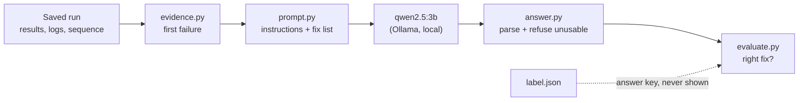

# Triage baseline (no retrieval)

Model: `qwen2.5:3b`, temperature 0, fixed seed. Scored on whether the model named the fix that resolves each failure. Counts, not percentages: nine questions.

## error only: 4 of 9

| Fault | Expected | Chosen | | Error shown → the model's answer |
|---|---|---|---|---|
| cable_loss | CABLE | FIRMWARE | ✗ | `Failed: path_loss_100mhz: 1.8898817412 dB, limit 0 to 0.974341649025 dB, margin -0.91554...` -> FIRMWARE (instrument's firmware) because The test results indicate significant path loss across multiple frequencies, which could... |
| config_decimal_error | CONFIGURATION | CONFIGURATION | ✓ | `AssertionError: the generator carries a level offset of 0 dB, but the bench configuration...` -> CONFIGURATION (the bench configuration) because The configuration expects a level offset of 15 dB while the generator carries a... |
| config_parameter_missing | CONFIGURATION | CONFIGURATION | ✓ | `ConfigurationError: BENCH_LEVEL_OFFSET_DB is not set in the bench configuration` -> CONFIGURATION (bench configuration) because ConfigurationError: BENCH_LEVEL_OFFSET_DB is not set in the bench configuration |
| config_parameter_out_of_range | CONFIGURATION | FIRMWARE | ✗ | `ConfigurationError: BENCH_LEVEL_OFFSET_DB=80 is outside the instrument's range of -50 to...` -> FIRMWARE (test code and its configuration) because ConfigurationError suggests a firmware regression due to an out-of-range... |
| link_down | LINK | FIRMWARE | ✗ | `Failed: path_loss_100mhz: 109.243158555 dB, limit 0 to 0.974341649025 dB, margin -108.269...` -> FIRMWARE (instrument's firmware) because The test results indicate significant deviations from the expected limits, suggesting a... |
| link_flaky | LINK | FIRMWARE | ✗ | `Failed: path_loss_1000mhz: 110.881881396 dB, limit 1 to 2 dB, margin -108.882 dB, FAIL` -> FIRMWARE (instrument's firmware) because The test result is outside the acceptable limit, indicating a potential firmware... |
| output_command_change | FIRMWARE | TIMEOUT | ✗ | `drivers.session.InstrumentTimeoutError: TCPIP::127.0.0.1::5025::SOCKET: no reply to...` -> TIMEOUT (raise the session timeout to the instrument's response time) because The session timeout error indicates a VISA Timeout... |
| reset_leaks_offset | FIRMWARE | FIRMWARE | ✓ | `AssertionError: the generator carries a level offset of -2 dB, but the bench...` -> FIRMWARE (the test code and its configuration) because The test code expects a level offset of 0 dB, but the generator carries a... |
| slow_responses | TIMEOUT | TIMEOUT | ✓ | `drivers.session.InstrumentTimeoutError: TCPIP::127.0.0.1::5025::SOCKET: no reply within...` -> TIMEOUT (session timeout) because InstrumentTimeoutError indicates a session timeout issue |

Wrong choices: FIRMWARE x4, TIMEOUT x1.

## full evidence: 3 of 9

| Fault | Expected | Chosen | | Error shown → the model's answer |
|---|---|---|---|---|
| cable_loss | CABLE | FIRMWARE | ✗ | `Failed: path_loss_100mhz: 1.8898817412 dB, limit 0 to 0.974341649025 dB, margin -0.91554...` -> FIRMWARE (analyzer and generator firmware) because Firmware versions have not changed since the last passing run, indicating a... |
| config_decimal_error | CONFIGURATION | FIRMWARE | ✗ | `AssertionError: the generator carries a level offset of 0 dB, but the bench configuration...` -> FIRMWARE (generator firmware) because The generator's firmware is at version 0.1.0, which is unchanged since the last passing... |
| config_parameter_missing | CONFIGURATION | CONFIGURATION | ✓ | `ConfigurationError: BENCH_LEVEL_OFFSET_DB is not set in the bench configuration` -> CONFIGURATION (bench configuration) because ConfigurationError: BENCH_LEVEL_OFFSET_DB is not set in the bench configuration |
| config_parameter_out_of_range | CONFIGURATION | FIRMWARE | ✗ | `ConfigurationError: BENCH_LEVEL_OFFSET_DB=80 is outside the instrument's range of -50 to...` -> FIRMWARE (previous release) because ConfigurationError is due to a configuration setting outside the instrument's range, and the... |
| link_down | LINK | CABLE | ✗ | `Failed: path_loss_100mhz: 109.243158555 dB, limit 0 to 0.974341649025 dB, margin -108.269...` -> CABLE (cable) because The test path loss calibration does not match the cable datasheet, indicating potential issues with the... |
| link_flaky | LINK | CABLE | ✗ | `Failed: path_loss_1000mhz: 110.881881396 dB, limit 1 to 2 dB, margin -108.882 dB, FAIL` -> CABLE (cable and connectors) because The instrument logs indicate that there is no signal reaching the analyzer, suggesting a... |
| output_command_change | FIRMWARE | FIRMWARE | ✓ | `drivers.session.InstrumentTimeoutError: TCPIP::127.0.0.1::5025::SOCKET: no reply to...` -> FIRMWARE (instrument firmware) because The test failures are attributed to the instrument firmware, specifically the 'Undefined... |
| reset_leaks_offset | FIRMWARE | FIRMWARE | ✓ | `AssertionError: the generator carries a level offset of -2 dB, but the bench...` -> FIRMWARE (generator firmware) because The generator's firmware is different from the last passing run, which may have introduced... |
| slow_responses | TIMEOUT | FIRMWARE | ✗ | `drivers.session.InstrumentTimeoutError: TCPIP::127.0.0.1::5025::SOCKET: no reply within...` -> FIRMWARE (instrument firmware) because The test timeout error suggests a potential regression in the firmware, which has not... |

Wrong choices: FIRMWARE x4, CABLE x2.

## Findings

- Best scenario: error only, 4 of 9.
- More evidence lowered the score (4 to 3 of 9): on this model, fuller context did not help.
- Most common wrong choice: FIRMWARE (8 times across the scenarios); the model falls back to one answer when unsure.
- Solved in every scenario: config_parameter_missing, reset_leaks_offset — the failures whose error text names the fix almost literally.

These are one machine's deterministic numbers (temperature 0, fixed seed); another machine's model may differ in wording and the odd verdict. A verdict whose reasoning is sound but whose category is wrong still counts as a miss, so the counts, if anything, understate the model.
