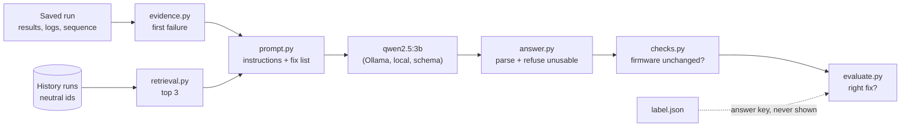

# Triage: retrieval against the no-retrieval baseline

Model: `qwen2.5:3b`, temperature 0, fixed seed, replies constrained to the answer's JSON schema. Scored on whether the model named the fix that resolves each failure, over 27 questions. ✓ right, ? UNKNOWN, ✗ a confident wrong action, ! unusable reply.

| Scenario | Adds | Right | 95% interval | UNKNOWN | Wrong | Malformed |
|---|---|---|---|---|---|---|
| error only |  | 12 of 27 | 7 to 17 | 0 | 15 | 0 |
| full evidence | to error only | 9 of 27 | 5 to 14 | 0 | 18 | 0 |
| full + retrieval | to full evidence | 18 of 27 | 13 to 22 | 0 | 9 | 0 |
| full + retrieval + firmware check | to full + retrieval | 18 of 27 | 13 to 22 | 3 | 6 | 0 |
| full + retrieval, own fault held out | to full + retrieval | 9 of 27 | 5 to 14 | 0 | 18 | 0 |

## error only: 12 of 27 right (95% interval 7 to 17); 0 UNKNOWN, 15 wrong, 0 malformed

| Question | Expected | Chosen | | Error shown → the model's answer |
|---|---|---|---|---|
| cable_loss-1 | CABLE | FIRMWARE | ✗ | `Failed: path_loss_100mhz: 1.8898817412 dB, limit 0 to 0.974341649025 dB, margin -0.91554...` -> FIRMWARE (instrument's firmware) because The test results indicate significant path loss across multiple frequencies, which could... |
| cable_loss-2 | CABLE | FIRMWARE | ✗ | `Failed: path_loss_100mhz: 1.3898817412 dB, limit 0 to 0.974341649025 dB, margin -0.41554...` -> FIRMWARE (instrument's firmware) because The test results indicate significant path loss across multiple frequencies, which could... |
| cable_loss-3 | CABLE | FIRMWARE | ✗ | `Failed: path_loss_100mhz: 2.8898817412 dB, limit 0 to 0.974341649025 dB, margin -1.91554...` -> FIRMWARE (instrument's firmware) because The test results indicate significant deviations from the expected limits, suggesting a... |
| config_decimal_error-1 | CONFIGURATION | CONFIGURATION | ✓ | `AssertionError: the generator carries a level offset of 0 dB, but the bench configuration...` -> CONFIGURATION (the bench configuration) because The configuration expects a level offset of 15 dB while the generator carries a... |
| config_decimal_error-2 | CONFIGURATION | CONFIGURATION | ✓ | `AssertionError: the generator carries a level offset of 0 dB, but the bench configuration...` -> CONFIGURATION (the bench configuration) because The configuration expects a level offset of 15 dB while the generator carries a... |
| config_decimal_error-3 | CONFIGURATION | CONFIGURATION | ✓ | `AssertionError: the generator carries a level offset of 0 dB, but the bench configuration...` -> CONFIGURATION (the bench configuration) because The configuration expects a level offset of 15 dB while the generator carries a... |
| config_parameter_missing-1 | CONFIGURATION | CONFIGURATION | ✓ | `ConfigurationError: BENCH_LEVEL_OFFSET_DB is not set in the bench configuration` -> CONFIGURATION (bench configuration) because ConfigurationError: BENCH_LEVEL_OFFSET_DB is not set in the bench configuration |
| config_parameter_missing-2 | CONFIGURATION | CONFIGURATION | ✓ | `ConfigurationError: BENCH_LEVEL_OFFSET_DB is not set in the bench configuration` -> CONFIGURATION (bench configuration) because ConfigurationError: BENCH_LEVEL_OFFSET_DB is not set in the bench configuration |
| config_parameter_missing-3 | CONFIGURATION | CONFIGURATION | ✓ | `ConfigurationError: BENCH_LEVEL_OFFSET_DB is not set in the bench configuration` -> CONFIGURATION (bench configuration) because ConfigurationError: BENCH_LEVEL_OFFSET_DB is not set in the bench configuration |
| config_parameter_out_of_range-1 | CONFIGURATION | FIRMWARE | ✗ | `ConfigurationError: BENCH_LEVEL_OFFSET_DB=80 is outside the instrument's range of -50 to...` -> FIRMWARE (test code and its configuration) because ConfigurationError suggests a firmware regression due to an out-of-range... |
| config_parameter_out_of_range-2 | CONFIGURATION | FIRMWARE | ✗ | `ConfigurationError: BENCH_LEVEL_OFFSET_DB=80 is outside the instrument's range of -50 to...` -> FIRMWARE (test code and its configuration) because ConfigurationError suggests a firmware regression due to an out-of-range... |
| config_parameter_out_of_range-3 | CONFIGURATION | FIRMWARE | ✗ | `ConfigurationError: BENCH_LEVEL_OFFSET_DB=80 is outside the instrument's range of -50 to...` -> FIRMWARE (test code and its configuration) because ConfigurationError suggests a firmware regression due to an out-of-range... |
| link_down-1 | LINK | FIRMWARE | ✗ | `Failed: path_loss_100mhz: 109.243158555 dB, limit 0 to 0.974341649025 dB, margin -108.269...` -> FIRMWARE (instrument's firmware) because The test results indicate significant deviations from the expected limits, suggesting a... |
| link_down-2 | LINK | FIRMWARE | ✗ | `Failed: path_loss_100mhz: 109.243158555 dB, limit 0 to 0.974341649025 dB, margin -108.269...` -> FIRMWARE (instrument's firmware) because The test results indicate significant deviations from the expected limits, suggesting a... |
| link_down-3 | LINK | FIRMWARE | ✗ | `Failed: path_loss_100mhz: 109.243158555 dB, limit 0 to 0.974341649025 dB, margin -108.269...` -> FIRMWARE (instrument's firmware) because The test results indicate significant deviations from the expected limits, suggesting a... |
| link_flaky-1 | LINK | FIRMWARE | ✗ | `Failed: path_loss_1000mhz: 110.881881396 dB, limit 1 to 2 dB, margin -108.882 dB, FAIL` -> FIRMWARE (instrument's firmware) because The test result is outside the acceptable limit, indicating a potential firmware... |
| link_flaky-2 | LINK | FIRMWARE | ✗ | `Failed: path_loss_1000mhz: 110.881881396 dB, limit 1 to 2 dB, margin -108.882 dB, FAIL` -> FIRMWARE (instrument's firmware) because The test result is outside the acceptable limit, indicating a potential firmware... |
| link_flaky-3 | LINK | FIRMWARE | ✗ | `Failed: path_loss_5000mhz: 110.132770235 dB, limit 2.85410196625 to 3.85410196625 dB,...` -> FIRMWARE (instrument's firmware) because The test result margin is far below the acceptable limit, indicating a potential... |
| output_command_change-1 | FIRMWARE | TIMEOUT | ✗ | `drivers.session.InstrumentTimeoutError: TCPIP::127.0.0.1::5025::SOCKET: no reply to...` -> TIMEOUT (raise the session timeout to the instrument's response time) because The session timeout error indicates a VISA Timeout... |
| output_command_change-2 | FIRMWARE | TIMEOUT | ✗ | `drivers.session.InstrumentTimeoutError: TCPIP::127.0.0.1::5025::SOCKET: no reply to...` -> TIMEOUT (raise the session timeout to the instrument's response time) because The session timeout error indicates a VISA Timeout... |
| output_command_change-3 | FIRMWARE | TIMEOUT | ✗ | `drivers.session.InstrumentTimeoutError: TCPIP::127.0.0.1::5025::SOCKET: no reply to...` -> TIMEOUT (raise the session timeout to the instrument's response time) because The session timeout error indicates a VISA Timeout... |
| reset_leaks_offset-1 | FIRMWARE | FIRMWARE | ✓ | `AssertionError: the generator carries a level offset of -2 dB, but the bench...` -> FIRMWARE (the test code and its configuration) because The test code expects a level offset of 0 dB, but the generator carries a... |
| reset_leaks_offset-2 | FIRMWARE | FIRMWARE | ✓ | `AssertionError: the generator carries a level offset of -2 dB, but the bench...` -> FIRMWARE (the test code and its configuration) because The test code expects a level offset of 0 dB, but the generator carries a... |
| reset_leaks_offset-3 | FIRMWARE | FIRMWARE | ✓ | `AssertionError: the generator carries a level offset of -2 dB, but the bench...` -> FIRMWARE (the test code and its configuration) because The test code expects a level offset of 0 dB, but the generator carries a... |
| slow_responses-1 | TIMEOUT | TIMEOUT | ✓ | `drivers.session.InstrumentTimeoutError: TCPIP::127.0.0.1::5025::SOCKET: no reply within...` -> TIMEOUT (session timeout) because InstrumentTimeoutError indicates a session timeout issue |
| slow_responses-2 | TIMEOUT | TIMEOUT | ✓ | `drivers.session.InstrumentTimeoutError: TCPIP::127.0.0.1::5025::SOCKET: no reply within...` -> TIMEOUT (session timeout) because InstrumentTimeoutError indicates a session timeout issue |
| slow_responses-3 | TIMEOUT | TIMEOUT | ✓ | `drivers.session.InstrumentTimeoutError: TCPIP::127.0.0.1::5025::SOCKET: no reply within...` -> TIMEOUT (session timeout) because InstrumentTimeoutError indicates a session timeout issue |

Confident wrong choices: FIRMWARE x12, TIMEOUT x3.

## full evidence: 9 of 27 right (95% interval 5 to 14); 0 UNKNOWN, 18 wrong, 0 malformed

| Question | Expected | Chosen | | Error shown → the model's answer |
|---|---|---|---|---|
| cable_loss-1 | CABLE | FIRMWARE | ✗ | `Failed: path_loss_100mhz: 1.8898817412 dB, limit 0 to 0.974341649025 dB, margin -0.91554...` -> FIRMWARE (analyzer and generator firmware) because Firmware versions have not changed since the last passing run, indicating a... |
| cable_loss-2 | CABLE | FIRMWARE | ✗ | `Failed: path_loss_100mhz: 1.3898817412 dB, limit 0 to 0.974341649025 dB, margin -0.41554...` -> FIRMWARE (analyzer and generator firmware) because Firmware versions have not changed since the last passing run, indicating a... |
| cable_loss-3 | CABLE | FIRMWARE | ✗ | `Failed: path_loss_100mhz: 2.8898817412 dB, limit 0 to 0.974341649025 dB, margin -1.91554...` -> FIRMWARE (analyzer and generator firmware) because Firmware versions have not changed since the last passing run, indicating a... |
| config_decimal_error-1 | CONFIGURATION | FIRMWARE | ✗ | `AssertionError: the generator carries a level offset of 0 dB, but the bench configuration...` -> FIRMWARE (generator firmware) because The generator's firmware is at version 0.1.0, which is unchanged since the last passing... |
| config_decimal_error-2 | CONFIGURATION | FIRMWARE | ✗ | `AssertionError: the generator carries a level offset of 0 dB, but the bench configuration...` -> FIRMWARE (generator firmware) because The generator's firmware is at version 0.1.0, which is unchanged since the last passing... |
| config_decimal_error-3 | CONFIGURATION | FIRMWARE | ✗ | `AssertionError: the generator carries a level offset of 0 dB, but the bench configuration...` -> FIRMWARE (generator firmware) because The generator's firmware is at version 0.1.0, which is unchanged since the last passing... |
| config_parameter_missing-1 | CONFIGURATION | CONFIGURATION | ✓ | `ConfigurationError: BENCH_LEVEL_OFFSET_DB is not set in the bench configuration` -> CONFIGURATION (bench configuration) because ConfigurationError: BENCH_LEVEL_OFFSET_DB is not set in the bench configuration |
| config_parameter_missing-2 | CONFIGURATION | CONFIGURATION | ✓ | `ConfigurationError: BENCH_LEVEL_OFFSET_DB is not set in the bench configuration` -> CONFIGURATION (bench configuration) because ConfigurationError: BENCH_LEVEL_OFFSET_DB is not set in the bench configuration |
| config_parameter_missing-3 | CONFIGURATION | CONFIGURATION | ✓ | `ConfigurationError: BENCH_LEVEL_OFFSET_DB is not set in the bench configuration` -> CONFIGURATION (bench configuration) because ConfigurationError: BENCH_LEVEL_OFFSET_DB is not set in the bench configuration |
| config_parameter_out_of_range-1 | CONFIGURATION | FIRMWARE | ✗ | `ConfigurationError: BENCH_LEVEL_OFFSET_DB=80 is outside the instrument's range of -50 to...` -> FIRMWARE (previous release) because ConfigurationError is due to a configuration setting outside the instrument's range, and the... |
| config_parameter_out_of_range-2 | CONFIGURATION | FIRMWARE | ✗ | `ConfigurationError: BENCH_LEVEL_OFFSET_DB=80 is outside the instrument's range of -50 to...` -> FIRMWARE (previous release) because ConfigurationError is due to a configuration setting outside the instrument's range, and the... |
| config_parameter_out_of_range-3 | CONFIGURATION | FIRMWARE | ✗ | `ConfigurationError: BENCH_LEVEL_OFFSET_DB=80 is outside the instrument's range of -50 to...` -> FIRMWARE (previous release) because ConfigurationError is due to a configuration setting outside the instrument's range, and the... |
| link_down-1 | LINK | CABLE | ✗ | `Failed: path_loss_100mhz: 109.243158555 dB, limit 0 to 0.974341649025 dB, margin -108.269...` -> CABLE (cable) because The test path loss calibration does not match the cable datasheet, indicating potential issues with the... |
| link_down-2 | LINK | CABLE | ✗ | `Failed: path_loss_100mhz: 109.243158555 dB, limit 0 to 0.974341649025 dB, margin -108.269...` -> CABLE (cable and connectors) because The test path loss calibration does not match the cable datasheet, indicating potential... |
| link_down-3 | LINK | CABLE | ✗ | `Failed: path_loss_100mhz: 109.243158555 dB, limit 0 to 0.974341649025 dB, margin -108.269...` -> CABLE (cable) because The test path loss calibration does not match the cable datasheet, indicating potential issues with the... |
| link_flaky-1 | LINK | CABLE | ✗ | `Failed: path_loss_1000mhz: 110.881881396 dB, limit 1 to 2 dB, margin -108.882 dB, FAIL` -> CABLE (cable and connectors) because The tests failed due to a lack of signal reaching the analyzer, which could indicate issues... |
| link_flaky-2 | LINK | CABLE | ✗ | `Failed: path_loss_1000mhz: 110.881881396 dB, limit 1 to 2 dB, margin -108.882 dB, FAIL` -> CABLE (cable and connectors) because The instrument logs indicate issues with the cable and connectors, such as 'No signal... |
| link_flaky-3 | LINK | CABLE | ✗ | `Failed: path_loss_5000mhz: 110.132770235 dB, limit 2.85410196625 to 3.85410196625 dB,...` -> CABLE (cable and connectors) because The tests failed due to a lack of signal reaching the analyzer, which could indicate issues... |
| output_command_change-1 | FIRMWARE | FIRMWARE | ✓ | `drivers.session.InstrumentTimeoutError: TCPIP::127.0.0.1::5025::SOCKET: no reply to...` -> FIRMWARE (instrument firmware) because The test failures are attributed to the instrument firmware, specifically the 'Undefined... |
| output_command_change-2 | FIRMWARE | FIRMWARE | ✓ | `drivers.session.InstrumentTimeoutError: TCPIP::127.0.0.1::5025::SOCKET: no reply to...` -> FIRMWARE (instrument firmware) because The test failures are attributed to the instrument firmware, specifically the 'Undefined... |
| output_command_change-3 | FIRMWARE | FIRMWARE | ✓ | `drivers.session.InstrumentTimeoutError: TCPIP::127.0.0.1::5025::SOCKET: no reply to...` -> FIRMWARE (instrument firmware) because The test failures are attributed to the instrument firmware, specifically the 'Undefined... |
| reset_leaks_offset-1 | FIRMWARE | FIRMWARE | ✓ | `AssertionError: the generator carries a level offset of -2 dB, but the bench...` -> FIRMWARE (generator firmware) because The generator's firmware is different from the last passing run, which may have introduced... |
| reset_leaks_offset-2 | FIRMWARE | FIRMWARE | ✓ | `AssertionError: the generator carries a level offset of -2 dB, but the bench...` -> FIRMWARE (generator firmware) because The generator's firmware is different from the last passing run, which may have introduced... |
| reset_leaks_offset-3 | FIRMWARE | FIRMWARE | ✓ | `AssertionError: the generator carries a level offset of -2 dB, but the bench...` -> FIRMWARE (generator firmware) because The generator's firmware is different from the last passing run, which may have introduced... |
| slow_responses-1 | TIMEOUT | FIRMWARE | ✗ | `drivers.session.InstrumentTimeoutError: TCPIP::127.0.0.1::5025::SOCKET: no reply within...` -> FIRMWARE (instrument firmware) because The test timeout error suggests a potential regression in the firmware, which has not... |
| slow_responses-2 | TIMEOUT | FIRMWARE | ✗ | `drivers.session.InstrumentTimeoutError: TCPIP::127.0.0.1::5025::SOCKET: no reply within...` -> FIRMWARE (instrument firmware) because The test timeout error suggests a potential regression in the firmware, which has not... |
| slow_responses-3 | TIMEOUT | FIRMWARE | ✗ | `drivers.session.InstrumentTimeoutError: TCPIP::127.0.0.1::5025::SOCKET: no reply within...` -> FIRMWARE (instrument firmware) because The test timeout error suggests a potential regression in the firmware, which has not... |

Confident wrong choices: FIRMWARE x12, CABLE x6.

## full + retrieval: 18 of 27 right (95% interval 13 to 22); 0 UNKNOWN, 9 wrong, 0 malformed

| Question | Expected | Chosen | | Precedent offered | Error shown → the model's answer |
|---|---|---|---|---|---|
| cable_loss-1 | CABLE | CABLE | ✓ | yes | `Failed: path_loss_100mhz: 1.8898817412 dB, limit 0 to 0.974341649025 dB, margin -0.91554...` -> CABLE (cable) citing past-02361fa7, past-1cc6dfe4, past-91f81966 because Extra loss in the cable between generator and analyzer,... |
| cable_loss-2 | CABLE | CABLE | ✓ | yes | `Failed: path_loss_100mhz: 1.3898817412 dB, limit 0 to 0.974341649025 dB, margin -0.41554...` -> CABLE (cable) citing past-02361fa7, past-1cc6dfe4, past-91f81966 because Extra loss in the cable between generator and analyzer,... |
| cable_loss-3 | CABLE | CABLE | ✓ | yes | `Failed: path_loss_100mhz: 2.8898817412 dB, limit 0 to 0.974341649025 dB, margin -1.91554...` -> CABLE (cable) citing past-02361fa7, past-1cc6dfe4, past-91f81966 because Extra loss in the cable between generator and analyzer,... |
| config_decimal_error-1 | CONFIGURATION | CONFIGURATION | ✓ | yes | `AssertionError: the generator carries a level offset of 0 dB, but the bench configuration...` -> CONFIGURATION (bench configuration) citing past-7bf35e34 because The bench configuration asks for a 15 dB level offset where 1.5... |
| config_decimal_error-2 | CONFIGURATION | CONFIGURATION | ✓ | yes | `AssertionError: the generator carries a level offset of 0 dB, but the bench configuration...` -> CONFIGURATION (bench configuration) citing past-7bf35e34 because The bench configuration asks for a 15 dB level offset where 1.5... |
| config_decimal_error-3 | CONFIGURATION | CONFIGURATION | ✓ | yes | `AssertionError: the generator carries a level offset of 0 dB, but the bench configuration...` -> CONFIGURATION (bench configuration) citing past-7bf35e34 because The bench configuration asks for a 15 dB level offset where 1.5... |
| config_parameter_missing-1 | CONFIGURATION | CONFIGURATION | ✓ | yes | `ConfigurationError: BENCH_LEVEL_OFFSET_DB is not set in the bench configuration` -> CONFIGURATION (bench configuration) citing past-3517bce5, past-e625e535 because The bench configuration has no level_offset_db,... |
| config_parameter_missing-2 | CONFIGURATION | CONFIGURATION | ✓ | yes | `ConfigurationError: BENCH_LEVEL_OFFSET_DB is not set in the bench configuration` -> CONFIGURATION (bench configuration) citing past-3517bce5, past-e625e535 because The bench configuration has no level_offset_db,... |
| config_parameter_missing-3 | CONFIGURATION | CONFIGURATION | ✓ | yes | `ConfigurationError: BENCH_LEVEL_OFFSET_DB is not set in the bench configuration` -> CONFIGURATION (bench configuration) citing past-3517bce5, past-e625e535 because The bench configuration has no level_offset_db,... |
| config_parameter_out_of_range-1 | CONFIGURATION | CONFIGURATION | ✓ | yes | `ConfigurationError: BENCH_LEVEL_OFFSET_DB=80 is outside the instrument's range of -50 to...` -> CONFIGURATION (bench configuration) citing past-601d8447, past-99a1b8da because The bench configuration asks for an 80 dB level... |
| config_parameter_out_of_range-2 | CONFIGURATION | CONFIGURATION | ✓ | yes | `ConfigurationError: BENCH_LEVEL_OFFSET_DB=80 is outside the instrument's range of -50 to...` -> CONFIGURATION (bench configuration) citing past-601d8447, past-99a1b8da because The bench configuration asks for an 80 dB level... |
| config_parameter_out_of_range-3 | CONFIGURATION | CONFIGURATION | ✓ | yes | `ConfigurationError: BENCH_LEVEL_OFFSET_DB=80 is outside the instrument's range of -50 to...` -> CONFIGURATION (bench configuration) citing past-601d8447, past-99a1b8da because The bench configuration asks for an 80 dB level... |
| link_down-1 | LINK | CABLE | ✗ | yes | `Failed: path_loss_100mhz: 109.243158555 dB, limit 0 to 0.974341649025 dB, margin -108.269...` -> CABLE (between the instruments) citing past-84f9838c, past-2eb4e315 because nothing is connected |
| link_down-2 | LINK | CABLE | ✗ | yes | `Failed: path_loss_100mhz: 109.243158555 dB, limit 0 to 0.974341649025 dB, margin -108.269...` -> CABLE (between the instruments) citing past-84f9838c, past-2eb4e315 because nothing is connected |
| link_down-3 | LINK | CABLE | ✗ | yes | `Failed: path_loss_100mhz: 109.243158555 dB, limit 0 to 0.974341649025 dB, margin -108.269...` -> CABLE (between the instruments) citing past-84f9838c, past-2eb4e315 because nothing is connected |
| link_flaky-1 | LINK | CABLE | ✗ | yes | `Failed: path_loss_1000mhz: 110.881881396 dB, limit 1 to 2 dB, margin -108.882 dB, FAIL` -> CABLE (cable) citing past-7fb0f8a1, past-07a71b1a, past-2eb4e315 because The signal disappears for one sweep in a few, indicating... |
| link_flaky-2 | LINK | CABLE | ✗ | yes | `Failed: path_loss_1000mhz: 110.881881396 dB, limit 1 to 2 dB, margin -108.882 dB, FAIL` -> CABLE (connector) citing past-7fb0f8a1, past-e54ad5c5, past-07a71b1a because A loose connector causes the signal to disappear for... |
| link_flaky-3 | LINK | CABLE | ✗ | yes | `Failed: path_loss_5000mhz: 110.132770235 dB, limit 2.85410196625 to 3.85410196625 dB,...` -> CABLE (cable) citing past-e54ad5c5 because The cable was disconnected or not properly connected, causing no signal reaching the... |
| output_command_change-1 | FIRMWARE | FIRMWARE | ✓ | yes | `drivers.session.InstrumentTimeoutError: TCPIP::127.0.0.1::5025::SOCKET: no reply to...` -> FIRMWARE (generator 0.2.0-rc1) citing past-2791c882, past-76a04473, past-32860a36 because Release 0.2.0-rc1 dropped the short... |
| output_command_change-2 | FIRMWARE | FIRMWARE | ✓ | yes | `drivers.session.InstrumentTimeoutError: TCPIP::127.0.0.1::5025::SOCKET: no reply to...` -> FIRMWARE (generator 0.2.0-rc1) citing past-2791c882, past-76a04473, past-32860a36 because Release 0.2.0-rc1 dropped the short... |
| output_command_change-3 | FIRMWARE | FIRMWARE | ✓ | yes | `drivers.session.InstrumentTimeoutError: TCPIP::127.0.0.1::5025::SOCKET: no reply to...` -> FIRMWARE (generator 0.2.0-rc1) citing past-2791c882, past-76a04473, past-32860a36 because Release 0.2.0-rc1 dropped the short... |
| reset_leaks_offset-1 | FIRMWARE | FIRMWARE | ✓ | yes | `AssertionError: the generator carries a level offset of -2 dB, but the bench...` -> FIRMWARE (generator 0.2.0-rc2) citing past-dd67c376, past-24027cce because The regression is reported and the release restored... |
| reset_leaks_offset-2 | FIRMWARE | FIRMWARE | ✓ | yes | `AssertionError: the generator carries a level offset of -2 dB, but the bench...` -> FIRMWARE (generator 0.2.0-rc2) citing past-dd67c376, past-24027cce because The regression is reported and the release restored... |
| reset_leaks_offset-3 | FIRMWARE | FIRMWARE | ✓ | yes | `AssertionError: the generator carries a level offset of -2 dB, but the bench...` -> FIRMWARE (generator 0.2.0-rc2) citing past-dd67c376, past-24027cce because The regression is reported and the release restored... |
| slow_responses-1 | TIMEOUT | FIRMWARE | ✗ | yes | `drivers.session.InstrumentTimeoutError: TCPIP::127.0.0.1::5025::SOCKET: no reply within...` -> FIRMWARE (previous release) citing past-55069a87 because The test's instrument timeout is shorter than the generator's response... |
| slow_responses-2 | TIMEOUT | FIRMWARE | ✗ | yes | `drivers.session.InstrumentTimeoutError: TCPIP::127.0.0.1::5025::SOCKET: no reply within...` -> FIRMWARE (previous release) citing past-55069a87 because The test's instrument timeout is shorter than the generator's response... |
| slow_responses-3 | TIMEOUT | FIRMWARE | ✗ | yes | `drivers.session.InstrumentTimeoutError: TCPIP::127.0.0.1::5025::SOCKET: no reply within...` -> FIRMWARE (previous release) citing past-55069a87 because The test's instrument timeout is shorter than the generator's response... |

Confident wrong choices: CABLE x6, FIRMWARE x3.

## full + retrieval + firmware check: 18 of 27 right (95% interval 13 to 22); 3 UNKNOWN, 6 wrong, 0 malformed

| Question | Expected | Chosen | | Precedent offered | Error shown → the model's answer |
|---|---|---|---|---|---|
| cable_loss-1 | CABLE | CABLE | ✓ | yes | `Failed: path_loss_100mhz: 1.8898817412 dB, limit 0 to 0.974341649025 dB, margin -0.91554...` -> CABLE (cable) citing past-02361fa7, past-1cc6dfe4, past-91f81966 because Extra loss in the cable between generator and analyzer,... |
| cable_loss-2 | CABLE | CABLE | ✓ | yes | `Failed: path_loss_100mhz: 1.3898817412 dB, limit 0 to 0.974341649025 dB, margin -0.41554...` -> CABLE (cable) citing past-02361fa7, past-1cc6dfe4, past-91f81966 because Extra loss in the cable between generator and analyzer,... |
| cable_loss-3 | CABLE | CABLE | ✓ | yes | `Failed: path_loss_100mhz: 2.8898817412 dB, limit 0 to 0.974341649025 dB, margin -1.91554...` -> CABLE (cable) citing past-02361fa7, past-1cc6dfe4, past-91f81966 because Extra loss in the cable between generator and analyzer,... |
| config_decimal_error-1 | CONFIGURATION | CONFIGURATION | ✓ | yes | `AssertionError: the generator carries a level offset of 0 dB, but the bench configuration...` -> CONFIGURATION (bench configuration) citing past-7bf35e34 because The bench configuration asks for a 15 dB level offset where 1.5... |
| config_decimal_error-2 | CONFIGURATION | CONFIGURATION | ✓ | yes | `AssertionError: the generator carries a level offset of 0 dB, but the bench configuration...` -> CONFIGURATION (bench configuration) citing past-7bf35e34 because The bench configuration asks for a 15 dB level offset where 1.5... |
| config_decimal_error-3 | CONFIGURATION | CONFIGURATION | ✓ | yes | `AssertionError: the generator carries a level offset of 0 dB, but the bench configuration...` -> CONFIGURATION (bench configuration) citing past-7bf35e34 because The bench configuration asks for a 15 dB level offset where 1.5... |
| config_parameter_missing-1 | CONFIGURATION | CONFIGURATION | ✓ | yes | `ConfigurationError: BENCH_LEVEL_OFFSET_DB is not set in the bench configuration` -> CONFIGURATION (bench configuration) citing past-3517bce5, past-e625e535 because The bench configuration has no level_offset_db,... |
| config_parameter_missing-2 | CONFIGURATION | CONFIGURATION | ✓ | yes | `ConfigurationError: BENCH_LEVEL_OFFSET_DB is not set in the bench configuration` -> CONFIGURATION (bench configuration) citing past-3517bce5, past-e625e535 because The bench configuration has no level_offset_db,... |
| config_parameter_missing-3 | CONFIGURATION | CONFIGURATION | ✓ | yes | `ConfigurationError: BENCH_LEVEL_OFFSET_DB is not set in the bench configuration` -> CONFIGURATION (bench configuration) citing past-3517bce5, past-e625e535 because The bench configuration has no level_offset_db,... |
| config_parameter_out_of_range-1 | CONFIGURATION | CONFIGURATION | ✓ | yes | `ConfigurationError: BENCH_LEVEL_OFFSET_DB=80 is outside the instrument's range of -50 to...` -> CONFIGURATION (bench configuration) citing past-601d8447, past-99a1b8da because The bench configuration asks for an 80 dB level... |
| config_parameter_out_of_range-2 | CONFIGURATION | CONFIGURATION | ✓ | yes | `ConfigurationError: BENCH_LEVEL_OFFSET_DB=80 is outside the instrument's range of -50 to...` -> CONFIGURATION (bench configuration) citing past-601d8447, past-99a1b8da because The bench configuration asks for an 80 dB level... |
| config_parameter_out_of_range-3 | CONFIGURATION | CONFIGURATION | ✓ | yes | `ConfigurationError: BENCH_LEVEL_OFFSET_DB=80 is outside the instrument's range of -50 to...` -> CONFIGURATION (bench configuration) citing past-601d8447, past-99a1b8da because The bench configuration asks for an 80 dB level... |
| link_down-1 | LINK | CABLE | ✗ | yes | `Failed: path_loss_100mhz: 109.243158555 dB, limit 0 to 0.974341649025 dB, margin -108.269...` -> CABLE (between the instruments) citing past-84f9838c, past-2eb4e315 because nothing is connected |
| link_down-2 | LINK | CABLE | ✗ | yes | `Failed: path_loss_100mhz: 109.243158555 dB, limit 0 to 0.974341649025 dB, margin -108.269...` -> CABLE (between the instruments) citing past-84f9838c, past-2eb4e315 because nothing is connected |
| link_down-3 | LINK | CABLE | ✗ | yes | `Failed: path_loss_100mhz: 109.243158555 dB, limit 0 to 0.974341649025 dB, margin -108.269...` -> CABLE (between the instruments) citing past-84f9838c, past-2eb4e315 because nothing is connected |
| link_flaky-1 | LINK | CABLE | ✗ | yes | `Failed: path_loss_1000mhz: 110.881881396 dB, limit 1 to 2 dB, margin -108.882 dB, FAIL` -> CABLE (cable) citing past-7fb0f8a1, past-07a71b1a, past-2eb4e315 because The signal disappears for one sweep in a few, indicating... |
| link_flaky-2 | LINK | CABLE | ✗ | yes | `Failed: path_loss_1000mhz: 110.881881396 dB, limit 1 to 2 dB, margin -108.882 dB, FAIL` -> CABLE (connector) citing past-7fb0f8a1, past-e54ad5c5, past-07a71b1a because A loose connector causes the signal to disappear for... |
| link_flaky-3 | LINK | CABLE | ✗ | yes | `Failed: path_loss_5000mhz: 110.132770235 dB, limit 2.85410196625 to 3.85410196625 dB,...` -> CABLE (cable) citing past-e54ad5c5 because The cable was disconnected or not properly connected, causing no signal reaching the... |
| output_command_change-1 | FIRMWARE | FIRMWARE | ✓ | yes | `drivers.session.InstrumentTimeoutError: TCPIP::127.0.0.1::5025::SOCKET: no reply to...` -> FIRMWARE (generator 0.2.0-rc1) citing past-2791c882, past-76a04473, past-32860a36 because Release 0.2.0-rc1 dropped the short... |
| output_command_change-2 | FIRMWARE | FIRMWARE | ✓ | yes | `drivers.session.InstrumentTimeoutError: TCPIP::127.0.0.1::5025::SOCKET: no reply to...` -> FIRMWARE (generator 0.2.0-rc1) citing past-2791c882, past-76a04473, past-32860a36 because Release 0.2.0-rc1 dropped the short... |
| output_command_change-3 | FIRMWARE | FIRMWARE | ✓ | yes | `drivers.session.InstrumentTimeoutError: TCPIP::127.0.0.1::5025::SOCKET: no reply to...` -> FIRMWARE (generator 0.2.0-rc1) citing past-2791c882, past-76a04473, past-32860a36 because Release 0.2.0-rc1 dropped the short... |
| reset_leaks_offset-1 | FIRMWARE | FIRMWARE | ✓ | yes | `AssertionError: the generator carries a level offset of -2 dB, but the bench...` -> FIRMWARE (generator 0.2.0-rc2) citing past-dd67c376, past-24027cce because The regression is reported and the release restored... |
| reset_leaks_offset-2 | FIRMWARE | FIRMWARE | ✓ | yes | `AssertionError: the generator carries a level offset of -2 dB, but the bench...` -> FIRMWARE (generator 0.2.0-rc2) citing past-dd67c376, past-24027cce because The regression is reported and the release restored... |
| reset_leaks_offset-3 | FIRMWARE | FIRMWARE | ✓ | yes | `AssertionError: the generator carries a level offset of -2 dB, but the bench...` -> FIRMWARE (generator 0.2.0-rc2) citing past-dd67c376, past-24027cce because The regression is reported and the release restored... |
| slow_responses-1 | TIMEOUT | UNKNOWN | ? | yes | `drivers.session.InstrumentTimeoutError: TCPIP::127.0.0.1::5025::SOCKET: no reply within...` -> UNKNOWN (previous release) citing past-55069a87 because The test's instrument timeout is shorter than the generator's response... |
| slow_responses-2 | TIMEOUT | UNKNOWN | ? | yes | `drivers.session.InstrumentTimeoutError: TCPIP::127.0.0.1::5025::SOCKET: no reply within...` -> UNKNOWN (previous release) citing past-55069a87 because The test's instrument timeout is shorter than the generator's response... |
| slow_responses-3 | TIMEOUT | UNKNOWN | ? | yes | `drivers.session.InstrumentTimeoutError: TCPIP::127.0.0.1::5025::SOCKET: no reply within...` -> UNKNOWN (previous release) citing past-55069a87 because The test's instrument timeout is shorter than the generator's response... |

Confident wrong choices: CABLE x6.

## full + retrieval, own fault held out: 9 of 27 right (95% interval 5 to 14); 0 UNKNOWN, 18 wrong, 0 malformed

| Question | Expected | Chosen | | Precedent offered | Error shown → the model's answer |
|---|---|---|---|---|---|
| cable_loss-1 | CABLE | CABLE | ✓ | no | `Failed: path_loss_100mhz: 1.8898817412 dB, limit 0 to 0.974341649025 dB, margin -0.91554...` -> CABLE (cable) citing past-c9039a7f because The cable was not properly connected or was loose, causing the signal to disappear for... |
| cable_loss-2 | CABLE | CABLE | ✓ | no | `Failed: path_loss_100mhz: 1.3898817412 dB, limit 0 to 0.974341649025 dB, margin -0.41554...` -> CABLE (cable) citing past-c9039a7f because The cable was not properly connected or was loose, causing the signal to disappear for... |
| cable_loss-3 | CABLE | CABLE | ✓ | no | `Failed: path_loss_100mhz: 2.8898817412 dB, limit 0 to 0.974341649025 dB, margin -1.91554...` -> CABLE (cable) citing past-c9039a7f because The cable was not properly connected or was loose, causing the signal to disappear for... |
| config_decimal_error-1 | CONFIGURATION | FIRMWARE | ✗ | no | `AssertionError: the generator carries a level offset of 0 dB, but the bench configuration...` -> FIRMWARE (generator 0.2.0-rc2) citing past-24027cce because The regression is due to the release 0.2.0-rc2 not clearing the level... |
| config_decimal_error-2 | CONFIGURATION | FIRMWARE | ✗ | no | `AssertionError: the generator carries a level offset of 0 dB, but the bench configuration...` -> FIRMWARE (generator 0.2.0-rc2) citing past-24027cce because The regression is due to the release 0.2.0-rc2 not clearing the level... |
| config_decimal_error-3 | CONFIGURATION | FIRMWARE | ✗ | no | `AssertionError: the generator carries a level offset of 0 dB, but the bench configuration...` -> FIRMWARE (generator 0.2.0-rc2) citing past-24027cce because The regression is due to the release 0.2.0-rc2 not clearing the level... |
| config_parameter_missing-1 | CONFIGURATION | CONFIGURATION | ✓ | no | `ConfigurationError: BENCH_LEVEL_OFFSET_DB is not set in the bench configuration` -> CONFIGURATION (bench configuration) citing past-601d8447, past-99a1b8da because ConfigurationError: BENCH_LEVEL_OFFSET_DB=80 is... |
| config_parameter_missing-2 | CONFIGURATION | CONFIGURATION | ✓ | no | `ConfigurationError: BENCH_LEVEL_OFFSET_DB is not set in the bench configuration` -> CONFIGURATION (bench configuration) citing past-601d8447, past-99a1b8da because ConfigurationError: BENCH_LEVEL_OFFSET_DB=80 is... |
| config_parameter_missing-3 | CONFIGURATION | CONFIGURATION | ✓ | no | `ConfigurationError: BENCH_LEVEL_OFFSET_DB is not set in the bench configuration` -> CONFIGURATION (bench configuration) citing past-601d8447, past-99a1b8da because ConfigurationError: BENCH_LEVEL_OFFSET_DB=80 is... |
| config_parameter_out_of_range-1 | CONFIGURATION | CONFIGURATION | ✓ | no | `ConfigurationError: BENCH_LEVEL_OFFSET_DB=80 is outside the instrument's range of -50 to...` -> CONFIGURATION (bench configuration) citing past-3517bce5, past-e625e535 because ConfigurationError: BENCH_LEVEL_OFFSET_DB is not... |
| config_parameter_out_of_range-2 | CONFIGURATION | CONFIGURATION | ✓ | no | `ConfigurationError: BENCH_LEVEL_OFFSET_DB=80 is outside the instrument's range of -50 to...` -> CONFIGURATION (bench configuration) citing past-3517bce5, past-e625e535 because ConfigurationError: BENCH_LEVEL_OFFSET_DB is not... |
| config_parameter_out_of_range-3 | CONFIGURATION | CONFIGURATION | ✓ | no | `ConfigurationError: BENCH_LEVEL_OFFSET_DB=80 is outside the instrument's range of -50 to...` -> CONFIGURATION (bench configuration) citing past-3517bce5, past-e625e535 because ConfigurationError: BENCH_LEVEL_OFFSET_DB is not... |
| link_down-1 | LINK | CABLE | ✗ | no | `Failed: path_loss_100mhz: 109.243158555 dB, limit 0 to 0.974341649025 dB, margin -108.269...` -> CABLE (connector) citing past-7fb0f8a1, past-07a71b1a, past-e54ad5c5 because A loose connector causes intermittent signal loss,... |
| link_down-2 | LINK | CABLE | ✗ | no | `Failed: path_loss_100mhz: 109.243158555 dB, limit 0 to 0.974341649025 dB, margin -108.269...` -> CABLE (connector) citing past-7fb0f8a1, past-07a71b1a, past-e54ad5c5 because A loose connector causes intermittent signal loss,... |
| link_down-3 | LINK | CABLE | ✗ | no | `Failed: path_loss_100mhz: 109.243158555 dB, limit 0 to 0.974341649025 dB, margin -108.269...` -> CABLE (connector) citing past-7fb0f8a1, past-07a71b1a, past-e54ad5c5 because A loose connector causes intermittent signal loss,... |
| link_flaky-1 | LINK | CABLE | ✗ | no | `Failed: path_loss_1000mhz: 110.881881396 dB, limit 1 to 2 dB, margin -108.882 dB, FAIL` -> CABLE (cable) citing past-02361fa7 because Extra loss in the cable between generator and analyzer, from a damaged cable |
| link_flaky-2 | LINK | CABLE | ✗ | no | `Failed: path_loss_1000mhz: 110.881881396 dB, limit 1 to 2 dB, margin -108.882 dB, FAIL` -> CABLE (cable) citing past-84f9838c, past-c9039a7f, past-84f9838c because No signal reaching the analyzer: nothing is connected |
| link_flaky-3 | LINK | CABLE | ✗ | no | `Failed: path_loss_5000mhz: 110.132770235 dB, limit 2.85410196625 to 3.85410196625 dB,...` -> CABLE (cable) citing past-02361fa7 because Extra loss in the cable between generator and analyzer, from a damaged cable |
| output_command_change-1 | FIRMWARE | TIMEOUT | ✗ | no | `drivers.session.InstrumentTimeoutError: TCPIP::127.0.0.1::5025::SOCKET: no reply to...` -> TIMEOUT (test session timeout) citing past-55069a87 because The test's 2 s instrument timeout is shorter than the generator's... |
| output_command_change-2 | FIRMWARE | TIMEOUT | ✗ | no | `drivers.session.InstrumentTimeoutError: TCPIP::127.0.0.1::5025::SOCKET: no reply to...` -> TIMEOUT (test session timeout) citing past-55069a87 because The test's 2 s instrument timeout is shorter than the generator's... |
| output_command_change-3 | FIRMWARE | TIMEOUT | ✗ | no | `drivers.session.InstrumentTimeoutError: TCPIP::127.0.0.1::5025::SOCKET: no reply to...` -> TIMEOUT (test session timeout) citing past-55069a87 because The test's 2 s instrument timeout is shorter than the generator's... |
| reset_leaks_offset-1 | FIRMWARE | CONFIGURATION | ✗ | no | `AssertionError: the generator carries a level offset of -2 dB, but the bench...` -> CONFIGURATION (bench configuration) citing past-7bf35e34 because The bench configuration asks for a 15 dB level offset where 1.5... |
| reset_leaks_offset-2 | FIRMWARE | CONFIGURATION | ✗ | no | `AssertionError: the generator carries a level offset of -2 dB, but the bench...` -> CONFIGURATION (bench configuration) citing past-7bf35e34 because The bench configuration asks for a 15 dB level offset where 1.5... |
| reset_leaks_offset-3 | FIRMWARE | CONFIGURATION | ✗ | no | `AssertionError: the generator carries a level offset of -2 dB, but the bench...` -> CONFIGURATION (bench configuration) citing past-7bf35e34 because The bench configuration asks for a 15 dB level offset where 1.5... |
| slow_responses-1 | TIMEOUT | FIRMWARE | ✗ | no | `drivers.session.InstrumentTimeoutError: TCPIP::127.0.0.1::5025::SOCKET: no reply within...` -> FIRMWARE (generator 0.2.0-rc1) citing past-32860a36, past-76a04473, past-2791c882 because Firmware 0.2.0-rc1 dropped the short... |
| slow_responses-2 | TIMEOUT | FIRMWARE | ✗ | no | `drivers.session.InstrumentTimeoutError: TCPIP::127.0.0.1::5025::SOCKET: no reply within...` -> FIRMWARE (generator 0.2.0-rc1) citing past-32860a36, past-76a04473, past-2791c882 because Firmware 0.2.0-rc1 dropped the short... |
| slow_responses-3 | TIMEOUT | FIRMWARE | ✗ | no | `drivers.session.InstrumentTimeoutError: TCPIP::127.0.0.1::5025::SOCKET: no reply within...` -> FIRMWARE (generator 0.2.0-rc1) citing past-32860a36, past-76a04473, past-2791c882 because Firmware 0.2.0-rc1 dropped the short... |

Confident wrong choices: FIRMWARE x6, CABLE x6, TIMEOUT x3, CONFIGURATION x3.

## Findings

- Best scenario: full + retrieval, 18 of 27 right (95% interval 13 to 22); 0 UNKNOWN, 9 wrong, 0 malformed.
- error only to full evidence lowered the score by 3 (12 to 9 of 27); confident wrong answers went from 15 to 18.
- full evidence to full + retrieval raised the score by 9 (9 to 18 of 27); confident wrong answers went from 18 to 9.
- full + retrieval to full + retrieval + firmware check did not change the score (18 to 18 of 27); confident wrong answers went from 9 to 6.
- full + retrieval to full + retrieval, own fault held out lowered the score by 9 (18 to 9 of 27); confident wrong answers went from 9 to 18.
- full + retrieval: retrieval offered a past run of the question's own fault for 27 of 27 questions.
- full + retrieval: cited the matching past failure yet still chose wrong on 9 questions (link_down, link_flaky, slow_responses).
- full + retrieval + firmware check: retrieval offered a past run of the question's own fault for 27 of 27 questions.
- full + retrieval + firmware check: cited the matching past failure yet still chose wrong on 9 questions (link_down, link_flaky, slow_responses).
- full + retrieval, own fault held out: with no past run of its own fault to go on, the model said UNKNOWN 0 times and named a wrong action 18 times, of 27.
- Most common confident wrong choice: FIRMWARE (33 times across the scenarios).
- Right in every question of every scenario: config_parameter_missing.

These are one machine's deterministic numbers (temperature 0, fixed seed); another machine's model may differ in wording and the odd verdict. The interval treats the questions as independent, which they are only in part: the three questions of a fault with nothing to scale repeat one scenario. A verdict whose reasoning is sound but whose action is wrong still counts as a miss.
