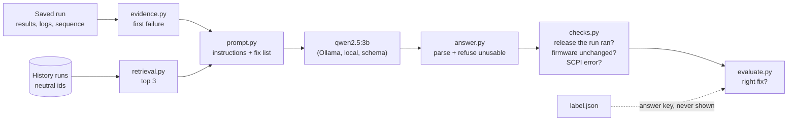

# Triage: retrieval against the no-retrieval baseline

Model: `qwen2.5:3b`, temperature 0, fixed seed, replies constrained to the answer's JSON schema. Scored on whether the model named the fix that resolves each failure: 27 questions, 3 for each of 9 faults. A fault is solved when every one of its questions is right, and the interval is over faults, because a fault's questions are answered alike (see Findings). ✓ right, ? UNKNOWN, ✗ a confident wrong action, ! unusable reply.

| Scenario | Adds | Faults solved | 95% interval | Questions right | UNKNOWN | Wrong | Malformed |
|---|---|---|---|---|---|---|---|
| error only |  | 3 of 9 | 1 to 6 | 9 of 27 | 0 | 18 | 0 |
| full evidence | to error only | 4 of 9 | 2 to 7 | 13 of 27 | 0 | 14 | 0 |
| full + retrieval | to full evidence | 5 of 9 | 2 to 7 | 15 of 27 | 0 | 9 | 3 |
| full + retrieval + checks | to full + retrieval | 5 of 9 | 2 to 7 | 15 of 27 | 6 | 3 | 3 |
| full + retrieval + checks, own fault held out | to full + retrieval + checks | 3 of 9 | 1 to 6 | 12 of 27 | 5 | 10 | 0 |

## By fault

Questions right, of those asked, for each fault.

| Fault | Expected | error only | full evidence | full + retrieval | full + retrieval + checks | full + retrieval + checks, own fault held out |
|---|---|---|---|---|---|---|
| cable_loss | CABLE | 0/3 | 3/3 | 3/3 | 3/3 | 0/3 |
| config_decimal_error | CONFIGURATION | 0/3 | 0/3 | 0/3 | 0/3 | 1/3 |
| config_parameter_missing | CONFIGURATION | 3/3 | 3/3 | 3/3 | 3/3 | 3/3 |
| config_parameter_out_of_range | CONFIGURATION | 0/3 | 0/3 | 3/3 | 3/3 | 3/3 |
| link_down | LINK | 0/3 | 0/3 | 0/3 | 0/3 | 3/3 |
| link_flaky | LINK | 0/3 | 1/3 | 3/3 | 3/3 | 2/3 |
| output_command_change | FIRMWARE | 0/3 | 3/3 | 3/3 | 3/3 | 0/3 |
| reset_leaks_offset | FIRMWARE | 3/3 | 3/3 | 0/3 | 0/3 | 0/3 |
| slow_responses | TIMEOUT | 3/3 | 0/3 | 0/3 | 0/3 | 0/3 |

## error only: 3 of 9 faults solved (95% interval 1 to 6); 9 of 27 questions right; 0 UNKNOWN, 18 wrong, 0 malformed

| Question | Expected | Chosen | | Error shown → the model's answer |
|---|---|---|---|---|
| cable_loss-1 | CABLE | FIRMWARE | ✗ | `Failed: path_loss_100mhz: 1.8898817412 dB, limit 0 to 0.974341649025 dB, margin -0.91554...` -> FIRMWARE (instrument's firmware) because The path loss values exceed the specified limits, indicating potential firmware issues. |
| cable_loss-2 | CABLE | FIRMWARE | ✗ | `Failed: path_loss_100mhz: 1.3898817412 dB, limit 0 to 0.974341649025 dB, margin -0.41554...` -> FIRMWARE (instrument's firmware) because The path loss measurements exceed the specified limits, indicating potential firmware... |
| cable_loss-3 | CABLE | FIRMWARE | ✗ | `Failed: path_loss_100mhz: 2.8898817412 dB, limit 0 to 0.974341649025 dB, margin -1.91554...` -> FIRMWARE (instrument's firmware) because The path loss values exceed the specified limits, indicating potential firmware issues. |
| config_decimal_error-1 | CONFIGURATION | FIRMWARE | ✗ | `AssertionError: the generator carries a level offset of 0 dB, but the bench configuration...` -> FIRMWARE (test code and its configuration) because The test code's configuration for the generator level offset is incorrect. |
| config_decimal_error-2 | CONFIGURATION | FIRMWARE | ✗ | `AssertionError: the generator carries a level offset of 0 dB, but the bench configuration...` -> FIRMWARE (test code and its configuration) because The test code's configuration for the generator level offset is incorrect. |
| config_decimal_error-3 | CONFIGURATION | FIRMWARE | ✗ | `AssertionError: the generator carries a level offset of 0 dB, but the bench configuration...` -> FIRMWARE (test code and its configuration) because The test code's configuration for the generator level offset is incorrect. |
| config_parameter_missing-1 | CONFIGURATION | CONFIGURATION | ✓ | `ConfigurationError: BENCH_LEVEL_OFFSET_DB is not set in the bench configuration` -> CONFIGURATION (bench configuration) because ConfigurationError: BENCH_LEVEL_OFFSET_DB is not set in the bench configuration |
| config_parameter_missing-2 | CONFIGURATION | CONFIGURATION | ✓ | `ConfigurationError: BENCH_LEVEL_OFFSET_DB is not set in the bench configuration` -> CONFIGURATION (bench configuration) because ConfigurationError: BENCH_LEVEL_OFFSET_DB is not set in the bench configuration |
| config_parameter_missing-3 | CONFIGURATION | CONFIGURATION | ✓ | `ConfigurationError: BENCH_LEVEL_OFFSET_DB is not set in the bench configuration` -> CONFIGURATION (bench configuration) because ConfigurationError: BENCH_LEVEL_OFFSET_DB is not set in the bench configuration |
| config_parameter_out_of_range-1 | CONFIGURATION | FIRMWARE | ✗ | `ConfigurationError: BENCH_LEVEL_OFFSET_DB=80 is outside the instrument's range of -50 to...` -> FIRMWARE (test code and its configuration) because ConfigurationError suggests a firmware regression due to an out-of-range... |
| config_parameter_out_of_range-2 | CONFIGURATION | FIRMWARE | ✗ | `ConfigurationError: BENCH_LEVEL_OFFSET_DB=80 is outside the instrument's range of -50 to...` -> FIRMWARE (test code and its configuration) because ConfigurationError suggests a firmware regression due to an out-of-range... |
| config_parameter_out_of_range-3 | CONFIGURATION | FIRMWARE | ✗ | `ConfigurationError: BENCH_LEVEL_OFFSET_DB=80 is outside the instrument's range of -50 to...` -> FIRMWARE (test code and its configuration) because ConfigurationError suggests a firmware regression due to an out-of-range... |
| link_down-1 | LINK | FIRMWARE | ✗ | `Failed: path_loss_100mhz: 109.243158555 dB, limit 0 to 0.974341649025 dB, margin -108.269...` -> FIRMWARE (instrument's firmware) because The path loss values are far outside the specified limits, indicating potential firmware... |
| link_down-2 | LINK | FIRMWARE | ✗ | `Failed: path_loss_100mhz: 109.243158555 dB, limit 0 to 0.974341649025 dB, margin -108.269...` -> FIRMWARE (instrument's firmware) because The path loss values are far outside the specified limits, indicating potential firmware... |
| link_down-3 | LINK | FIRMWARE | ✗ | `Failed: path_loss_100mhz: 109.243158555 dB, limit 0 to 0.974341649025 dB, margin -108.269...` -> FIRMWARE (instrument's firmware) because The path loss values are far outside the specified limits, indicating potential firmware... |
| link_flaky-1 | LINK | FIRMWARE | ✗ | `Failed: path_loss_1000mhz: 110.881881396 dB, limit 1 to 2 dB, margin -108.882 dB, FAIL` -> FIRMWARE (instrument's firmware) because The instrument's firmware regression is indicated by the failed RF test run. |
| link_flaky-2 | LINK | FIRMWARE | ✗ | `Failed: path_loss_1000mhz: 110.881881396 dB, limit 1 to 2 dB, margin -108.882 dB, FAIL` -> FIRMWARE (instrument's firmware) because The instrument's firmware regression is indicated by the failed RF test run. |
| link_flaky-3 | LINK | FIRMWARE | ✗ | `Failed: path_loss_5000mhz: 110.132770235 dB, limit 2.85410196625 to 3.85410196625 dB,...` -> FIRMWARE (instrument's firmware) because The signal margin is far below the acceptable limit, indicating a potential firmware... |
| output_command_change-1 | FIRMWARE | TIMEOUT | ✗ | `drivers.session.InstrumentTimeoutError: TCPIP::127.0.0.1::5025::SOCKET: no reply to...` -> TIMEOUT (Instrument response time) because The instrument errors indicate a VISA Timeout error, suggesting the session timeout... |
| output_command_change-2 | FIRMWARE | TIMEOUT | ✗ | `drivers.session.InstrumentTimeoutError: TCPIP::127.0.0.1::5025::SOCKET: no reply to...` -> TIMEOUT (Instrument response time) because The instrument errors indicate a VISA Timeout error, suggesting the session timeout... |
| output_command_change-3 | FIRMWARE | TIMEOUT | ✗ | `drivers.session.InstrumentTimeoutError: TCPIP::127.0.0.1::5025::SOCKET: no reply to...` -> TIMEOUT (Instrument response time) because The instrument errors indicate a VISA Timeout error, suggesting the session timeout... |
| reset_leaks_offset-1 | FIRMWARE | FIRMWARE | ✓ | `AssertionError: the generator carries a level offset of -2 dB, but the bench...` -> FIRMWARE (test code and its configuration) because The test code's configuration for the generator level is incorrect, expecting... |
| reset_leaks_offset-2 | FIRMWARE | FIRMWARE | ✓ | `AssertionError: the generator carries a level offset of -2 dB, but the bench...` -> FIRMWARE (test code and its configuration) because The test code's configuration for the generator level is incorrect, expecting... |
| reset_leaks_offset-3 | FIRMWARE | FIRMWARE | ✓ | `AssertionError: the generator carries a level offset of -2 dB, but the bench...` -> FIRMWARE (test code and its configuration) because The test code's configuration for the generator level is incorrect, expecting... |
| slow_responses-1 | TIMEOUT | TIMEOUT | ✓ | `drivers.session.InstrumentTimeoutError: TCPIP::127.0.0.1::5025::SOCKET: no reply within...` -> TIMEOUT (session timeout) because received an InstrumentTimeoutError indicating a session timeout while opening a session |
| slow_responses-2 | TIMEOUT | TIMEOUT | ✓ | `drivers.session.InstrumentTimeoutError: TCPIP::127.0.0.1::5025::SOCKET: no reply within...` -> TIMEOUT (session timeout) because received an InstrumentTimeoutError indicating a session timeout while opening a session |
| slow_responses-3 | TIMEOUT | TIMEOUT | ✓ | `drivers.session.InstrumentTimeoutError: TCPIP::127.0.0.1::5025::SOCKET: no reply within...` -> TIMEOUT (session timeout) because received an InstrumentTimeoutError indicating a session timeout while opening a session |

Confident wrong choices: FIRMWARE x15, TIMEOUT x3.

## full evidence: 4 of 9 faults solved (95% interval 2 to 7); 13 of 27 questions right; 0 UNKNOWN, 14 wrong, 0 malformed

| Question | Expected | Chosen | | Error shown → the model's answer |
|---|---|---|---|---|
| cable_loss-1 | CABLE | CABLE | ✓ | `Failed: path_loss_100mhz: 1.8898817412 dB, limit 0 to 0.974341649025 dB, margin -0.91554...` -> CABLE (cable and connectors) because The test path loss calibration does not match the cable datasheet, indicating potential... |
| cable_loss-2 | CABLE | CABLE | ✓ | `Failed: path_loss_100mhz: 1.3898817412 dB, limit 0 to 0.974341649025 dB, margin -0.41554...` -> CABLE (cable and connectors) because The test path loss calibration does not match the cable datasheet, indicating potential... |
| cable_loss-3 | CABLE | CABLE | ✓ | `Failed: path_loss_100mhz: 2.8898817412 dB, limit 0 to 0.974341649025 dB, margin -1.91554...` -> CABLE (cable and connectors) because The test path loss calibration does not match the cable datasheet, indicating potential... |
| config_decimal_error-1 | CONFIGURATION | FIRMWARE | ✗ | `AssertionError: the generator carries a level offset of 0 dB, but the bench configuration...` -> FIRMWARE (generator firmware) because The generator's firmware is at version 0.1.0, which is unchanged since the last passing... |
| config_decimal_error-2 | CONFIGURATION | FIRMWARE | ✗ | `AssertionError: the generator carries a level offset of 0 dB, but the bench configuration...` -> FIRMWARE (generator firmware) because The generator's firmware is at version 0.1.0, which is unchanged since the last passing... |
| config_decimal_error-3 | CONFIGURATION | FIRMWARE | ✗ | `AssertionError: the generator carries a level offset of 0 dB, but the bench configuration...` -> FIRMWARE (generator firmware) because The generator's firmware is at version 0.1.0, which is unchanged since the last passing... |
| config_parameter_missing-1 | CONFIGURATION | CONFIGURATION | ✓ | `ConfigurationError: BENCH_LEVEL_OFFSET_DB is not set in the bench configuration` -> CONFIGURATION (bench configuration) because ConfigurationError: BENCH_LEVEL_OFFSET_DB is not set in the bench configuration |
| config_parameter_missing-2 | CONFIGURATION | CONFIGURATION | ✓ | `ConfigurationError: BENCH_LEVEL_OFFSET_DB is not set in the bench configuration` -> CONFIGURATION (bench configuration) because ConfigurationError: BENCH_LEVEL_OFFSET_DB is not set in the bench configuration |
| config_parameter_missing-3 | CONFIGURATION | CONFIGURATION | ✓ | `ConfigurationError: BENCH_LEVEL_OFFSET_DB is not set in the bench configuration` -> CONFIGURATION (bench configuration) because ConfigurationError: BENCH_LEVEL_OFFSET_DB is not set in the bench configuration |
| config_parameter_out_of_range-1 | CONFIGURATION | FIRMWARE | ✗ | `ConfigurationError: BENCH_LEVEL_OFFSET_DB=80 is outside the instrument's range of -50 to...` -> FIRMWARE (previous release) because The firmware version has not changed since the last passing run, and the configuration error... |
| config_parameter_out_of_range-2 | CONFIGURATION | FIRMWARE | ✗ | `ConfigurationError: BENCH_LEVEL_OFFSET_DB=80 is outside the instrument's range of -50 to...` -> FIRMWARE (previous release) because The firmware version has not changed since the last passing run, and the configuration error... |
| config_parameter_out_of_range-3 | CONFIGURATION | FIRMWARE | ✗ | `ConfigurationError: BENCH_LEVEL_OFFSET_DB=80 is outside the instrument's range of -50 to...` -> FIRMWARE (previous release) because The firmware version has not changed since the last passing run, and the configuration error... |
| link_down-1 | LINK | CABLE | ✗ | `Failed: path_loss_100mhz: 109.243158555 dB, limit 0 to 0.974341649025 dB, margin -108.269...` -> CABLE (cable) because The test_path_loss_calibration_matches_the_cable_datasheet test failed due to path_loss values exceeding... |
| link_down-2 | LINK | CABLE | ✗ | `Failed: path_loss_100mhz: 109.243158555 dB, limit 0 to 0.974341649025 dB, margin -108.269...` -> CABLE (cable) because The test_path_loss_calibration_matches_the_cable_datasheet test failed due to path_loss values exceeding... |
| link_down-3 | LINK | CABLE | ✗ | `Failed: path_loss_100mhz: 109.243158555 dB, limit 0 to 0.974341649025 dB, margin -108.269...` -> CABLE (cable) because The test_path_loss_calibration_matches_the_cable_datasheet test failed due to path_loss values exceeding... |
| link_flaky-1 | LINK | CABLE | ✗ | `Failed: path_loss_1000mhz: 110.881881396 dB, limit 1 to 2 dB, margin -108.882 dB, FAIL` -> CABLE (cable and connectors) because No signal or intermittent signal; the path is open, and the instrument logs indicate no... |
| link_flaky-2 | LINK | CABLE | ✗ | `Failed: path_loss_1000mhz: 110.881881396 dB, limit 1 to 2 dB, margin -108.882 dB, FAIL` -> CABLE (signal generator and spectrum analyzer cables) because The instrument logs indicate no signal reaching the analyzer,... |
| link_flaky-3 | LINK | LINK | ✓ | `Failed: path_loss_5000mhz: 110.132770235 dB, limit 2.85410196625 to 3.85410196625 dB,...` -> LINK (the path between the instruments) because Multiple warnings indicate no signal reaching the analyzer, suggesting the path... |
| output_command_change-1 | FIRMWARE | FIRMWARE | ✓ | `drivers.session.InstrumentTimeoutError: TCPIP::127.0.0.1::5025::SOCKET: no reply to...` -> FIRMWARE (instrument firmware) because The instrument logs show command rejection errors and data out of range issues, indicating... |
| output_command_change-2 | FIRMWARE | FIRMWARE | ✓ | `drivers.session.InstrumentTimeoutError: TCPIP::127.0.0.1::5025::SOCKET: no reply to...` -> FIRMWARE (instrument firmware) because The test failures are attributed to the instrument firmware, specifically the 'Undefined... |
| output_command_change-3 | FIRMWARE | FIRMWARE | ✓ | `drivers.session.InstrumentTimeoutError: TCPIP::127.0.0.1::5025::SOCKET: no reply to...` -> FIRMWARE (instrument firmware) because The test failures are attributed to the instrument firmware, specifically the 'Undefined... |
| reset_leaks_offset-1 | FIRMWARE | FIRMWARE | ✓ | `AssertionError: the generator carries a level offset of -2 dB, but the bench...` -> FIRMWARE (generator firmware) because The generator's firmware is different from the last passing run, which may have introduced... |
| reset_leaks_offset-2 | FIRMWARE | FIRMWARE | ✓ | `AssertionError: the generator carries a level offset of -2 dB, but the bench...` -> FIRMWARE (generator firmware) because The generator's firmware is different from the last passing run, which may have introduced... |
| reset_leaks_offset-3 | FIRMWARE | FIRMWARE | ✓ | `AssertionError: the generator carries a level offset of -2 dB, but the bench...` -> FIRMWARE (generator firmware) because The generator's firmware is different from the last passing run, which may have introduced... |
| slow_responses-1 | TIMEOUT | FIRMWARE | ✗ | `drivers.session.InstrumentTimeoutError: TCPIP::127.0.0.1::5025::SOCKET: no reply within...` -> FIRMWARE (analyzer and generator firmware) because Firmware version 0.1.0 has been unchanged since the last passing run and the... |
| slow_responses-2 | TIMEOUT | FIRMWARE | ✗ | `drivers.session.InstrumentTimeoutError: TCPIP::127.0.0.1::5025::SOCKET: no reply within...` -> FIRMWARE (analyzer and generator firmware) because Firmware version 0.1.0 has been unchanged since the last passing run and the... |
| slow_responses-3 | TIMEOUT | FIRMWARE | ✗ | `drivers.session.InstrumentTimeoutError: TCPIP::127.0.0.1::5025::SOCKET: no reply within...` -> FIRMWARE (analyzer and generator firmware) because Firmware version 0.1.0 has been unchanged since the last passing run and the... |

Confident wrong choices: FIRMWARE x9, CABLE x5.

## full + retrieval: 5 of 9 faults solved (95% interval 2 to 7); 15 of 27 questions right; 0 UNKNOWN, 9 wrong, 3 malformed

| Question | Expected | Chosen | | Precedent offered | Error shown → the model's answer |
|---|---|---|---|---|---|
| cable_loss-1 | CABLE | CABLE | ✓ | yes | `Failed: path_loss_100mhz: 1.8898817412 dB, limit 0 to 0.974341649025 dB, margin -0.91554...` -> CABLE (cable) citing past-4942d6fc, past-281d3a52, past-fe4fbacd because Extra loss in the cable between generator and analyzer,... |
| cable_loss-2 | CABLE | CABLE | ✓ | yes | `Failed: path_loss_100mhz: 1.3898817412 dB, limit 0 to 0.974341649025 dB, margin -0.41554...` -> CABLE (cable) citing past-4942d6fc, past-281d3a52, past-fe4fbacd because Extra loss in the cable between generator and analyzer,... |
| cable_loss-3 | CABLE | CABLE | ✓ | yes | `Failed: path_loss_100mhz: 2.8898817412 dB, limit 0 to 0.974341649025 dB, margin -1.91554...` -> CABLE (cable) citing past-4942d6fc, past-281d3a52, past-fe4fbacd because Extra loss in the cable between generator and analyzer,... |
| config_decimal_error-1 | CONFIGURATION | FIRMWARE | ✗ | yes | `AssertionError: the generator carries a level offset of 0 dB, but the bench configuration...` -> FIRMWARE (previous release) citing past-dc4e498b because Release 0.2.0-rc2 no longer clears the level offset on *RST, so an... |
| config_decimal_error-2 | CONFIGURATION | FIRMWARE | ✗ | yes | `AssertionError: the generator carries a level offset of 0 dB, but the bench configuration...` -> FIRMWARE (previous release) citing past-dc4e498b because Release 0.2.0-rc2 no longer clears the level offset on *RST, so an... |
| config_decimal_error-3 | CONFIGURATION | FIRMWARE | ✗ | yes | `AssertionError: the generator carries a level offset of 0 dB, but the bench configuration...` -> FIRMWARE (previous release) citing past-dc4e498b because Release 0.2.0-rc2 no longer clears the level offset on *RST, so an... |
| config_parameter_missing-1 | CONFIGURATION | CONFIGURATION | ✓ | yes | `ConfigurationError: BENCH_LEVEL_OFFSET_DB is not set in the bench configuration` -> CONFIGURATION (bench configuration) citing past-63009060 because The bench configuration has an invalid level_offset_db value... |
| config_parameter_missing-2 | CONFIGURATION | CONFIGURATION | ✓ | yes | `ConfigurationError: BENCH_LEVEL_OFFSET_DB is not set in the bench configuration` -> CONFIGURATION (bench configuration) citing past-63009060 because The bench configuration has an invalid level_offset_db value... |
| config_parameter_missing-3 | CONFIGURATION | CONFIGURATION | ✓ | yes | `ConfigurationError: BENCH_LEVEL_OFFSET_DB is not set in the bench configuration` -> CONFIGURATION (bench configuration) citing past-63009060 because The bench configuration has an invalid level_offset_db value... |
| config_parameter_out_of_range-1 | CONFIGURATION | CONFIGURATION | ✓ | yes | `ConfigurationError: BENCH_LEVEL_OFFSET_DB=80 is outside the instrument's range of -50 to...` -> CONFIGURATION (bench configuration) citing past-6ecba48c, past-63009060, past-017c6886 because The bench configuration asks for... |
| config_parameter_out_of_range-2 | CONFIGURATION | CONFIGURATION | ✓ | yes | `ConfigurationError: BENCH_LEVEL_OFFSET_DB=80 is outside the instrument's range of -50 to...` -> CONFIGURATION (bench configuration) citing past-6ecba48c, past-63009060, past-017c6886 because The bench configuration asks for... |
| config_parameter_out_of_range-3 | CONFIGURATION | CONFIGURATION | ✓ | yes | `ConfigurationError: BENCH_LEVEL_OFFSET_DB=80 is outside the instrument's range of -50 to...` -> CONFIGURATION (bench configuration) citing past-6ecba48c, past-63009060, past-017c6886 because The bench configuration asks for... |
| link_down-1 | LINK | malformed | ! | yes | `Failed: path_loss_100mhz: 109.243158555 dB, limit 0 to 0.974341649025 dB, margin -108.269...` -> unusable: cites sources it wasn't given: ['First failure: test_path_loss_calibration_matches_the_cable_datasheet (found in... |
| link_down-2 | LINK | malformed | ! | yes | `Failed: path_loss_100mhz: 109.243158555 dB, limit 0 to 0.974341649025 dB, margin -108.269...` -> unusable: cites sources it wasn't given: ['First failure: test_path_loss_calibration_matches_the_cable_datasheet (found in... |
| link_down-3 | LINK | malformed | ! | yes | `Failed: path_loss_100mhz: 109.243158555 dB, limit 0 to 0.974341649025 dB, margin -108.269...` -> unusable: cites sources it wasn't given: ['First failure: test_path_loss_calibration_matches_the_cable_datasheet (found in... |
| link_flaky-1 | LINK | LINK | ✓ | yes | `Failed: path_loss_1000mhz: 110.881881396 dB, limit 1 to 2 dB, margin -108.882 dB, FAIL` -> LINK (the path between the instruments) citing past-00b97427, past-5beda183 because The instrument logs show multiple warnings... |
| link_flaky-2 | LINK | LINK | ✓ | yes | `Failed: path_loss_1000mhz: 110.881881396 dB, limit 1 to 2 dB, margin -108.882 dB, FAIL` -> LINK (the path between the instruments) citing past-00b97427, past-9f3f6bc4, past-5beda183 because The instrument logs show... |
| link_flaky-3 | LINK | LINK | ✓ | yes | `Failed: path_loss_5000mhz: 110.132770235 dB, limit 2.85410196625 to 3.85410196625 dB,...` -> LINK (the path between the instruments) citing past-00b97427, past-1de1f758 because No signal reaching the analyzer: nothing is... |
| output_command_change-1 | FIRMWARE | FIRMWARE | ✓ | yes | `drivers.session.InstrumentTimeoutError: TCPIP::127.0.0.1::5025::SOCKET: no reply to...` -> FIRMWARE (Firmware) citing past-61c2cd71 because The regression is due to the release 0.2.0-rc1 dropping the short form of the RF... |
| output_command_change-2 | FIRMWARE | FIRMWARE | ✓ | yes | `drivers.session.InstrumentTimeoutError: TCPIP::127.0.0.1::5025::SOCKET: no reply to...` -> FIRMWARE (Firmware) citing past-c831b3b6, past-bd06e3ce, past-61c2cd71 because The regression is due to the release 0.2.0-rc1... |
| output_command_change-3 | FIRMWARE | FIRMWARE | ✓ | yes | `drivers.session.InstrumentTimeoutError: TCPIP::127.0.0.1::5025::SOCKET: no reply to...` -> FIRMWARE (Firmware) citing past-c831b3b6, past-bd06e3ce, past-61c2cd71 because The regression in the RF output command OUTP ON... |
| reset_leaks_offset-1 | FIRMWARE | CONFIGURATION | ✗ | yes | `AssertionError: the generator carries a level offset of -2 dB, but the bench...` -> CONFIGURATION (bench configuration) citing past-472b3a26 because The bench configuration asks for a 15 dB level offset where 1.5... |
| reset_leaks_offset-2 | FIRMWARE | CONFIGURATION | ✗ | yes | `AssertionError: the generator carries a level offset of -2 dB, but the bench...` -> CONFIGURATION (bench configuration) citing past-472b3a26 because The bench configuration asks for a 15 dB level offset where 1.5... |
| reset_leaks_offset-3 | FIRMWARE | CONFIGURATION | ✗ | yes | `AssertionError: the generator carries a level offset of -2 dB, but the bench...` -> CONFIGURATION (bench configuration) citing past-472b3a26 because The bench configuration asks for a 15 dB level offset where 1.5... |
| slow_responses-1 | TIMEOUT | FIRMWARE | ✗ | yes | `drivers.session.InstrumentTimeoutError: TCPIP::127.0.0.1::5025::SOCKET: no reply within...` -> FIRMWARE (previous release) citing past-61c2cd71 because The release 0.2.0-rc1 dropped the short form of the RF output command,... |
| slow_responses-2 | TIMEOUT | FIRMWARE | ✗ | yes | `drivers.session.InstrumentTimeoutError: TCPIP::127.0.0.1::5025::SOCKET: no reply within...` -> FIRMWARE (previous release) citing past-61c2cd71 because The release 0.2.0-rc1 dropped the short form of the RF output command,... |
| slow_responses-3 | TIMEOUT | FIRMWARE | ✗ | yes | `drivers.session.InstrumentTimeoutError: TCPIP::127.0.0.1::5025::SOCKET: no reply within...` -> FIRMWARE (previous release) citing past-61c2cd71 because The release 0.2.0-rc1 dropped the short form of the RF output command,... |

Confident wrong choices: FIRMWARE x6, CONFIGURATION x3.

## full + retrieval + checks: 5 of 9 faults solved (95% interval 2 to 7); 15 of 27 questions right; 6 UNKNOWN, 3 wrong, 3 malformed

| Question | Expected | Chosen | | Precedent offered | Error shown → the model's answer |
|---|---|---|---|---|---|
| cable_loss-1 | CABLE | CABLE | ✓ | yes | `Failed: path_loss_100mhz: 1.8898817412 dB, limit 0 to 0.974341649025 dB, margin -0.91554...` -> CABLE (cable) citing past-4942d6fc, past-281d3a52, past-fe4fbacd because Extra loss in the cable between generator and analyzer,... |
| cable_loss-2 | CABLE | CABLE | ✓ | yes | `Failed: path_loss_100mhz: 1.3898817412 dB, limit 0 to 0.974341649025 dB, margin -0.41554...` -> CABLE (cable) citing past-4942d6fc, past-281d3a52, past-fe4fbacd because Extra loss in the cable between generator and analyzer,... |
| cable_loss-3 | CABLE | CABLE | ✓ | yes | `Failed: path_loss_100mhz: 2.8898817412 dB, limit 0 to 0.974341649025 dB, margin -1.91554...` -> CABLE (cable) citing past-4942d6fc, past-281d3a52, past-fe4fbacd because Extra loss in the cable between generator and analyzer,... |
| config_decimal_error-1 | CONFIGURATION | UNKNOWN | ? | yes | `AssertionError: the generator carries a level offset of 0 dB, but the bench configuration...` -> UNKNOWN (previous release) citing past-dc4e498b because Release 0.2.0-rc2 no longer clears the level offset on *RST, so an offset... |
| config_decimal_error-2 | CONFIGURATION | UNKNOWN | ? | yes | `AssertionError: the generator carries a level offset of 0 dB, but the bench configuration...` -> UNKNOWN (previous release) citing past-dc4e498b because Release 0.2.0-rc2 no longer clears the level offset on *RST, so an offset... |
| config_decimal_error-3 | CONFIGURATION | UNKNOWN | ? | yes | `AssertionError: the generator carries a level offset of 0 dB, but the bench configuration...` -> UNKNOWN (previous release) citing past-dc4e498b because Release 0.2.0-rc2 no longer clears the level offset on *RST, so an offset... |
| config_parameter_missing-1 | CONFIGURATION | CONFIGURATION | ✓ | yes | `ConfigurationError: BENCH_LEVEL_OFFSET_DB is not set in the bench configuration` -> CONFIGURATION (bench configuration) citing past-63009060 because The bench configuration has an invalid level_offset_db value... |
| config_parameter_missing-2 | CONFIGURATION | CONFIGURATION | ✓ | yes | `ConfigurationError: BENCH_LEVEL_OFFSET_DB is not set in the bench configuration` -> CONFIGURATION (bench configuration) citing past-63009060 because The bench configuration has an invalid level_offset_db value... |
| config_parameter_missing-3 | CONFIGURATION | CONFIGURATION | ✓ | yes | `ConfigurationError: BENCH_LEVEL_OFFSET_DB is not set in the bench configuration` -> CONFIGURATION (bench configuration) citing past-63009060 because The bench configuration has an invalid level_offset_db value... |
| config_parameter_out_of_range-1 | CONFIGURATION | CONFIGURATION | ✓ | yes | `ConfigurationError: BENCH_LEVEL_OFFSET_DB=80 is outside the instrument's range of -50 to...` -> CONFIGURATION (bench configuration) citing past-6ecba48c, past-63009060, past-017c6886 because The bench configuration asks for... |
| config_parameter_out_of_range-2 | CONFIGURATION | CONFIGURATION | ✓ | yes | `ConfigurationError: BENCH_LEVEL_OFFSET_DB=80 is outside the instrument's range of -50 to...` -> CONFIGURATION (bench configuration) citing past-6ecba48c, past-63009060, past-017c6886 because The bench configuration asks for... |
| config_parameter_out_of_range-3 | CONFIGURATION | CONFIGURATION | ✓ | yes | `ConfigurationError: BENCH_LEVEL_OFFSET_DB=80 is outside the instrument's range of -50 to...` -> CONFIGURATION (bench configuration) citing past-6ecba48c, past-63009060, past-017c6886 because The bench configuration asks for... |
| link_down-1 | LINK | malformed | ! | yes | `Failed: path_loss_100mhz: 109.243158555 dB, limit 0 to 0.974341649025 dB, margin -108.269...` -> unusable: cites sources it wasn't given: ['First failure: test_path_loss_calibration_matches_the_cable_datasheet (found in... |
| link_down-2 | LINK | malformed | ! | yes | `Failed: path_loss_100mhz: 109.243158555 dB, limit 0 to 0.974341649025 dB, margin -108.269...` -> unusable: cites sources it wasn't given: ['First failure: test_path_loss_calibration_matches_the_cable_datasheet (found in... |
| link_down-3 | LINK | malformed | ! | yes | `Failed: path_loss_100mhz: 109.243158555 dB, limit 0 to 0.974341649025 dB, margin -108.269...` -> unusable: cites sources it wasn't given: ['First failure: test_path_loss_calibration_matches_the_cable_datasheet (found in... |
| link_flaky-1 | LINK | LINK | ✓ | yes | `Failed: path_loss_1000mhz: 110.881881396 dB, limit 1 to 2 dB, margin -108.882 dB, FAIL` -> LINK (the path between the instruments) citing past-00b97427, past-5beda183 because The instrument logs show multiple warnings... |
| link_flaky-2 | LINK | LINK | ✓ | yes | `Failed: path_loss_1000mhz: 110.881881396 dB, limit 1 to 2 dB, margin -108.882 dB, FAIL` -> LINK (the path between the instruments) citing past-00b97427, past-9f3f6bc4, past-5beda183 because The instrument logs show... |
| link_flaky-3 | LINK | LINK | ✓ | yes | `Failed: path_loss_5000mhz: 110.132770235 dB, limit 2.85410196625 to 3.85410196625 dB,...` -> LINK (the path between the instruments) citing past-00b97427, past-1de1f758 because No signal reaching the analyzer: nothing is... |
| output_command_change-1 | FIRMWARE | FIRMWARE | ✓ | yes | `drivers.session.InstrumentTimeoutError: TCPIP::127.0.0.1::5025::SOCKET: no reply to...` -> FIRMWARE (Firmware) citing past-61c2cd71 because The regression is due to the release 0.2.0-rc1 dropping the short form of the RF... |
| output_command_change-2 | FIRMWARE | FIRMWARE | ✓ | yes | `drivers.session.InstrumentTimeoutError: TCPIP::127.0.0.1::5025::SOCKET: no reply to...` -> FIRMWARE (Firmware) citing past-c831b3b6, past-bd06e3ce, past-61c2cd71 because The regression is due to the release 0.2.0-rc1... |
| output_command_change-3 | FIRMWARE | FIRMWARE | ✓ | yes | `drivers.session.InstrumentTimeoutError: TCPIP::127.0.0.1::5025::SOCKET: no reply to...` -> FIRMWARE (Firmware) citing past-c831b3b6, past-bd06e3ce, past-61c2cd71 because The regression in the RF output command OUTP ON... |
| reset_leaks_offset-1 | FIRMWARE | CONFIGURATION | ✗ | yes | `AssertionError: the generator carries a level offset of -2 dB, but the bench...` -> CONFIGURATION (bench configuration) citing past-472b3a26 because The bench configuration asks for a 15 dB level offset where 1.5... |
| reset_leaks_offset-2 | FIRMWARE | CONFIGURATION | ✗ | yes | `AssertionError: the generator carries a level offset of -2 dB, but the bench...` -> CONFIGURATION (bench configuration) citing past-472b3a26 because The bench configuration asks for a 15 dB level offset where 1.5... |
| reset_leaks_offset-3 | FIRMWARE | CONFIGURATION | ✗ | yes | `AssertionError: the generator carries a level offset of -2 dB, but the bench...` -> CONFIGURATION (bench configuration) citing past-472b3a26 because The bench configuration asks for a 15 dB level offset where 1.5... |
| slow_responses-1 | TIMEOUT | UNKNOWN | ? | yes | `drivers.session.InstrumentTimeoutError: TCPIP::127.0.0.1::5025::SOCKET: no reply within...` -> UNKNOWN (previous release) citing past-61c2cd71 because The release 0.2.0-rc1 dropped the short form of the RF output command,... |
| slow_responses-2 | TIMEOUT | UNKNOWN | ? | yes | `drivers.session.InstrumentTimeoutError: TCPIP::127.0.0.1::5025::SOCKET: no reply within...` -> UNKNOWN (previous release) citing past-61c2cd71 because The release 0.2.0-rc1 dropped the short form of the RF output command,... |
| slow_responses-3 | TIMEOUT | UNKNOWN | ? | yes | `drivers.session.InstrumentTimeoutError: TCPIP::127.0.0.1::5025::SOCKET: no reply within...` -> UNKNOWN (previous release) citing past-61c2cd71 because The release 0.2.0-rc1 dropped the short form of the RF output command,... |

Confident wrong choices: CONFIGURATION x3.

## full + retrieval + checks, own fault held out: 3 of 9 faults solved (95% interval 1 to 6); 12 of 27 questions right; 5 UNKNOWN, 10 wrong, 0 malformed

| Question | Expected | Chosen | | Precedent offered | Error shown → the model's answer |
|---|---|---|---|---|---|
| cable_loss-1 | CABLE | LINK | ✗ | no | `Failed: path_loss_100mhz: 1.8898817412 dB, limit 0 to 0.974341649025 dB, margin -0.91554...` -> LINK (cable and connectors) citing past-1de1f758, past-00b97427, past-af55a23b because No signal or intermittent signal; the path... |
| cable_loss-2 | CABLE | LINK | ✗ | no | `Failed: path_loss_100mhz: 1.3898817412 dB, limit 0 to 0.974341649025 dB, margin -0.41554...` -> LINK (cable and connectors) citing past-1de1f758, past-00b97427 because No signal or intermittent signal; the path is open |
| cable_loss-3 | CABLE | LINK | ✗ | no | `Failed: path_loss_100mhz: 2.8898817412 dB, limit 0 to 0.974341649025 dB, margin -1.91554...` -> LINK (the path between the instruments) citing past-1de1f758, past-00b97427 because No signal reaching the analyzer: nothing is... |
| config_decimal_error-1 | CONFIGURATION | UNKNOWN | ? | no | `AssertionError: the generator carries a level offset of 0 dB, but the bench configuration...` -> UNKNOWN (Firmware) citing past-dc4e498b, past-711582e1 because The regression has been reported and fixed in the previous... |
| config_decimal_error-2 | CONFIGURATION | CONFIGURATION | ✓ | no | `AssertionError: the generator carries a level offset of 0 dB, but the bench configuration...` -> CONFIGURATION (bench configuration) citing past-6ecba48c because ConfigurationError: BENCH_LEVEL_OFFSET_DB=80 is outside the... |
| config_decimal_error-3 | CONFIGURATION | UNKNOWN | ? | no | `AssertionError: the generator carries a level offset of 0 dB, but the bench configuration...` -> UNKNOWN (Firmware) citing past-dc4e498b, past-711582e1 because The regression has been reported and fixed in the previous... |
| config_parameter_missing-1 | CONFIGURATION | CONFIGURATION | ✓ | no | `ConfigurationError: BENCH_LEVEL_OFFSET_DB is not set in the bench configuration` -> CONFIGURATION (bench configuration) citing past-472b3a26 because The bench configuration asks for a 15 dB level offset where 1.5... |
| config_parameter_missing-2 | CONFIGURATION | CONFIGURATION | ✓ | no | `ConfigurationError: BENCH_LEVEL_OFFSET_DB is not set in the bench configuration` -> CONFIGURATION (bench configuration) citing past-472b3a26 because The bench configuration asks for a 15 dB level offset where 1.5... |
| config_parameter_missing-3 | CONFIGURATION | CONFIGURATION | ✓ | no | `ConfigurationError: BENCH_LEVEL_OFFSET_DB is not set in the bench configuration` -> CONFIGURATION (bench configuration) citing past-472b3a26 because The bench configuration asks for a 15 dB level offset where 1.5... |
| config_parameter_out_of_range-1 | CONFIGURATION | CONFIGURATION | ✓ | no | `ConfigurationError: BENCH_LEVEL_OFFSET_DB=80 is outside the instrument's range of -50 to...` -> CONFIGURATION (bench configuration) citing past-472b3a26 because The bench configuration has a misaligned level_offset_db... |
| config_parameter_out_of_range-2 | CONFIGURATION | CONFIGURATION | ✓ | no | `ConfigurationError: BENCH_LEVEL_OFFSET_DB=80 is outside the instrument's range of -50 to...` -> CONFIGURATION (bench configuration) citing past-472b3a26 because The bench configuration has a misaligned level_offset_db... |
| config_parameter_out_of_range-3 | CONFIGURATION | CONFIGURATION | ✓ | no | `ConfigurationError: BENCH_LEVEL_OFFSET_DB=80 is outside the instrument's range of -50 to...` -> CONFIGURATION (bench configuration) citing past-017c6886, past-ae00851e, past-472b3a26 because The bench configuration has a... |
| link_down-1 | LINK | LINK | ✓ | no | `Failed: path_loss_100mhz: 109.243158555 dB, limit 0 to 0.974341649025 dB, margin -108.269...` -> LINK (signal path between instruments) citing past-9f3f6bc4, past-5beda183, past-00b97427 because No signal or intermittent... |
| link_down-2 | LINK | LINK | ✓ | no | `Failed: path_loss_100mhz: 109.243158555 dB, limit 0 to 0.974341649025 dB, margin -108.269...` -> LINK (signal path between instruments) citing past-9f3f6bc4, past-5beda183, past-00b97427 because No signal or intermittent... |
| link_down-3 | LINK | LINK | ✓ | no | `Failed: path_loss_100mhz: 109.243158555 dB, limit 0 to 0.974341649025 dB, margin -108.269...` -> LINK (signal path between instruments) citing past-9f3f6bc4, past-5beda183, past-00b97427 because No signal or intermittent... |
| link_flaky-1 | LINK | CABLE | ✗ | no | `Failed: path_loss_1000mhz: 110.881881396 dB, limit 1 to 2 dB, margin -108.882 dB, FAIL` -> CABLE (cable) citing past-4942d6fc because Extra loss in the cable between generator and analyzer, from a damaged cable |
| link_flaky-2 | LINK | LINK | ✓ | no | `Failed: path_loss_1000mhz: 110.881881396 dB, limit 1 to 2 dB, margin -108.882 dB, FAIL` -> LINK (between the instruments) citing past-af55a23b, past-8d73106e because nothing is connected |
| link_flaky-3 | LINK | LINK | ✓ | no | `Failed: path_loss_5000mhz: 110.132770235 dB, limit 2.85410196625 to 3.85410196625 dB,...` -> LINK (between the instruments) citing past-af55a23b, past-8d73106e because nothing is connected |
| output_command_change-1 | FIRMWARE | LINK | ✗ | no | `drivers.session.InstrumentTimeoutError: TCPIP::127.0.0.1::5025::SOCKET: no reply to...` -> LINK (the cable between the instruments) citing past-1de1f758 because No signal or intermittent signal; the path is open |
| output_command_change-2 | FIRMWARE | LINK | ✗ | no | `drivers.session.InstrumentTimeoutError: TCPIP::127.0.0.1::5025::SOCKET: no reply to...` -> LINK (the cable between the instruments) citing past-1de1f758 because No signal or intermittent signal; the path is open |
| output_command_change-3 | FIRMWARE | LINK | ✗ | no | `drivers.session.InstrumentTimeoutError: TCPIP::127.0.0.1::5025::SOCKET: no reply to...` -> LINK (the cable between the instruments) citing past-1de1f758 because No signal or intermittent signal; the path is open |
| reset_leaks_offset-1 | FIRMWARE | CONFIGURATION | ✗ | no | `AssertionError: the generator carries a level offset of -2 dB, but the bench...` -> CONFIGURATION (bench configuration) citing past-472b3a26, past-21e4fe6f, past-6ecba48c because The bench configuration asks for a... |
| reset_leaks_offset-2 | FIRMWARE | CONFIGURATION | ✗ | no | `AssertionError: the generator carries a level offset of -2 dB, but the bench...` -> CONFIGURATION (bench configuration) citing past-472b3a26, past-21e4fe6f, past-6ecba48c because The bench configuration asks for a... |
| reset_leaks_offset-3 | FIRMWARE | CONFIGURATION | ✗ | no | `AssertionError: the generator carries a level offset of -2 dB, but the bench...` -> CONFIGURATION (bench configuration) citing past-472b3a26, past-21e4fe6f, past-6ecba48c because The bench configuration asks for a... |
| slow_responses-1 | TIMEOUT | UNKNOWN | ? | no | `drivers.session.InstrumentTimeoutError: TCPIP::127.0.0.1::5025::SOCKET: no reply within...` -> UNKNOWN (release 0.2.0-rc1) citing past-c831b3b6 because Release 0.2.0-rc1 dropped the short form of the RF output command: OUTP... |
| slow_responses-2 | TIMEOUT | UNKNOWN | ? | no | `drivers.session.InstrumentTimeoutError: TCPIP::127.0.0.1::5025::SOCKET: no reply within...` -> UNKNOWN (release 0.2.0-rc1) citing past-c831b3b6 because Release 0.2.0-rc1 dropped the short form of the RF output command: OUTP... |
| slow_responses-3 | TIMEOUT | UNKNOWN | ? | no | `drivers.session.InstrumentTimeoutError: TCPIP::127.0.0.1::5025::SOCKET: no reply within...` -> UNKNOWN (release 0.2.0-rc1) citing past-c831b3b6 because Release 0.2.0-rc1 dropped the short form of the RF output command: OUTP... |

Confident wrong choices: LINK x6, CONFIGURATION x3, CABLE x1.

## Findings

- Best scenario: full + retrieval, 5 of 9 faults solved (95% interval 2 to 7); 15 of 27 questions right; 0 UNKNOWN, 9 wrong, 3 malformed.
- A fault's questions split (some right, some wrong) in 3 of 45 fault-and-scenario cells; otherwise they were answered alike, so the fault, not the question, is the unit the scores count.
- error only to full evidence raised faults solved by 1 (3 to 4 of 9); confident wrong answers went from 18 to 14 of 27.
- full evidence to full + retrieval raised faults solved by 1 (4 to 5 of 9); confident wrong answers went from 14 to 9 of 27.
- full + retrieval to full + retrieval + checks did not change the faults solved (5 to 5 of 9); confident wrong answers went from 9 to 3 of 27.
- full + retrieval + checks to full + retrieval + checks, own fault held out lowered faults solved by 2 (5 to 3 of 9); confident wrong answers went from 3 to 10 of 27.
- full + retrieval: retrieval offered a past run of the question's own fault for 27 of 27 questions.
- full + retrieval + checks: retrieval offered a past run of the question's own fault for 27 of 27 questions.
- full + retrieval + checks, own fault held out: with no past run of its own fault to go on, the model said UNKNOWN 5 times and named a wrong action 10 times, of 27.
- Most common confident wrong choice: FIRMWARE (30 times across the scenarios).
- Right in every question of every scenario: config_parameter_missing.

6 faults have no size to vary (config_decimal_error, config_parameter_missing, config_parameter_out_of_range, link_down, output_command_change, reset_leaks_offset), so their questions repeat their history runs' scenario and differ only in timing and reading noise (see triage/data/README.md). Of the 5 faults full + retrieval solved, 3 are among them: with retrieval, those show the model finding a near-identical past run, not generalising to a new one.

These are one machine's deterministic numbers (temperature 0, fixed seed); another machine's model may differ in wording and the odd verdict. A verdict whose reasoning is sound but whose action is wrong still counts as a miss.
