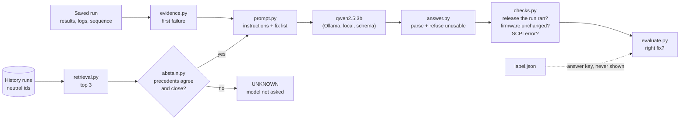

# Triage: retrieval against the no-retrieval baseline

Model: `qwen2.5:3b`, temperature 0, fixed seed, replies constrained to the answer's JSON schema. Scored on whether the model named the fix that resolves each failure: 27 questions, 3 for each of 9 faults. A fault is solved when every one of its questions is right, and the interval is over faults, because a fault's questions are answered alike (see Findings). ✓ right, ? UNKNOWN, ✗ a confident wrong action, ! unusable reply.

| Scenario | Adds | Faults solved | 95% interval | Questions right | UNKNOWN | Wrong | Malformed |
|---|---|---|---|---|---|---|---|
| error only |  | 3 of 9 | 1 to 6 | 9 of 27 | 0 | 18 | 0 |
| full evidence | to error only | 5 of 9 | 2 to 7 | 16 of 27 | 0 | 11 | 0 |
| full evidence, no firmware line | to full evidence | 4 of 9 | 2 to 7 | 13 of 27 | 0 | 14 | 0 |
| full + retrieval | to full evidence | 6 of 9 | 3 to 8 | 18 of 27 | 0 | 6 | 3 |
| full + retrieval + checks | to full + retrieval | 6 of 9 | 3 to 8 | 18 of 27 | 3 | 3 | 3 |
| full + retrieval + checks, own fault held out | to full + retrieval + checks | 4 of 9 | 2 to 7 | 13 of 27 | 3 | 11 | 0 |
| full + retrieval + checks + gates | to full + retrieval + checks | 5 of 9 | 2 to 7 | 15 of 27 | 9 | 0 | 3 |
| full + retrieval + checks + gates, own fault held out | to full + retrieval + checks, own fault held out | 1 of 9 | 0 to 4 | 4 of 27 | 20 | 3 | 0 |

## By fault

Questions right, of those asked, for each fault.

| Fault | Expected | error only | full evidence | full evidence, no firmware line | full + retrieval | full + retrieval + checks | full + retrieval + checks, own fault held out | full + retrieval + checks + gates | full + retrieval + checks + gates, own fault held out |
|---|---|---|---|---|---|---|---|---|---|
| cable_loss | CABLE | 0/3 | 3/3 | 3/3 | 3/3 | 3/3 | 0/3 | 3/3 | 0/3 |
| config_decimal_error | CONFIGURATION | 0/3 | 3/3 | 3/3 | 3/3 | 3/3 | 3/3 | 0/3 | 0/3 |
| config_parameter_missing | CONFIGURATION | 3/3 | 3/3 | 3/3 | 3/3 | 3/3 | 3/3 | 3/3 | 0/3 |
| config_parameter_out_of_range | CONFIGURATION | 0/3 | 0/3 | 0/3 | 3/3 | 3/3 | 3/3 | 3/3 | 0/3 |
| link_down | LINK | 0/3 | 0/3 | 0/3 | 0/3 | 0/3 | 3/3 | 0/3 | 3/3 |
| link_flaky | LINK | 0/3 | 1/3 | 1/3 | 3/3 | 3/3 | 1/3 | 3/3 | 1/3 |
| output_command_change | FIRMWARE | 0/3 | 3/3 | 3/3 | 3/3 | 3/3 | 0/3 | 3/3 | 0/3 |
| reset_leaks_offset | FIRMWARE | 3/3 | 3/3 | 0/3 | 0/3 | 0/3 | 0/3 | 0/3 | 0/3 |
| slow_responses | TIMEOUT | 3/3 | 0/3 | 0/3 | 0/3 | 0/3 | 0/3 | 0/3 | 0/3 |

## error only: 3 of 9 faults solved (95% interval 1 to 6); 9 of 27 questions right; 0 UNKNOWN, 18 wrong, 0 malformed

| Question | Expected | Chosen | | Error shown → the model's answer |
|---|---|---|---|---|
| cable_loss-1 | CABLE | FIRMWARE | ✗ | `Failed: path_loss_100mhz: 1.8898817412 dB, limit 0 to 0.974341649025 dB, margin -0.91554...` -> FIRMWARE (instrument's firmware) because The path loss values exceed the specified limits, indicating potential firmware issues. |
| cable_loss-2 | CABLE | FIRMWARE | ✗ | `Failed: path_loss_100mhz: 1.3898817412 dB, limit 0 to 0.974341649025 dB, margin -0.41554...` -> FIRMWARE (instrument's firmware) because The path loss measurements exceed the specified limits, indicating potential firmware... |
| cable_loss-3 | CABLE | FIRMWARE | ✗ | `Failed: path_loss_100mhz: 2.8898817412 dB, limit 0 to 0.974341649025 dB, margin -1.91554...` -> FIRMWARE (instrument's firmware) because The path loss values exceed the specified limits, indicating potential firmware issues. |
| config_decimal_error-1 | CONFIGURATION | FIRMWARE | ✗ | `AssertionError: the generator carries a level offset of 0 dB, but the bench configuration...` -> FIRMWARE (test code and its configuration) because The test code's configuration for the generator level offset is incorrect. |
| config_decimal_error-2 | CONFIGURATION | FIRMWARE | ✗ | `AssertionError: the generator carries a level offset of 0 dB, but the bench configuration...` -> FIRMWARE (test code and its configuration) because The test code's configuration for the generator level offset is incorrect. |
| config_decimal_error-3 | CONFIGURATION | FIRMWARE | ✗ | `AssertionError: the generator carries a level offset of 0 dB, but the bench configuration...` -> FIRMWARE (test code and its configuration) because The test code's configuration for the generator level offset is incorrect. |
| config_parameter_missing-1 | CONFIGURATION | CONFIGURATION | ✓ | `ConfigurationError: BENCH_LEVEL_OFFSET_DB is not set in the bench configuration` -> CONFIGURATION (bench configuration) because ConfigurationError: BENCH_LEVEL_OFFSET_DB is not set in the bench configuration |
| config_parameter_missing-2 | CONFIGURATION | CONFIGURATION | ✓ | `ConfigurationError: BENCH_LEVEL_OFFSET_DB is not set in the bench configuration` -> CONFIGURATION (bench configuration) because ConfigurationError: BENCH_LEVEL_OFFSET_DB is not set in the bench configuration |
| config_parameter_missing-3 | CONFIGURATION | CONFIGURATION | ✓ | `ConfigurationError: BENCH_LEVEL_OFFSET_DB is not set in the bench configuration` -> CONFIGURATION (bench configuration) because ConfigurationError: BENCH_LEVEL_OFFSET_DB is not set in the bench configuration |
| config_parameter_out_of_range-1 | CONFIGURATION | FIRMWARE | ✗ | `ConfigurationError: BENCH_LEVEL_OFFSET_DB=80 is outside the instrument's range of -50 to...` -> FIRMWARE (test code and its configuration) because ConfigurationError suggests a firmware regression due to an out-of-range... |
| config_parameter_out_of_range-2 | CONFIGURATION | FIRMWARE | ✗ | `ConfigurationError: BENCH_LEVEL_OFFSET_DB=80 is outside the instrument's range of -50 to...` -> FIRMWARE (test code and its configuration) because ConfigurationError suggests a firmware regression due to an out-of-range... |
| config_parameter_out_of_range-3 | CONFIGURATION | FIRMWARE | ✗ | `ConfigurationError: BENCH_LEVEL_OFFSET_DB=80 is outside the instrument's range of -50 to...` -> FIRMWARE (test code and its configuration) because ConfigurationError suggests a firmware regression due to an out-of-range... |
| link_down-1 | LINK | FIRMWARE | ✗ | `Failed: path_loss_100mhz: 109.243158555 dB, limit 0 to 0.974341649025 dB, margin -108.269...` -> FIRMWARE (instrument's firmware) because The path loss values are far outside the specified limits, indicating potential firmware... |
| link_down-2 | LINK | FIRMWARE | ✗ | `Failed: path_loss_100mhz: 109.243158555 dB, limit 0 to 0.974341649025 dB, margin -108.269...` -> FIRMWARE (instrument's firmware) because The path loss values are far outside the specified limits, indicating potential firmware... |
| link_down-3 | LINK | FIRMWARE | ✗ | `Failed: path_loss_100mhz: 109.243158555 dB, limit 0 to 0.974341649025 dB, margin -108.269...` -> FIRMWARE (instrument's firmware) because The path loss values are far outside the specified limits, indicating potential firmware... |
| link_flaky-1 | LINK | FIRMWARE | ✗ | `Failed: path_loss_1000mhz: 110.881881396 dB, limit 1 to 2 dB, margin -108.882 dB, FAIL` -> FIRMWARE (instrument's firmware) because The instrument's firmware regression is indicated by the failed RF test run. |
| link_flaky-2 | LINK | FIRMWARE | ✗ | `Failed: path_loss_1000mhz: 110.881881396 dB, limit 1 to 2 dB, margin -108.882 dB, FAIL` -> FIRMWARE (instrument's firmware) because The instrument's firmware regression is indicated by the failed RF test run. |
| link_flaky-3 | LINK | FIRMWARE | ✗ | `Failed: path_loss_5000mhz: 110.132770235 dB, limit 2.85410196625 to 3.85410196625 dB,...` -> FIRMWARE (instrument's firmware) because The signal margin is far below the acceptable limit, indicating a potential firmware... |
| output_command_change-1 | FIRMWARE | TIMEOUT | ✗ | `drivers.session.InstrumentTimeoutError: TCPIP::127.0.0.1::5025::SOCKET: no reply to...` -> TIMEOUT (Instrument response time) because The instrument errors indicate a VISA Timeout error, suggesting the session timeout... |
| output_command_change-2 | FIRMWARE | TIMEOUT | ✗ | `drivers.session.InstrumentTimeoutError: TCPIP::127.0.0.1::5025::SOCKET: no reply to...` -> TIMEOUT (Instrument response time) because The instrument errors indicate a VISA Timeout error, suggesting the session timeout... |
| output_command_change-3 | FIRMWARE | TIMEOUT | ✗ | `drivers.session.InstrumentTimeoutError: TCPIP::127.0.0.1::5025::SOCKET: no reply to...` -> TIMEOUT (Instrument response time) because The instrument errors indicate a VISA Timeout error, suggesting the session timeout... |
| reset_leaks_offset-1 | FIRMWARE | FIRMWARE | ✓ | `AssertionError: the generator carries a level offset of -2 dB, but the bench...` -> FIRMWARE (test code and its configuration) because The test code's configuration for the generator level is incorrect, expecting... |
| reset_leaks_offset-2 | FIRMWARE | FIRMWARE | ✓ | `AssertionError: the generator carries a level offset of -2 dB, but the bench...` -> FIRMWARE (test code and its configuration) because The test code's configuration for the generator level is incorrect, expecting... |
| reset_leaks_offset-3 | FIRMWARE | FIRMWARE | ✓ | `AssertionError: the generator carries a level offset of -2 dB, but the bench...` -> FIRMWARE (test code and its configuration) because The test code's configuration for the generator level is incorrect, expecting... |
| slow_responses-1 | TIMEOUT | TIMEOUT | ✓ | `drivers.session.InstrumentTimeoutError: TCPIP::127.0.0.1::5025::SOCKET: no reply within...` -> TIMEOUT (session timeout) because received an InstrumentTimeoutError indicating a session timeout while opening a session |
| slow_responses-2 | TIMEOUT | TIMEOUT | ✓ | `drivers.session.InstrumentTimeoutError: TCPIP::127.0.0.1::5025::SOCKET: no reply within...` -> TIMEOUT (session timeout) because received an InstrumentTimeoutError indicating a session timeout while opening a session |
| slow_responses-3 | TIMEOUT | TIMEOUT | ✓ | `drivers.session.InstrumentTimeoutError: TCPIP::127.0.0.1::5025::SOCKET: no reply within...` -> TIMEOUT (session timeout) because received an InstrumentTimeoutError indicating a session timeout while opening a session |

Confident wrong choices: FIRMWARE x15, TIMEOUT x3.

## full evidence: 5 of 9 faults solved (95% interval 2 to 7); 16 of 27 questions right; 0 UNKNOWN, 11 wrong, 0 malformed

| Question | Expected | Chosen | | Error shown → the model's answer |
|---|---|---|---|---|
| cable_loss-1 | CABLE | CABLE | ✓ | `Failed: path_loss_100mhz: 1.8898817412 dB, limit 0 to 0.974341649025 dB, margin -0.91554...` -> CABLE (cable and connectors) because The test results indicate that the path loss calibration does not match the cable datasheet,... |
| cable_loss-2 | CABLE | CABLE | ✓ | `Failed: path_loss_100mhz: 1.3898817412 dB, limit 0 to 0.974341649025 dB, margin -0.41554...` -> CABLE (cable and connectors) because The test path loss calibration does not match the cable datasheet, indicating potential... |
| cable_loss-3 | CABLE | CABLE | ✓ | `Failed: path_loss_100mhz: 2.8898817412 dB, limit 0 to 0.974341649025 dB, margin -1.91554...` -> CABLE (cable and connectors) because The test results indicate that the path loss calibration does not match the cable datasheet,... |
| config_decimal_error-1 | CONFIGURATION | CONFIGURATION | ✓ | `AssertionError: the generator carries a level offset of 0 dB, but the bench configuration...` -> CONFIGURATION (bench configuration) because The generator's level offset is expected to be 15 dB, but the configuration indicates... |
| config_decimal_error-2 | CONFIGURATION | CONFIGURATION | ✓ | `AssertionError: the generator carries a level offset of 0 dB, but the bench configuration...` -> CONFIGURATION (bench configuration) because The generator's level offset is expected to be 15 dB, but the configuration indicates... |
| config_decimal_error-3 | CONFIGURATION | CONFIGURATION | ✓ | `AssertionError: the generator carries a level offset of 0 dB, but the bench configuration...` -> CONFIGURATION (bench configuration) because The generator's level offset is expected to be 15 dB, but the configuration indicates... |
| config_parameter_missing-1 | CONFIGURATION | CONFIGURATION | ✓ | `ConfigurationError: BENCH_LEVEL_OFFSET_DB is not set in the bench configuration` -> CONFIGURATION (bench configuration) because ConfigurationError: BENCH_LEVEL_OFFSET_DB is not set in the bench configuration |
| config_parameter_missing-2 | CONFIGURATION | CONFIGURATION | ✓ | `ConfigurationError: BENCH_LEVEL_OFFSET_DB is not set in the bench configuration` -> CONFIGURATION (bench configuration) because ConfigurationError: BENCH_LEVEL_OFFSET_DB is not set in the bench configuration |
| config_parameter_missing-3 | CONFIGURATION | CONFIGURATION | ✓ | `ConfigurationError: BENCH_LEVEL_OFFSET_DB is not set in the bench configuration` -> CONFIGURATION (bench configuration) because ConfigurationError: BENCH_LEVEL_OFFSET_DB is not set in the bench configuration |
| config_parameter_out_of_range-1 | CONFIGURATION | FIRMWARE | ✗ | `ConfigurationError: BENCH_LEVEL_OFFSET_DB=80 is outside the instrument's range of -50 to...` -> FIRMWARE (previous release) because The configuration error suggests a regression in the firmware of the instrument, which is the... |
| config_parameter_out_of_range-2 | CONFIGURATION | FIRMWARE | ✗ | `ConfigurationError: BENCH_LEVEL_OFFSET_DB=80 is outside the instrument's range of -50 to...` -> FIRMWARE (previous release) because The configuration error suggests a regression in the firmware of the instrument, which is the... |
| config_parameter_out_of_range-3 | CONFIGURATION | FIRMWARE | ✗ | `ConfigurationError: BENCH_LEVEL_OFFSET_DB=80 is outside the instrument's range of -50 to...` -> FIRMWARE (previous release) because The configuration error suggests a regression in the firmware of the instrument, which is the... |
| link_down-1 | LINK | CABLE | ✗ | `Failed: path_loss_100mhz: 109.243158555 dB, limit 0 to 0.974341649025 dB, margin -108.269...` -> CABLE (signal generator and spectrum analyzer) because The tests failed due to path_loss values exceeding the limits, indicating... |
| link_down-2 | LINK | CABLE | ✗ | `Failed: path_loss_100mhz: 109.243158555 dB, limit 0 to 0.974341649025 dB, margin -108.269...` -> CABLE (signal generator and spectrum analyzer) because The tests failed due to path_loss values exceeding the limits, indicating... |
| link_down-3 | LINK | CABLE | ✗ | `Failed: path_loss_100mhz: 109.243158555 dB, limit 0 to 0.974341649025 dB, margin -108.269...` -> CABLE (cable) because The tests failed due to path_loss values exceeding the limits, indicating no signal or a severely... |
| link_flaky-1 | LINK | CABLE | ✗ | `Failed: path_loss_1000mhz: 110.881881396 dB, limit 1 to 2 dB, margin -108.882 dB, FAIL` -> CABLE (cable and connectors) because The cable and connectors may be faulty or misaligned, causing intermittent signal issues and... |
| link_flaky-2 | LINK | CABLE | ✗ | `Failed: path_loss_1000mhz: 110.881881396 dB, limit 1 to 2 dB, margin -108.882 dB, FAIL` -> CABLE (cable and connectors) because The tests failed due to no signal reaching the analyzer, indicating the cable or connectors... |
| link_flaky-3 | LINK | LINK | ✓ | `Failed: path_loss_5000mhz: 110.132770235 dB, limit 2.85410196625 to 3.85410196625 dB,...` -> LINK (the path between the instruments) because No signal or intermittent signal issues found in instrument logs indicate the... |
| output_command_change-1 | FIRMWARE | FIRMWARE | ✓ | `drivers.session.InstrumentTimeoutError: TCPIP::127.0.0.1::5025::SOCKET: no reply to...` -> FIRMWARE (instrument firmware) because The instrument error is related to the firmware version, which has changed since the last... |
| output_command_change-2 | FIRMWARE | FIRMWARE | ✓ | `drivers.session.InstrumentTimeoutError: TCPIP::127.0.0.1::5025::SOCKET: no reply to...` -> FIRMWARE (instrument firmware) because The instrument error is related to the firmware version, which has changed since the last... |
| output_command_change-3 | FIRMWARE | FIRMWARE | ✓ | `drivers.session.InstrumentTimeoutError: TCPIP::127.0.0.1::5025::SOCKET: no reply to...` -> FIRMWARE (instrument firmware) because The instrument error is related to the firmware version, which has changed since the last... |
| reset_leaks_offset-1 | FIRMWARE | FIRMWARE | ✓ | `AssertionError: the generator carries a level offset of -2 dB, but the bench...` -> FIRMWARE (generator firmware) because The generator's firmware is different from the last passing run, which may have introduced... |
| reset_leaks_offset-2 | FIRMWARE | FIRMWARE | ✓ | `AssertionError: the generator carries a level offset of -2 dB, but the bench...` -> FIRMWARE (generator firmware) because The generator's firmware is different from the last passing run, which may have introduced... |
| reset_leaks_offset-3 | FIRMWARE | FIRMWARE | ✓ | `AssertionError: the generator carries a level offset of -2 dB, but the bench...` -> FIRMWARE (generator firmware) because The generator's firmware is different from the last passing run, which may have introduced... |
| slow_responses-1 | TIMEOUT | FIRMWARE | ✗ | `drivers.session.InstrumentTimeoutError: TCPIP::127.0.0.1::5025::SOCKET: no reply within...` -> FIRMWARE (previous release) because The test failures are due to an instrument timeout error, which could indicate a firmware... |
| slow_responses-2 | TIMEOUT | FIRMWARE | ✗ | `drivers.session.InstrumentTimeoutError: TCPIP::127.0.0.1::5025::SOCKET: no reply within...` -> FIRMWARE (previous release) because The test failures are due to an InstrumentTimeoutError, which could indicate a regression in... |
| slow_responses-3 | TIMEOUT | FIRMWARE | ✗ | `drivers.session.InstrumentTimeoutError: TCPIP::127.0.0.1::5025::SOCKET: no reply within...` -> FIRMWARE (previous release) because The test failures are due to an instrument timeout error, which could indicate a firmware... |

Confident wrong choices: FIRMWARE x6, CABLE x5.

## full evidence, no firmware line: 4 of 9 faults solved (95% interval 2 to 7); 13 of 27 questions right; 0 UNKNOWN, 14 wrong, 0 malformed

| Question | Expected | Chosen | | Error shown → the model's answer |
|---|---|---|---|---|
| cable_loss-1 | CABLE | CABLE | ✓ | `Failed: path_loss_100mhz: 1.8898817412 dB, limit 0 to 0.974341649025 dB, margin -0.91554...` -> CABLE (cable and connectors) because The test failed due to path_loss measurements exceeding the cable datasheet limits,... |
| cable_loss-2 | CABLE | CABLE | ✓ | `Failed: path_loss_100mhz: 1.3898817412 dB, limit 0 to 0.974341649025 dB, margin -0.41554...` -> CABLE (cable and connectors) because The test failed due to path_loss measurements exceeding the cable datasheet limits,... |
| cable_loss-3 | CABLE | CABLE | ✓ | `Failed: path_loss_100mhz: 2.8898817412 dB, limit 0 to 0.974341649025 dB, margin -1.91554...` -> CABLE (cable and connectors) because The test failed due to path_loss measurements exceeding the cable datasheet limits,... |
| config_decimal_error-1 | CONFIGURATION | CONFIGURATION | ✓ | `AssertionError: the generator carries a level offset of 0 dB, but the bench configuration...` -> CONFIGURATION (bench configuration) because The generator's level offset is expected to be 15 dB, but the configuration indicates... |
| config_decimal_error-2 | CONFIGURATION | CONFIGURATION | ✓ | `AssertionError: the generator carries a level offset of 0 dB, but the bench configuration...` -> CONFIGURATION (bench configuration) because The generator's level offset is expected to be 15 dB, but the configuration indicates... |
| config_decimal_error-3 | CONFIGURATION | CONFIGURATION | ✓ | `AssertionError: the generator carries a level offset of 0 dB, but the bench configuration...` -> CONFIGURATION (bench configuration) because The generator's level offset is expected to be 15 dB, but the configuration indicates... |
| config_parameter_missing-1 | CONFIGURATION | CONFIGURATION | ✓ | `ConfigurationError: BENCH_LEVEL_OFFSET_DB is not set in the bench configuration` -> CONFIGURATION (bench configuration) because ConfigurationError: BENCH_LEVEL_OFFSET_DB is not set in the bench configuration |
| config_parameter_missing-2 | CONFIGURATION | CONFIGURATION | ✓ | `ConfigurationError: BENCH_LEVEL_OFFSET_DB is not set in the bench configuration` -> CONFIGURATION (bench configuration) because ConfigurationError: BENCH_LEVEL_OFFSET_DB is not set in the bench configuration |
| config_parameter_missing-3 | CONFIGURATION | CONFIGURATION | ✓ | `ConfigurationError: BENCH_LEVEL_OFFSET_DB is not set in the bench configuration` -> CONFIGURATION (bench configuration) because ConfigurationError: BENCH_LEVEL_OFFSET_DB is not set in the bench configuration |
| config_parameter_out_of_range-1 | CONFIGURATION | FIRMWARE | ✗ | `ConfigurationError: BENCH_LEVEL_OFFSET_DB=80 is outside the instrument's range of -50 to...` -> FIRMWARE (test code and its configuration) because The configuration error suggests a regression in the firmware that limits the... |
| config_parameter_out_of_range-2 | CONFIGURATION | FIRMWARE | ✗ | `ConfigurationError: BENCH_LEVEL_OFFSET_DB=80 is outside the instrument's range of -50 to...` -> FIRMWARE (test code and its configuration) because The configuration error suggests a regression in the firmware that limits the... |
| config_parameter_out_of_range-3 | CONFIGURATION | FIRMWARE | ✗ | `ConfigurationError: BENCH_LEVEL_OFFSET_DB=80 is outside the instrument's range of -50 to...` -> FIRMWARE (test code and its configuration) because The configuration error suggests a regression in the firmware that limits the... |
| link_down-1 | LINK | CABLE | ✗ | `Failed: path_loss_100mhz: 109.243158555 dB, limit 0 to 0.974341649025 dB, margin -108.269...` -> CABLE (cable and connectors) because No signal or intermittent signal; the path is open, and the test... |
| link_down-2 | LINK | CABLE | ✗ | `Failed: path_loss_100mhz: 109.243158555 dB, limit 0 to 0.974341649025 dB, margin -108.269...` -> CABLE (signal generator and spectrum analyzer cables) because The tests failed due to path_loss values exceeding the limits,... |
| link_down-3 | LINK | CABLE | ✗ | `Failed: path_loss_100mhz: 109.243158555 dB, limit 0 to 0.974341649025 dB, margin -108.269...` -> CABLE (cable and connectors) because No signal or intermittent signal; the path is open, and the test... |
| link_flaky-1 | LINK | CABLE | ✗ | `Failed: path_loss_1000mhz: 110.881881396 dB, limit 1 to 2 dB, margin -108.882 dB, FAIL` -> CABLE (cable and connectors) because No signal or intermittent signal; the path is open, and the test failed due to path_loss... |
| link_flaky-2 | LINK | CABLE | ✗ | `Failed: path_loss_1000mhz: 110.881881396 dB, limit 1 to 2 dB, margin -108.882 dB, FAIL` -> CABLE (signal generator and spectrum analyzer cables) because The tests failed due to signal loss or attenuation, indicated by... |
| link_flaky-3 | LINK | LINK | ✓ | `Failed: path_loss_5000mhz: 110.132770235 dB, limit 2.85410196625 to 3.85410196625 dB,...` -> LINK (Path between instruments) because Tests show no signal reaching the analyzer, indicating the path is not open. |
| output_command_change-1 | FIRMWARE | FIRMWARE | ✓ | `drivers.session.InstrumentTimeoutError: TCPIP::127.0.0.1::5025::SOCKET: no reply to...` -> FIRMWARE (Instrument firmware) because The instrument error is related to 'Undefined header', which suggests a firmware... |
| output_command_change-2 | FIRMWARE | FIRMWARE | ✓ | `drivers.session.InstrumentTimeoutError: TCPIP::127.0.0.1::5025::SOCKET: no reply to...` -> FIRMWARE (Instrument firmware) because The instrument error is related to 'Undefined header', which suggests a firmware... |
| output_command_change-3 | FIRMWARE | FIRMWARE | ✓ | `drivers.session.InstrumentTimeoutError: TCPIP::127.0.0.1::5025::SOCKET: no reply to...` -> FIRMWARE (instrument firmware) because The instrument error is related to undefined header, which could indicate a firmware... |
| reset_leaks_offset-1 | FIRMWARE | CONFIGURATION | ✗ | `AssertionError: the generator carries a level offset of -2 dB, but the bench...` -> CONFIGURATION (bench configuration) because The generator's level offset is -2 dB, but the configuration expects 0 dB, leading to... |
| reset_leaks_offset-2 | FIRMWARE | CONFIGURATION | ✗ | `AssertionError: the generator carries a level offset of -2 dB, but the bench...` -> CONFIGURATION (bench configuration) because The generator's level offset is -2 dB, but the configuration expects 0 dB, leading to... |
| reset_leaks_offset-3 | FIRMWARE | CONFIGURATION | ✗ | `AssertionError: the generator carries a level offset of -2 dB, but the bench...` -> CONFIGURATION (bench configuration) because The generator's level offset is -2 dB, but the configuration expects 0 dB, leading to... |
| slow_responses-1 | TIMEOUT | FIRMWARE | ✗ | `drivers.session.InstrumentTimeoutError: TCPIP::127.0.0.1::5025::SOCKET: no reply within...` -> FIRMWARE (previous release) because The test_instruments_identify_as_the_release_under_test failed with an... |
| slow_responses-2 | TIMEOUT | FIRMWARE | ✗ | `drivers.session.InstrumentTimeoutError: TCPIP::127.0.0.1::5025::SOCKET: no reply within...` -> FIRMWARE (previous release) because The test_instruments_identify_as_the_release_under_test failed with an... |
| slow_responses-3 | TIMEOUT | FIRMWARE | ✗ | `drivers.session.InstrumentTimeoutError: TCPIP::127.0.0.1::5025::SOCKET: no reply within...` -> FIRMWARE (previous release) because The test_instruments_identify_as_the_release_under_test failed with an... |

Confident wrong choices: FIRMWARE x6, CABLE x5, CONFIGURATION x3.

## full + retrieval: 6 of 9 faults solved (95% interval 3 to 8); 18 of 27 questions right; 0 UNKNOWN, 6 wrong, 3 malformed

| Question | Expected | Chosen | | Precedent offered | Error shown → the model's answer |
|---|---|---|---|---|---|
| cable_loss-1 | CABLE | CABLE | ✓ | yes | `Failed: path_loss_100mhz: 1.8898817412 dB, limit 0 to 0.974341649025 dB, margin -0.91554...` -> CABLE (cable) citing past-72b3edd9, past-22406f9c, past-7858bf7e because Extra loss in the cable between generator and analyzer,... |
| cable_loss-2 | CABLE | CABLE | ✓ | yes | `Failed: path_loss_100mhz: 1.3898817412 dB, limit 0 to 0.974341649025 dB, margin -0.41554...` -> CABLE (the cable) citing past-72b3edd9, past-22406f9c, past-7858bf7e because Extra loss in the cable between generator and... |
| cable_loss-3 | CABLE | CABLE | ✓ | yes | `Failed: path_loss_100mhz: 2.8898817412 dB, limit 0 to 0.974341649025 dB, margin -1.91554...` -> CABLE (the cable) citing past-72b3edd9, past-22406f9c, past-7858bf7e because Extra loss in the cable between generator and... |
| config_decimal_error-1 | CONFIGURATION | CONFIGURATION | ✓ | yes | `AssertionError: the generator carries a level offset of 0 dB, but the bench configuration...` -> CONFIGURATION (bench configuration) citing past-9e31db17, past-4b20146a because The bench configuration asks for a 15 dB level... |
| config_decimal_error-2 | CONFIGURATION | CONFIGURATION | ✓ | yes | `AssertionError: the generator carries a level offset of 0 dB, but the bench configuration...` -> CONFIGURATION (bench configuration) citing past-9e31db17, past-4b20146a because The bench configuration asks for a 15 dB level... |
| config_decimal_error-3 | CONFIGURATION | CONFIGURATION | ✓ | yes | `AssertionError: the generator carries a level offset of 0 dB, but the bench configuration...` -> CONFIGURATION (bench configuration) citing past-9e31db17, past-4b20146a because The bench configuration asks for a 15 dB level... |
| config_parameter_missing-1 | CONFIGURATION | CONFIGURATION | ✓ | yes | `ConfigurationError: BENCH_LEVEL_OFFSET_DB is not set in the bench configuration` -> CONFIGURATION (bench configuration) citing past-93f536e3, past-9cfc5405 because The bench configuration has no level_offset_db,... |
| config_parameter_missing-2 | CONFIGURATION | CONFIGURATION | ✓ | yes | `ConfigurationError: BENCH_LEVEL_OFFSET_DB is not set in the bench configuration` -> CONFIGURATION (bench configuration) citing past-93f536e3, past-9cfc5405 because The bench configuration has no level_offset_db,... |
| config_parameter_missing-3 | CONFIGURATION | CONFIGURATION | ✓ | yes | `ConfigurationError: BENCH_LEVEL_OFFSET_DB is not set in the bench configuration` -> CONFIGURATION (bench configuration) citing past-93f536e3, past-9cfc5405 because The bench configuration has no level_offset_db,... |
| config_parameter_out_of_range-1 | CONFIGURATION | CONFIGURATION | ✓ | yes | `ConfigurationError: BENCH_LEVEL_OFFSET_DB=80 is outside the instrument's range of -50 to...` -> CONFIGURATION (bench configuration) citing past-93f536e3 because The bench configuration asks for an 80 dB level offset, beyond... |
| config_parameter_out_of_range-2 | CONFIGURATION | CONFIGURATION | ✓ | yes | `ConfigurationError: BENCH_LEVEL_OFFSET_DB=80 is outside the instrument's range of -50 to...` -> CONFIGURATION (bench configuration) citing past-93f536e3 because The bench configuration asks for an 80 dB level offset, beyond... |
| config_parameter_out_of_range-3 | CONFIGURATION | CONFIGURATION | ✓ | yes | `ConfigurationError: BENCH_LEVEL_OFFSET_DB=80 is outside the instrument's range of -50 to...` -> CONFIGURATION (bench configuration) citing past-93f536e3 because The bench configuration asks for an 80 dB level offset, beyond... |
| link_down-1 | LINK | malformed | ! | yes | `Failed: path_loss_100mhz: 109.243158555 dB, limit 0 to 0.974341649025 dB, margin -108.269...` -> unusable: no JSON object in the reply: '{ "fix" : "ALIGNMENT", "where" : "LINK", "because" : "The issue was consistently related... |
| link_down-2 | LINK | malformed | ! | yes | `Failed: path_loss_100mhz: 109.243158555 dB, limit 0 to 0.974341649025 dB, margin -108.269...` -> unusable: no JSON object in the reply: '{ "fix" : "ALIGNMENT", "where" : "LINK", "because" : "The issue was consistently related... |
| link_down-3 | LINK | malformed | ! | yes | `Failed: path_loss_100mhz: 109.243158555 dB, limit 0 to 0.974341649025 dB, margin -108.269...` -> unusable: no JSON object in the reply: '{ "fix" : "ALIGNMENT", "where" : "LINK", "because" : "The issue was consistently related... |
| link_flaky-1 | LINK | LINK | ✓ | yes | `Failed: path_loss_1000mhz: 110.881881396 dB, limit 1 to 2 dB, margin -108.882 dB, FAIL` -> LINK (the cable between the instruments) citing past-635b5889 because The signal disappears intermittently, indicating a loose... |
| link_flaky-2 | LINK | LINK | ✓ | yes | `Failed: path_loss_1000mhz: 110.881881396 dB, limit 1 to 2 dB, margin -108.882 dB, FAIL` -> LINK (the path between the instruments) citing past-5b5ef294, past-373d6ea7, past-305eedd7 because The tests consistently fail... |
| link_flaky-3 | LINK | LINK | ✓ | yes | `Failed: path_loss_5000mhz: 110.132770235 dB, limit 2.85410196625 to 3.85410196625 dB,...` -> LINK (the path between the instruments) citing past-635b5889, past-305eedd7 because The signal disappears intermittently,... |
| output_command_change-1 | FIRMWARE | FIRMWARE | ✓ | yes | `drivers.session.InstrumentTimeoutError: TCPIP::127.0.0.1::5025::SOCKET: no reply to...` -> FIRMWARE (Firmware) citing past-2d2fc9e9, past-274ed317, past-d527666c because The regression causing the tests to fail is a... |
| output_command_change-2 | FIRMWARE | FIRMWARE | ✓ | yes | `drivers.session.InstrumentTimeoutError: TCPIP::127.0.0.1::5025::SOCKET: no reply to...` -> FIRMWARE (release 0.2.0-rc1) citing past-2d2fc9e9, past-274ed317, past-d527666c because The regression is reported and fixed in... |
| output_command_change-3 | FIRMWARE | FIRMWARE | ✓ | yes | `drivers.session.InstrumentTimeoutError: TCPIP::127.0.0.1::5025::SOCKET: no reply to...` -> FIRMWARE (release 0.2.0-rc1) citing past-2d2fc9e9, past-274ed317, past-d527666c because The regression is reported and fixed in... |
| reset_leaks_offset-1 | FIRMWARE | CONFIGURATION | ✗ | yes | `AssertionError: the generator carries a level offset of -2 dB, but the bench...` -> CONFIGURATION (bench configuration) citing past-9e31db17 because The bench configuration asks for a 15 dB level offset where 1.5... |
| reset_leaks_offset-2 | FIRMWARE | CONFIGURATION | ✗ | yes | `AssertionError: the generator carries a level offset of -2 dB, but the bench...` -> CONFIGURATION (bench configuration) citing past-9e31db17 because The bench configuration asks for a 15 dB level offset where 1.5... |
| reset_leaks_offset-3 | FIRMWARE | CONFIGURATION | ✗ | yes | `AssertionError: the generator carries a level offset of -2 dB, but the bench...` -> CONFIGURATION (bench configuration) citing past-9e31db17 because The bench configuration asks for a 15 dB level offset where 1.5... |
| slow_responses-1 | TIMEOUT | FIRMWARE | ✗ | yes | `drivers.session.InstrumentTimeoutError: TCPIP::127.0.0.1::5025::SOCKET: no reply within...` -> FIRMWARE (the previous release) citing past-d527666c because The test's instrument timeout is shorter than the generator's... |
| slow_responses-2 | TIMEOUT | FIRMWARE | ✗ | yes | `drivers.session.InstrumentTimeoutError: TCPIP::127.0.0.1::5025::SOCKET: no reply within...` -> FIRMWARE (the previous release) citing past-d527666c because The test's instrument timeout is shorter than the generator's... |
| slow_responses-3 | TIMEOUT | FIRMWARE | ✗ | yes | `drivers.session.InstrumentTimeoutError: TCPIP::127.0.0.1::5025::SOCKET: no reply within...` -> FIRMWARE (the previous release) citing past-d527666c because The test's instrument timeout is shorter than the generator's... |

Confident wrong choices: CONFIGURATION x3, FIRMWARE x3.

## full + retrieval + checks: 6 of 9 faults solved (95% interval 3 to 8); 18 of 27 questions right; 3 UNKNOWN, 3 wrong, 3 malformed

| Question | Expected | Chosen | | Precedent offered | Error shown → the model's answer |
|---|---|---|---|---|---|
| cable_loss-1 | CABLE | CABLE | ✓ | yes | `Failed: path_loss_100mhz: 1.8898817412 dB, limit 0 to 0.974341649025 dB, margin -0.91554...` -> CABLE (cable) citing past-72b3edd9, past-22406f9c, past-7858bf7e because Extra loss in the cable between generator and analyzer,... |
| cable_loss-2 | CABLE | CABLE | ✓ | yes | `Failed: path_loss_100mhz: 1.3898817412 dB, limit 0 to 0.974341649025 dB, margin -0.41554...` -> CABLE (the cable) citing past-72b3edd9, past-22406f9c, past-7858bf7e because Extra loss in the cable between generator and... |
| cable_loss-3 | CABLE | CABLE | ✓ | yes | `Failed: path_loss_100mhz: 2.8898817412 dB, limit 0 to 0.974341649025 dB, margin -1.91554...` -> CABLE (the cable) citing past-72b3edd9, past-22406f9c, past-7858bf7e because Extra loss in the cable between generator and... |
| config_decimal_error-1 | CONFIGURATION | CONFIGURATION | ✓ | yes | `AssertionError: the generator carries a level offset of 0 dB, but the bench configuration...` -> CONFIGURATION (bench configuration) citing past-9e31db17, past-4b20146a because The bench configuration asks for a 15 dB level... |
| config_decimal_error-2 | CONFIGURATION | CONFIGURATION | ✓ | yes | `AssertionError: the generator carries a level offset of 0 dB, but the bench configuration...` -> CONFIGURATION (bench configuration) citing past-9e31db17, past-4b20146a because The bench configuration asks for a 15 dB level... |
| config_decimal_error-3 | CONFIGURATION | CONFIGURATION | ✓ | yes | `AssertionError: the generator carries a level offset of 0 dB, but the bench configuration...` -> CONFIGURATION (bench configuration) citing past-9e31db17, past-4b20146a because The bench configuration asks for a 15 dB level... |
| config_parameter_missing-1 | CONFIGURATION | CONFIGURATION | ✓ | yes | `ConfigurationError: BENCH_LEVEL_OFFSET_DB is not set in the bench configuration` -> CONFIGURATION (bench configuration) citing past-93f536e3, past-9cfc5405 because The bench configuration has no level_offset_db,... |
| config_parameter_missing-2 | CONFIGURATION | CONFIGURATION | ✓ | yes | `ConfigurationError: BENCH_LEVEL_OFFSET_DB is not set in the bench configuration` -> CONFIGURATION (bench configuration) citing past-93f536e3, past-9cfc5405 because The bench configuration has no level_offset_db,... |
| config_parameter_missing-3 | CONFIGURATION | CONFIGURATION | ✓ | yes | `ConfigurationError: BENCH_LEVEL_OFFSET_DB is not set in the bench configuration` -> CONFIGURATION (bench configuration) citing past-93f536e3, past-9cfc5405 because The bench configuration has no level_offset_db,... |
| config_parameter_out_of_range-1 | CONFIGURATION | CONFIGURATION | ✓ | yes | `ConfigurationError: BENCH_LEVEL_OFFSET_DB=80 is outside the instrument's range of -50 to...` -> CONFIGURATION (bench configuration) citing past-93f536e3 because The bench configuration asks for an 80 dB level offset, beyond... |
| config_parameter_out_of_range-2 | CONFIGURATION | CONFIGURATION | ✓ | yes | `ConfigurationError: BENCH_LEVEL_OFFSET_DB=80 is outside the instrument's range of -50 to...` -> CONFIGURATION (bench configuration) citing past-93f536e3 because The bench configuration asks for an 80 dB level offset, beyond... |
| config_parameter_out_of_range-3 | CONFIGURATION | CONFIGURATION | ✓ | yes | `ConfigurationError: BENCH_LEVEL_OFFSET_DB=80 is outside the instrument's range of -50 to...` -> CONFIGURATION (bench configuration) citing past-93f536e3 because The bench configuration asks for an 80 dB level offset, beyond... |
| link_down-1 | LINK | malformed | ! | yes | `Failed: path_loss_100mhz: 109.243158555 dB, limit 0 to 0.974341649025 dB, margin -108.269...` -> unusable: no JSON object in the reply: '{ "fix" : "ALIGNMENT", "where" : "LINK", "because" : "The issue was consistently related... |
| link_down-2 | LINK | malformed | ! | yes | `Failed: path_loss_100mhz: 109.243158555 dB, limit 0 to 0.974341649025 dB, margin -108.269...` -> unusable: no JSON object in the reply: '{ "fix" : "ALIGNMENT", "where" : "LINK", "because" : "The issue was consistently related... |
| link_down-3 | LINK | malformed | ! | yes | `Failed: path_loss_100mhz: 109.243158555 dB, limit 0 to 0.974341649025 dB, margin -108.269...` -> unusable: no JSON object in the reply: '{ "fix" : "ALIGNMENT", "where" : "LINK", "because" : "The issue was consistently related... |
| link_flaky-1 | LINK | LINK | ✓ | yes | `Failed: path_loss_1000mhz: 110.881881396 dB, limit 1 to 2 dB, margin -108.882 dB, FAIL` -> LINK (the cable between the instruments) citing past-635b5889 because The signal disappears intermittently, indicating a loose... |
| link_flaky-2 | LINK | LINK | ✓ | yes | `Failed: path_loss_1000mhz: 110.881881396 dB, limit 1 to 2 dB, margin -108.882 dB, FAIL` -> LINK (the path between the instruments) citing past-5b5ef294, past-373d6ea7, past-305eedd7 because The tests consistently fail... |
| link_flaky-3 | LINK | LINK | ✓ | yes | `Failed: path_loss_5000mhz: 110.132770235 dB, limit 2.85410196625 to 3.85410196625 dB,...` -> LINK (the path between the instruments) citing past-635b5889, past-305eedd7 because The signal disappears intermittently,... |
| output_command_change-1 | FIRMWARE | FIRMWARE | ✓ | yes | `drivers.session.InstrumentTimeoutError: TCPIP::127.0.0.1::5025::SOCKET: no reply to...` -> FIRMWARE (Firmware) citing past-2d2fc9e9, past-274ed317, past-d527666c because The regression causing the tests to fail is a... |
| output_command_change-2 | FIRMWARE | FIRMWARE | ✓ | yes | `drivers.session.InstrumentTimeoutError: TCPIP::127.0.0.1::5025::SOCKET: no reply to...` -> FIRMWARE (release 0.2.0-rc1) citing past-2d2fc9e9, past-274ed317, past-d527666c because The regression is reported and fixed in... |
| output_command_change-3 | FIRMWARE | FIRMWARE | ✓ | yes | `drivers.session.InstrumentTimeoutError: TCPIP::127.0.0.1::5025::SOCKET: no reply to...` -> FIRMWARE (release 0.2.0-rc1) citing past-2d2fc9e9, past-274ed317, past-d527666c because The regression is reported and fixed in... |
| reset_leaks_offset-1 | FIRMWARE | CONFIGURATION | ✗ | yes | `AssertionError: the generator carries a level offset of -2 dB, but the bench...` -> CONFIGURATION (bench configuration) citing past-9e31db17 because The bench configuration asks for a 15 dB level offset where 1.5... |
| reset_leaks_offset-2 | FIRMWARE | CONFIGURATION | ✗ | yes | `AssertionError: the generator carries a level offset of -2 dB, but the bench...` -> CONFIGURATION (bench configuration) citing past-9e31db17 because The bench configuration asks for a 15 dB level offset where 1.5... |
| reset_leaks_offset-3 | FIRMWARE | CONFIGURATION | ✗ | yes | `AssertionError: the generator carries a level offset of -2 dB, but the bench...` -> CONFIGURATION (bench configuration) citing past-9e31db17 because The bench configuration asks for a 15 dB level offset where 1.5... |
| slow_responses-1 | TIMEOUT | UNKNOWN | ? | yes | `drivers.session.InstrumentTimeoutError: TCPIP::127.0.0.1::5025::SOCKET: no reply within...` -> UNKNOWN (the previous release) citing past-d527666c because The test's instrument timeout is shorter than the generator's... |
| slow_responses-2 | TIMEOUT | UNKNOWN | ? | yes | `drivers.session.InstrumentTimeoutError: TCPIP::127.0.0.1::5025::SOCKET: no reply within...` -> UNKNOWN (the previous release) citing past-d527666c because The test's instrument timeout is shorter than the generator's... |
| slow_responses-3 | TIMEOUT | UNKNOWN | ? | yes | `drivers.session.InstrumentTimeoutError: TCPIP::127.0.0.1::5025::SOCKET: no reply within...` -> UNKNOWN (the previous release) citing past-d527666c because The test's instrument timeout is shorter than the generator's... |

Confident wrong choices: CONFIGURATION x3.

## full + retrieval + checks, own fault held out: 4 of 9 faults solved (95% interval 2 to 7); 13 of 27 questions right; 3 UNKNOWN, 11 wrong, 0 malformed

| Question | Expected | Chosen | | Precedent offered | Error shown → the model's answer |
|---|---|---|---|---|---|
| cable_loss-1 | CABLE | LINK | ✗ | no | `Failed: path_loss_100mhz: 1.8898817412 dB, limit 0 to 0.974341649025 dB, margin -0.91554...` -> LINK (the path between the instruments) citing past-635b5889, past-5b5ef294, past-a4e8f0bb because No signal reaching the... |
| cable_loss-2 | CABLE | LINK | ✗ | no | `Failed: path_loss_100mhz: 1.3898817412 dB, limit 0 to 0.974341649025 dB, margin -0.41554...` -> LINK (the path between the instruments) citing past-635b5889, past-5b5ef294, past-a4e8f0bb because No signal reaching the... |
| cable_loss-3 | CABLE | LINK | ✗ | no | `Failed: path_loss_100mhz: 2.8898817412 dB, limit 0 to 0.974341649025 dB, margin -1.91554...` -> LINK (the path between the instruments) citing past-635b5889, past-5b5ef294 because No signal reaching the analyzer: nothing is... |
| config_decimal_error-1 | CONFIGURATION | CONFIGURATION | ✓ | no | `AssertionError: the generator carries a level offset of 0 dB, but the bench configuration...` -> CONFIGURATION (bench configuration) citing past-bc748de3 because ConfigurationError: BENCH_LEVEL_OFFSET_DB=80 is outside the... |
| config_decimal_error-2 | CONFIGURATION | CONFIGURATION | ✓ | no | `AssertionError: the generator carries a level offset of 0 dB, but the bench configuration...` -> CONFIGURATION (bench configuration) citing past-bc748de3 because ConfigurationError: BENCH_LEVEL_OFFSET_DB=80 is outside the... |
| config_decimal_error-3 | CONFIGURATION | CONFIGURATION | ✓ | no | `AssertionError: the generator carries a level offset of 0 dB, but the bench configuration...` -> CONFIGURATION (bench configuration) citing past-bc748de3 because ConfigurationError: BENCH_LEVEL_OFFSET_DB=80 is outside the... |
| config_parameter_missing-1 | CONFIGURATION | CONFIGURATION | ✓ | no | `ConfigurationError: BENCH_LEVEL_OFFSET_DB is not set in the bench configuration` -> CONFIGURATION (bench configuration) citing past-4b20146a because The bench configuration asks for a 15 dB level offset where 1.5... |
| config_parameter_missing-2 | CONFIGURATION | CONFIGURATION | ✓ | no | `ConfigurationError: BENCH_LEVEL_OFFSET_DB is not set in the bench configuration` -> CONFIGURATION (bench configuration) citing past-4b20146a because The bench configuration asks for a 15 dB level offset where 1.5... |
| config_parameter_missing-3 | CONFIGURATION | CONFIGURATION | ✓ | no | `ConfigurationError: BENCH_LEVEL_OFFSET_DB is not set in the bench configuration` -> CONFIGURATION (bench configuration) citing past-4b20146a because The bench configuration asks for a 15 dB level offset where 1.5... |
| config_parameter_out_of_range-1 | CONFIGURATION | CONFIGURATION | ✓ | no | `ConfigurationError: BENCH_LEVEL_OFFSET_DB=80 is outside the instrument's range of -50 to...` -> CONFIGURATION (bench configuration) citing past-9e31db17 because The bench configuration has a misaligned level_offset_db... |
| config_parameter_out_of_range-2 | CONFIGURATION | CONFIGURATION | ✓ | no | `ConfigurationError: BENCH_LEVEL_OFFSET_DB=80 is outside the instrument's range of -50 to...` -> CONFIGURATION (bench configuration) citing past-9e31db17 because The bench configuration has a misaligned level_offset_db... |
| config_parameter_out_of_range-3 | CONFIGURATION | CONFIGURATION | ✓ | no | `ConfigurationError: BENCH_LEVEL_OFFSET_DB=80 is outside the instrument's range of -50 to...` -> CONFIGURATION (bench configuration) citing past-9e31db17 because The bench configuration has a misaligned level_offset_db... |
| link_down-1 | LINK | LINK | ✓ | no | `Failed: path_loss_100mhz: 109.243158555 dB, limit 0 to 0.974341649025 dB, margin -108.269...` -> LINK (connector) citing past-305eedd7, past-373d6ea7, past-5b5ef294 because A loose connector causes intermittent signal issues,... |
| link_down-2 | LINK | LINK | ✓ | no | `Failed: path_loss_100mhz: 109.243158555 dB, limit 0 to 0.974341649025 dB, margin -108.269...` -> LINK (connector) citing past-305eedd7, past-373d6ea7, past-5b5ef294 because A loose connector causes intermittent signal issues,... |
| link_down-3 | LINK | LINK | ✓ | no | `Failed: path_loss_100mhz: 109.243158555 dB, limit 0 to 0.974341649025 dB, margin -108.269...` -> LINK (connector) citing past-305eedd7, past-373d6ea7, past-5b5ef294 because A loose connector causes intermittent signal issues,... |
| link_flaky-1 | LINK | CABLE | ✗ | no | `Failed: path_loss_1000mhz: 110.881881396 dB, limit 1 to 2 dB, margin -108.882 dB, FAIL` -> CABLE (cable) citing past-22406f9c because Extra loss in the cable between generator and analyzer, from a damaged cable |
| link_flaky-2 | LINK | LINK | ✓ | no | `Failed: path_loss_1000mhz: 110.881881396 dB, limit 1 to 2 dB, margin -108.882 dB, FAIL` -> LINK (between the instruments) citing past-7be55217, past-a4e8f0bb because Nothing is connected between the generator and the... |
| link_flaky-3 | LINK | CABLE | ✗ | no | `Failed: path_loss_5000mhz: 110.132770235 dB, limit 2.85410196625 to 3.85410196625 dB,...` -> CABLE (cable) citing past-22406f9c because Extra loss in the cable between generator and analyzer, from a damaged cable |
| output_command_change-1 | FIRMWARE | LINK | ✗ | no | `drivers.session.InstrumentTimeoutError: TCPIP::127.0.0.1::5025::SOCKET: no reply to...` -> LINK (signal path between instruments) citing past-7a39eccf, past-61d908dc, past-5b5ef294 because No signal or intermittent... |
| output_command_change-2 | FIRMWARE | LINK | ✗ | no | `drivers.session.InstrumentTimeoutError: TCPIP::127.0.0.1::5025::SOCKET: no reply to...` -> LINK (signal path between instruments) citing past-7a39eccf, past-61d908dc, past-5b5ef294 because No signal or intermittent... |
| output_command_change-3 | FIRMWARE | LINK | ✗ | no | `drivers.session.InstrumentTimeoutError: TCPIP::127.0.0.1::5025::SOCKET: no reply to...` -> LINK (signal path between instruments) citing past-7a39eccf, past-61d908dc, past-5b5ef294 because No signal or intermittent... |
| reset_leaks_offset-1 | FIRMWARE | CONFIGURATION | ✗ | no | `AssertionError: the generator carries a level offset of -2 dB, but the bench...` -> CONFIGURATION (bench configuration) citing past-bc748de3 because The bench configuration asks for a 15 dB level offset where 1.5... |
| reset_leaks_offset-2 | FIRMWARE | CONFIGURATION | ✗ | no | `AssertionError: the generator carries a level offset of -2 dB, but the bench...` -> CONFIGURATION (bench configuration) citing past-bc748de3 because The bench configuration asks for a 15 dB level offset where 1.5... |
| reset_leaks_offset-3 | FIRMWARE | CONFIGURATION | ✗ | no | `AssertionError: the generator carries a level offset of -2 dB, but the bench...` -> CONFIGURATION (bench configuration) citing past-bc748de3 because The bench configuration asks for a 15 dB level offset where 1.5... |
| slow_responses-1 | TIMEOUT | UNKNOWN | ? | no | `drivers.session.InstrumentTimeoutError: TCPIP::127.0.0.1::5025::SOCKET: no reply within...` -> UNKNOWN (analyzer 0.2.0-rc1, generator 0.2.0-rc1) citing past-2d2fc9e9, past-274ed317 because Instrument error: -113,"Undefined... |
| slow_responses-2 | TIMEOUT | UNKNOWN | ? | no | `drivers.session.InstrumentTimeoutError: TCPIP::127.0.0.1::5025::SOCKET: no reply within...` -> UNKNOWN (analyzer 0.2.0-rc1, generator 0.2.0-rc1) citing past-2d2fc9e9, past-274ed317 because Instrument error: -113,"Undefined... |
| slow_responses-3 | TIMEOUT | UNKNOWN | ? | no | `drivers.session.InstrumentTimeoutError: TCPIP::127.0.0.1::5025::SOCKET: no reply within...` -> UNKNOWN (analyzer 0.2.0-rc1, generator 0.2.0-rc1) citing past-2d2fc9e9, past-274ed317 because Instrument error: -113,"Undefined... |

Confident wrong choices: LINK x6, CONFIGURATION x3, CABLE x2.

## full + retrieval + checks + gates: 5 of 9 faults solved (95% interval 2 to 7); 15 of 27 questions right; 9 UNKNOWN, 0 wrong, 3 malformed

| Question | Expected | Chosen | | Precedent offered | Error shown → the model's answer |
|---|---|---|---|---|---|
| cable_loss-1 | CABLE | CABLE | ✓ | yes | `Failed: path_loss_100mhz: 1.8898817412 dB, limit 0 to 0.974341649025 dB, margin -0.91554...` -> CABLE (cable) citing past-72b3edd9, past-22406f9c, past-7858bf7e because Extra loss in the cable between generator and analyzer,... |
| cable_loss-2 | CABLE | CABLE | ✓ | yes | `Failed: path_loss_100mhz: 1.3898817412 dB, limit 0 to 0.974341649025 dB, margin -0.41554...` -> CABLE (the cable) citing past-72b3edd9, past-22406f9c, past-7858bf7e because Extra loss in the cable between generator and... |
| cable_loss-3 | CABLE | CABLE | ✓ | yes | `Failed: path_loss_100mhz: 2.8898817412 dB, limit 0 to 0.974341649025 dB, margin -1.91554...` -> CABLE (the cable) citing past-72b3edd9, past-22406f9c, past-7858bf7e because Extra loss in the cable between generator and... |
| config_decimal_error-1 | CONFIGURATION | UNKNOWN | ? | yes | `AssertionError: the generator carries a level offset of 0 dB, but the bench configuration...` -> UNKNOWN, model not asked: the closest past runs were resolved by different actions (CONFIGURATION, FIRMWARE), so there is no one... |
| config_decimal_error-2 | CONFIGURATION | UNKNOWN | ? | yes | `AssertionError: the generator carries a level offset of 0 dB, but the bench configuration...` -> UNKNOWN, model not asked: the closest past runs were resolved by different actions (CONFIGURATION, FIRMWARE), so there is no one... |
| config_decimal_error-3 | CONFIGURATION | UNKNOWN | ? | yes | `AssertionError: the generator carries a level offset of 0 dB, but the bench configuration...` -> UNKNOWN, model not asked: the closest past runs were resolved by different actions (CONFIGURATION, FIRMWARE), so there is no one... |
| config_parameter_missing-1 | CONFIGURATION | CONFIGURATION | ✓ | yes | `ConfigurationError: BENCH_LEVEL_OFFSET_DB is not set in the bench configuration` -> CONFIGURATION (bench configuration) citing past-93f536e3, past-9cfc5405 because The bench configuration has no level_offset_db,... |
| config_parameter_missing-2 | CONFIGURATION | CONFIGURATION | ✓ | yes | `ConfigurationError: BENCH_LEVEL_OFFSET_DB is not set in the bench configuration` -> CONFIGURATION (bench configuration) citing past-93f536e3, past-9cfc5405 because The bench configuration has no level_offset_db,... |
| config_parameter_missing-3 | CONFIGURATION | CONFIGURATION | ✓ | yes | `ConfigurationError: BENCH_LEVEL_OFFSET_DB is not set in the bench configuration` -> CONFIGURATION (bench configuration) citing past-93f536e3, past-9cfc5405 because The bench configuration has no level_offset_db,... |
| config_parameter_out_of_range-1 | CONFIGURATION | CONFIGURATION | ✓ | yes | `ConfigurationError: BENCH_LEVEL_OFFSET_DB=80 is outside the instrument's range of -50 to...` -> CONFIGURATION (bench configuration) citing past-93f536e3 because The bench configuration asks for an 80 dB level offset, beyond... |
| config_parameter_out_of_range-2 | CONFIGURATION | CONFIGURATION | ✓ | yes | `ConfigurationError: BENCH_LEVEL_OFFSET_DB=80 is outside the instrument's range of -50 to...` -> CONFIGURATION (bench configuration) citing past-93f536e3 because The bench configuration asks for an 80 dB level offset, beyond... |
| config_parameter_out_of_range-3 | CONFIGURATION | CONFIGURATION | ✓ | yes | `ConfigurationError: BENCH_LEVEL_OFFSET_DB=80 is outside the instrument's range of -50 to...` -> CONFIGURATION (bench configuration) citing past-93f536e3 because The bench configuration asks for an 80 dB level offset, beyond... |
| link_down-1 | LINK | malformed | ! | yes | `Failed: path_loss_100mhz: 109.243158555 dB, limit 0 to 0.974341649025 dB, margin -108.269...` -> unusable: no JSON object in the reply: '{ "fix" : "ALIGNMENT", "where" : "LINK", "because" : "The issue was consistently related... |
| link_down-2 | LINK | malformed | ! | yes | `Failed: path_loss_100mhz: 109.243158555 dB, limit 0 to 0.974341649025 dB, margin -108.269...` -> unusable: no JSON object in the reply: '{ "fix" : "ALIGNMENT", "where" : "LINK", "because" : "The issue was consistently related... |
| link_down-3 | LINK | malformed | ! | yes | `Failed: path_loss_100mhz: 109.243158555 dB, limit 0 to 0.974341649025 dB, margin -108.269...` -> unusable: no JSON object in the reply: '{ "fix" : "ALIGNMENT", "where" : "LINK", "because" : "The issue was consistently related... |
| link_flaky-1 | LINK | LINK | ✓ | yes | `Failed: path_loss_1000mhz: 110.881881396 dB, limit 1 to 2 dB, margin -108.882 dB, FAIL` -> LINK (the cable between the instruments) citing past-635b5889 because The signal disappears intermittently, indicating a loose... |
| link_flaky-2 | LINK | LINK | ✓ | yes | `Failed: path_loss_1000mhz: 110.881881396 dB, limit 1 to 2 dB, margin -108.882 dB, FAIL` -> LINK (the path between the instruments) citing past-5b5ef294, past-373d6ea7, past-305eedd7 because The tests consistently fail... |
| link_flaky-3 | LINK | LINK | ✓ | yes | `Failed: path_loss_5000mhz: 110.132770235 dB, limit 2.85410196625 to 3.85410196625 dB,...` -> LINK (the path between the instruments) citing past-635b5889, past-305eedd7 because The signal disappears intermittently,... |
| output_command_change-1 | FIRMWARE | FIRMWARE | ✓ | yes | `drivers.session.InstrumentTimeoutError: TCPIP::127.0.0.1::5025::SOCKET: no reply to...` -> FIRMWARE (Firmware) citing past-2d2fc9e9, past-274ed317, past-d527666c because The regression causing the tests to fail is a... |
| output_command_change-2 | FIRMWARE | FIRMWARE | ✓ | yes | `drivers.session.InstrumentTimeoutError: TCPIP::127.0.0.1::5025::SOCKET: no reply to...` -> FIRMWARE (release 0.2.0-rc1) citing past-2d2fc9e9, past-274ed317, past-d527666c because The regression is reported and fixed in... |
| output_command_change-3 | FIRMWARE | FIRMWARE | ✓ | yes | `drivers.session.InstrumentTimeoutError: TCPIP::127.0.0.1::5025::SOCKET: no reply to...` -> FIRMWARE (release 0.2.0-rc1) citing past-2d2fc9e9, past-274ed317, past-d527666c because The regression is reported and fixed in... |
| reset_leaks_offset-1 | FIRMWARE | UNKNOWN | ? | yes | `AssertionError: the generator carries a level offset of -2 dB, but the bench...` -> UNKNOWN, model not asked: the closest past runs were resolved by different actions (FIRMWARE, CONFIGURATION), so there is no one... |
| reset_leaks_offset-2 | FIRMWARE | UNKNOWN | ? | yes | `AssertionError: the generator carries a level offset of -2 dB, but the bench...` -> UNKNOWN, model not asked: the closest past runs were resolved by different actions (FIRMWARE, CONFIGURATION), so there is no one... |
| reset_leaks_offset-3 | FIRMWARE | UNKNOWN | ? | yes | `AssertionError: the generator carries a level offset of -2 dB, but the bench...` -> UNKNOWN, model not asked: the closest past runs were resolved by different actions (FIRMWARE, CONFIGURATION), so there is no one... |
| slow_responses-1 | TIMEOUT | UNKNOWN | ? | yes | `drivers.session.InstrumentTimeoutError: TCPIP::127.0.0.1::5025::SOCKET: no reply within...` -> UNKNOWN, model not asked: the closest past runs were resolved by different actions (TIMEOUT, FIRMWARE), so there is no one... |
| slow_responses-2 | TIMEOUT | UNKNOWN | ? | yes | `drivers.session.InstrumentTimeoutError: TCPIP::127.0.0.1::5025::SOCKET: no reply within...` -> UNKNOWN, model not asked: the closest past runs were resolved by different actions (TIMEOUT, FIRMWARE), so there is no one... |
| slow_responses-3 | TIMEOUT | UNKNOWN | ? | yes | `drivers.session.InstrumentTimeoutError: TCPIP::127.0.0.1::5025::SOCKET: no reply within...` -> UNKNOWN, model not asked: the closest past runs were resolved by different actions (TIMEOUT, FIRMWARE), so there is no one... |

## full + retrieval + checks + gates, own fault held out: 1 of 9 faults solved (95% interval 0 to 4); 4 of 27 questions right; 20 UNKNOWN, 3 wrong, 0 malformed

| Question | Expected | Chosen | | Precedent offered | Error shown → the model's answer |
|---|---|---|---|---|---|
| cable_loss-1 | CABLE | LINK | ✗ | no | `Failed: path_loss_100mhz: 1.8898817412 dB, limit 0 to 0.974341649025 dB, margin -0.91554...` -> LINK (the path between the instruments) citing past-635b5889, past-5b5ef294, past-a4e8f0bb because No signal reaching the... |
| cable_loss-2 | CABLE | LINK | ✗ | no | `Failed: path_loss_100mhz: 1.3898817412 dB, limit 0 to 0.974341649025 dB, margin -0.41554...` -> LINK (the path between the instruments) citing past-635b5889, past-5b5ef294, past-a4e8f0bb because No signal reaching the... |
| cable_loss-3 | CABLE | LINK | ✗ | no | `Failed: path_loss_100mhz: 2.8898817412 dB, limit 0 to 0.974341649025 dB, margin -1.91554...` -> LINK (the path between the instruments) citing past-635b5889, past-5b5ef294 because No signal reaching the analyzer: nothing is... |
| config_decimal_error-1 | CONFIGURATION | UNKNOWN | ? | no | `AssertionError: the generator carries a level offset of 0 dB, but the bench configuration...` -> UNKNOWN, model not asked: the closest past runs were resolved by different actions (FIRMWARE, CONFIGURATION), so there is no one... |
| config_decimal_error-2 | CONFIGURATION | UNKNOWN | ? | no | `AssertionError: the generator carries a level offset of 0 dB, but the bench configuration...` -> UNKNOWN, model not asked: the closest past runs were resolved by different actions (FIRMWARE, CONFIGURATION), so there is no one... |
| config_decimal_error-3 | CONFIGURATION | UNKNOWN | ? | no | `AssertionError: the generator carries a level offset of 0 dB, but the bench configuration...` -> UNKNOWN, model not asked: the closest past runs were resolved by different actions (FIRMWARE, CONFIGURATION), so there is no one... |
| config_parameter_missing-1 | CONFIGURATION | UNKNOWN | ? | no | `ConfigurationError: BENCH_LEVEL_OFFSET_DB is not set in the bench configuration` -> UNKNOWN, model not asked: the closest past run is only 0.935 similar, below 0.95, so there is no close precedent |
| config_parameter_missing-2 | CONFIGURATION | UNKNOWN | ? | no | `ConfigurationError: BENCH_LEVEL_OFFSET_DB is not set in the bench configuration` -> UNKNOWN, model not asked: the closest past run is only 0.935 similar, below 0.95, so there is no close precedent |
| config_parameter_missing-3 | CONFIGURATION | UNKNOWN | ? | no | `ConfigurationError: BENCH_LEVEL_OFFSET_DB is not set in the bench configuration` -> UNKNOWN, model not asked: the closest past run is only 0.935 similar, below 0.95, so there is no close precedent |
| config_parameter_out_of_range-1 | CONFIGURATION | UNKNOWN | ? | no | `ConfigurationError: BENCH_LEVEL_OFFSET_DB=80 is outside the instrument's range of -50 to...` -> UNKNOWN, model not asked: the closest past run is only 0.940 similar, below 0.95, so there is no close precedent |
| config_parameter_out_of_range-2 | CONFIGURATION | UNKNOWN | ? | no | `ConfigurationError: BENCH_LEVEL_OFFSET_DB=80 is outside the instrument's range of -50 to...` -> UNKNOWN, model not asked: the closest past run is only 0.940 similar, below 0.95, so there is no close precedent |
| config_parameter_out_of_range-3 | CONFIGURATION | UNKNOWN | ? | no | `ConfigurationError: BENCH_LEVEL_OFFSET_DB=80 is outside the instrument's range of -50 to...` -> UNKNOWN, model not asked: the closest past run is only 0.939 similar, below 0.95, so there is no close precedent |
| link_down-1 | LINK | LINK | ✓ | no | `Failed: path_loss_100mhz: 109.243158555 dB, limit 0 to 0.974341649025 dB, margin -108.269...` -> LINK (connector) citing past-305eedd7, past-373d6ea7, past-5b5ef294 because A loose connector causes intermittent signal issues,... |
| link_down-2 | LINK | LINK | ✓ | no | `Failed: path_loss_100mhz: 109.243158555 dB, limit 0 to 0.974341649025 dB, margin -108.269...` -> LINK (connector) citing past-305eedd7, past-373d6ea7, past-5b5ef294 because A loose connector causes intermittent signal issues,... |
| link_down-3 | LINK | LINK | ✓ | no | `Failed: path_loss_100mhz: 109.243158555 dB, limit 0 to 0.974341649025 dB, margin -108.269...` -> LINK (connector) citing past-305eedd7, past-373d6ea7, past-5b5ef294 because A loose connector causes intermittent signal issues,... |
| link_flaky-1 | LINK | UNKNOWN | ? | no | `Failed: path_loss_1000mhz: 110.881881396 dB, limit 1 to 2 dB, margin -108.882 dB, FAIL` -> UNKNOWN, model not asked: the closest past runs were resolved by different actions (LINK, CABLE), so there is no one precedent to... |
| link_flaky-2 | LINK | LINK | ✓ | no | `Failed: path_loss_1000mhz: 110.881881396 dB, limit 1 to 2 dB, margin -108.882 dB, FAIL` -> LINK (between the instruments) citing past-7be55217, past-a4e8f0bb because Nothing is connected between the generator and the... |
| link_flaky-3 | LINK | UNKNOWN | ? | no | `Failed: path_loss_5000mhz: 110.132770235 dB, limit 2.85410196625 to 3.85410196625 dB,...` -> UNKNOWN, model not asked: the closest past runs were resolved by different actions (LINK, CABLE), so there is no one precedent to... |
| output_command_change-1 | FIRMWARE | UNKNOWN | ? | no | `drivers.session.InstrumentTimeoutError: TCPIP::127.0.0.1::5025::SOCKET: no reply to...` -> UNKNOWN, model not asked: the closest past runs were resolved by different actions (TIMEOUT, LINK), so there is no one precedent... |
| output_command_change-2 | FIRMWARE | UNKNOWN | ? | no | `drivers.session.InstrumentTimeoutError: TCPIP::127.0.0.1::5025::SOCKET: no reply to...` -> UNKNOWN, model not asked: the closest past runs were resolved by different actions (TIMEOUT, LINK), so there is no one precedent... |
| output_command_change-3 | FIRMWARE | UNKNOWN | ? | no | `drivers.session.InstrumentTimeoutError: TCPIP::127.0.0.1::5025::SOCKET: no reply to...` -> UNKNOWN, model not asked: the closest past runs were resolved by different actions (TIMEOUT, LINK), so there is no one precedent... |
| reset_leaks_offset-1 | FIRMWARE | UNKNOWN | ? | no | `AssertionError: the generator carries a level offset of -2 dB, but the bench...` -> UNKNOWN, model not asked: the closest past run is only 0.945 similar, below 0.95, so there is no close precedent |
| reset_leaks_offset-2 | FIRMWARE | UNKNOWN | ? | no | `AssertionError: the generator carries a level offset of -2 dB, but the bench...` -> UNKNOWN, model not asked: the closest past run is only 0.945 similar, below 0.95, so there is no close precedent |
| reset_leaks_offset-3 | FIRMWARE | UNKNOWN | ? | no | `AssertionError: the generator carries a level offset of -2 dB, but the bench...` -> UNKNOWN, model not asked: the closest past run is only 0.945 similar, below 0.95, so there is no close precedent |
| slow_responses-1 | TIMEOUT | UNKNOWN | ? | no | `drivers.session.InstrumentTimeoutError: TCPIP::127.0.0.1::5025::SOCKET: no reply within...` -> UNKNOWN, model not asked: the closest past run is only 0.796 similar, below 0.95, so there is no close precedent |
| slow_responses-2 | TIMEOUT | UNKNOWN | ? | no | `drivers.session.InstrumentTimeoutError: TCPIP::127.0.0.1::5025::SOCKET: no reply within...` -> UNKNOWN, model not asked: the closest past run is only 0.796 similar, below 0.95, so there is no close precedent |
| slow_responses-3 | TIMEOUT | UNKNOWN | ? | no | `drivers.session.InstrumentTimeoutError: TCPIP::127.0.0.1::5025::SOCKET: no reply within...` -> UNKNOWN, model not asked: the closest past run is only 0.796 similar, below 0.95, so there is no close precedent |

Confident wrong choices: LINK x3.

## Findings

- Best scenario: full + retrieval, 6 of 9 faults solved (95% interval 3 to 8); 18 of 27 questions right; 0 UNKNOWN, 6 wrong, 3 malformed.
- A fault's questions split (some right, some wrong) in 4 of 72 fault-and-scenario cells; otherwise they were answered alike, so the fault, not the question, is the unit the scores count.
- error only to full evidence raised faults solved by 2 (3 to 5 of 9); confident wrong answers went from 18 to 11 of 27.
- full evidence to full evidence, no firmware line lowered faults solved by 1 (5 to 4 of 9); confident wrong answers went from 11 to 14 of 27.
- full evidence to full + retrieval raised faults solved by 1 (5 to 6 of 9); confident wrong answers went from 11 to 6 of 27.
- full + retrieval to full + retrieval + checks did not change the faults solved (6 to 6 of 9); confident wrong answers went from 6 to 3 of 27.
- full + retrieval + checks to full + retrieval + checks, own fault held out lowered faults solved by 2 (6 to 4 of 9); confident wrong answers went from 3 to 11 of 27.
- full + retrieval + checks to full + retrieval + checks + gates lowered faults solved by 1 (6 to 5 of 9); confident wrong answers went from 3 to 0 of 27.
- full + retrieval + checks, own fault held out to full + retrieval + checks + gates, own fault held out lowered faults solved by 3 (4 to 1 of 9); confident wrong answers went from 11 to 3 of 27.
- full + retrieval: retrieval offered a past run of the question's own fault for 27 of 27 questions.
- full + retrieval + checks: retrieval offered a past run of the question's own fault for 27 of 27 questions.
- full + retrieval + checks, own fault held out: with no past run of its own fault to go on, the model said UNKNOWN 3 times and named a wrong action 11 times, of 27.
- full + retrieval + checks + gates: retrieval offered a past run of the question's own fault for 27 of 27 questions.
- full + retrieval + checks + gates, own fault held out: with no past run of its own fault to go on, the model said UNKNOWN 20 times and named a wrong action 3 times, of 27.
- full + retrieval + checks + gates: the gates answered UNKNOWN without asking the model on 9 of 27 questions; without the gates, 3 of those were confident wrong answers and 3 were right.
- full + retrieval + checks + gates, own fault held out: the gates answered UNKNOWN without asking the model on 20 of 27 questions; without the gates, 8 of those were confident wrong answers and 9 were right.
- Most common confident wrong choice: FIRMWARE (30 times across the scenarios).
- Right in every question of every scenario: none.

6 faults have no size to vary (config_decimal_error, config_parameter_missing, config_parameter_out_of_range, link_down, output_command_change, reset_leaks_offset), so their questions repeat their history runs' scenario and differ only in timing and reading noise (see triage/data/README.md). Of the 6 faults full + retrieval solved, 4 are among them: with retrieval, those show the model finding a near-identical past run, not generalising to a new one.

These are one machine's deterministic numbers (temperature 0, fixed seed); another machine's model may differ in wording and the odd verdict. A verdict whose reasoning is sound but whose action is wrong still counts as a miss.
